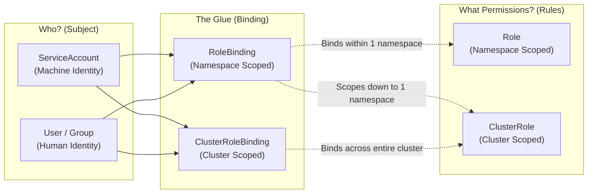

# Exercise 04 — RBAC

> Related: [RBAC skeleton](../../skeletons/rbac.yaml) | [ClusterRole skeleton](../../skeletons/clusterrole.yaml) | [README — Cluster Architecture](../../README.md#domain-4--cluster-architecture-installation--configuration-25)

Set up Role-Based Access Control with Roles, ClusterRoles, and bindings. This is heavily tested on the CKA.

## Tasks

1. Create a namespace called `exercise-04`
2. Create a ServiceAccount named `dev-sa` in namespace `exercise-04`
3. Create a Role named `pod-manager` in namespace `exercise-04` that allows:
   - `get`, `list`, `watch`, `create`, `delete` on `pods`
   - `get`, `list` on `services`
4. Create a RoleBinding named `dev-pod-access` that binds `pod-manager` to `dev-sa`
5. Verify that `dev-sa` can list pods in `exercise-04`
6. Verify that `dev-sa` cannot list pods in `default` namespace
7. Create a ClusterRole named `node-viewer` that allows `get`, `list` on `nodes`
8. Create a ClusterRoleBinding named `dev-node-access` binding `node-viewer` to `dev-sa`
9. Verify that `dev-sa` can now list nodes

## Additional Real-Exam Scenarios

10. A developer reports they cannot delete a deployment in `exercise-04`. Use `k auth can-i` to debug why
11. Test what `dev-sa` can do with deployments (should return "no")
12. List all permissions granted to `dev-sa` in the `exercise-04` namespace

## Hints

<details>
<summary>Stuck? Click to reveal hints</summary>

- `k create sa` to create ServiceAccount
- `k create role` with `--verb` and `--resource` flags
- `k create rolebinding` with `--role` and `--serviceaccount` flags
- `k auth can-i --as=system:serviceaccount:<ns>:<sa>` to test permissions
- `k auth can-i --list --as=...` to see all permissions for a ServiceAccount
- `k get role/clusterrole <name> -o yaml` to audit actual permissions granted
- Use `k auth can-i` to debug "permission denied" errors before production

**RBAC Subresources (Reddit Feedback — Commonly Missed):**
- Subresources require explicit verbs: `pods/log`, `pods/exec`, `deployments/scale`, `statefulsets/status`
- Example: To allow user to scale: `verbs: ["patch"], resources: ["deployments/scale"]`
- Test: `k auth can-i patch deployments/scale --as=system:serviceaccount:ns:sa`
- Wildcard `*` doesn't cover subresources — must be explicit

**API Groups (Commonly Forgotten):**
- Core API (pods, services, namespaces): `apiGroups: [""]` (empty string, not "v1")
- Apps API (deployments, daemonsets): `apiGroups: ["apps"]`
- Batch API (jobs, cronjobs): `apiGroups: ["batch"]`
- Test RBAC: `k api-resources` shows apiGroup for each resource

</details>

## What tripped me up

> **Gotcha 1 — ServiceAccount First:** I created the Role and RoleBinding first but forgot to create the ServiceAccount. `k auth can-i` returned "no" and I assumed my Role verbs were wrong. Spent 6 minutes re-reading the Role YAML. The SA just didn't exist. **Always create ServiceAccount first.**
>
> **Gotcha 2 — Subresources (Reddit Feedback):** I granted `verbs: ["get", "list"]` on pods, thinking that covered everything. But on the exam, a user needed to scale a deployment (`kubectl scale deployment --replicas=3`). That requires `verbs: ["patch"]` on `resources: ["deployments/scale"]`. Subresources like `/scale`, `/logs`, `/portforward` need explicit verb grants. **Test with: `k auth can-i patch deployments/scale --as=...`**
>
> **Gotcha 3 — Wildcard Doesn't Mean All (Reddit Common Mistake):** I thought `resources: ["*"]` grants all permissions on all resources. It doesn't cover subresources. `verbs: ["*"]` also doesn't include subresources. You need explicit `resources: ["pods/*"]` or `resources: ["pods", "pods/log"]`. **This trips up 40% of candidates on Reddit.**
>
> **Gotcha 4 — Core API Group (Reddit Feedback):** Forgot `apiGroups: [""]` on my Role. Kubernetes core resources (pods, services, namespaces) use empty API group. My Role had `apiGroups: ["v1"]` which is wrong. **Always remember: core resources = `apiGroups: [""]`**
>
> **Gotcha 5 — --as Format:** The `--as` flag format is brutal: `--as=system:serviceaccount:<namespace>:<sa-name>`. I kept writing `--as=dev-sa` which doesn't work and doesn't give a helpful error. It just says "no". **Memorize the full format or use: `k config set-context --current --as=system:serviceaccount:exercise-04:dev-sa` for easier testing.**

## Verify

```bash
# Should return "yes"
k auth can-i list pods -n exercise-04 --as=system:serviceaccount:exercise-04:dev-sa

# Should return "no"
k auth can-i list pods -n default --as=system:serviceaccount:exercise-04:dev-sa

# Should return "yes" after ClusterRoleBinding
k auth can-i list nodes --as=system:serviceaccount:exercise-04:dev-sa

# Real exam scenarios
# Verify no permission to delete services (only get/list allowed)
k auth can-i delete services -n exercise-04 --as=system:serviceaccount:exercise-04:dev-sa
# Should return "no"

# Verify no permission on deployments (not in the Role)
k auth can-i delete deployments -n exercise-04 --as=system:serviceaccount:exercise-04:dev-sa
# Should return "no"

# List all permissions granted (exam-critical debugging)
k auth can-i --list --as=system:serviceaccount:exercise-04:dev-sa -n exercise-04
```

## Cleanup

```bash
k delete ns exercise-04
k delete clusterrole node-viewer
k delete clusterrolebinding dev-node-access
```

<details>
<summary>Solution</summary>

```bash
k create ns exercise-04

# ServiceAccount
k create sa dev-sa -n exercise-04

# Role - Option 1: Create via YAML to ensure separate rules
cat <<EOF | k apply -f -
apiVersion: rbac.authorization.k8s.io/v1
kind: Role
metadata:
  name: pod-manager
  namespace: exercise-04
rules:
- apiGroups:
  - ""
  resources:
  - pods
  verbs:
  - get
  - list
  - watch
  - create
  - delete
- apiGroups:
  - ""
  resources:
  - services
  verbs:
  - get
  - list
EOF

# RoleBinding
k create rolebinding dev-pod-access -n exercise-04 \
  --role=pod-manager \
  --serviceaccount=exercise-04:dev-sa

# Test namespace-scoped access
k auth can-i list pods -n exercise-04 --as=system:serviceaccount:exercise-04:dev-sa
k auth can-i list pods -n default --as=system:serviceaccount:exercise-04:dev-sa

# ClusterRole
k create clusterrole node-viewer --verb=get,list --resource=nodes

# ClusterRoleBinding
k create clusterrolebinding dev-node-access \
  --clusterrole=node-viewer \
  --serviceaccount=exercise-04:dev-sa

# Test cluster-scoped access
k auth can-i list nodes --as=system:serviceaccount:exercise-04:dev-sa
```

</details>

---

## RBAC Core Concepts Explained (English)

Kubernetes Role-Based Access Control (RBAC) regulates who (**Subject**) can perform what actions (**Verbs**) on which entities (**Resources**) within which boundary (**Namespace** or **Cluster**).



---

### 1. ServiceAccount (SA)

* **Definition**: An identity created within Kubernetes specifically for **processes and applications inside Pods** to authenticate against the Kubernetes API server (in contrast to normal User accounts, which represent human operators outside the cluster).
* **Scope**: **Namespace-scoped** (`metadata.namespace`).
* **How it works**:
  - Each ServiceAccount belongs to a specific namespace.
  - When a Pod runs with a ServiceAccount, the kubelet automatically mounts an API token, CA certificate, and namespace descriptor into the container at `/var/run/secrets/kubernetes.io/serviceaccount`.
  - When testing or impersonating with `kubectl auth can-i`, the fully-qualified identity format is:
    `system:serviceaccount:<namespace>:<serviceaccount-name>`

#### Example YAML:
```yaml
apiVersion: v1
kind: ServiceAccount
metadata:
  name: dev-sa
  namespace: exercise-04
```

#### Imperative CLI:
```bash
kubectl create sa dev-sa -n exercise-04
```

#### Pod Consuming the ServiceAccount:
```yaml
apiVersion: v1
kind: Pod
metadata:
  name: api-client
  namespace: exercise-04
spec:
  serviceAccountName: dev-sa    # Injects dev-sa credentials into the container
  containers:
  - name: client
    image: curlimages/curl:8.6.0
    command: ["sleep", "3600"]
```

---

### 2. Role

* **Definition**: A purely additive set of permission rules that defines **what actions can be performed** on specific resources **strictly within a single namespace**.
* **Scope**: **Namespace-scoped** (`metadata.namespace`). It cannot grant access to cluster-wide resources (like Nodes, Namespaces, or PersistentVolumes).
* **Core Rule Fields**:
  - `apiGroups`: The API group owning the resource.
    - Core group (`pods`, `services`, `configmaps`, `secrets`, `endpoints`): `[""]` (empty string).
    - Apps group (`deployments`, `statefulsets`, `daemonsets`): `["apps"]`.
    - Batch group (`jobs`, `cronjobs`): `["batch"]`.
  - `resources`: Kubernetes API objects (`pods`, `services`, `deployments`) and subresources (`pods/log`, `pods/exec`, `deployments/scale`, `statefulsets/status`).
  - `verbs`: Permitted HTTP actions (`get`, `list`, `watch`, `create`, `update`, `patch`, `delete`).

#### Example YAML:
```yaml
apiVersion: rbac.authorization.k8s.io/v1
kind: Role
metadata:
  name: pod-manager
  namespace: exercise-04
rules:
# Rule 1: Manage Pods in namespace exercise-04
- apiGroups: [""]
  resources: ["pods"]
  verbs: ["get", "list", "watch", "create", "delete"]
# Rule 2: Read-only access to Services
- apiGroups: [""]
  resources: ["services"]
  verbs: ["get", "list"]
# Rule 3: Allow viewing pod logs (subresource)
- apiGroups: [""]
  resources: ["pods/log"]
  verbs: ["get"]
```

#### Imperative CLI:
```bash
kubectl create role pod-manager -n exercise-04 \
  --verb=get,list,watch,create,delete --resource=pods
```

---

### 3. RoleBinding

* **Definition**: The bridge that grants the permissions defined in a `Role` (or a `ClusterRole`) to a subject or list of subjects (`ServiceAccount`, `User`, `Group`) **within a single namespace**.
* **Scope**: **Namespace-scoped** (`metadata.namespace`).
* **Key Mechanisms**:
  - `roleRef`: Points to the Role or ClusterRole being assigned.
    > [!IMPORTANT]
    > `roleRef` is **immutable** once created. You cannot edit the target role in an existing binding; you must delete and recreate the RoleBinding.
  - Can bind a **`Role`** OR a **`ClusterRole`**. If it references a `ClusterRole`, the permissions are restricted only to the RoleBinding's namespace!

#### Example YAML:
```yaml
apiVersion: rbac.authorization.k8s.io/v1
kind: RoleBinding
metadata:
  name: dev-pod-access
  namespace: exercise-04
subjects:
- kind: ServiceAccount
  name: dev-sa
  namespace: exercise-04
roleRef:
  kind: Role
  name: pod-manager
  apiGroup: rbac.authorization.k8s.io
```

#### Imperative CLI:
```bash
kubectl create rolebinding dev-pod-access -n exercise-04 \
  --role=pod-manager \
  --serviceaccount=exercise-04:dev-sa
```

---

### 4. ClusterRole

* **Definition**: A cluster-wide permission set. It defines rules identically to a `Role`, but has **no namespace** constraint.
* **Scope**: **Cluster-wide** (no `metadata.namespace`).
* **Primary Use Cases**:
  1. Granting access to **cluster-scoped resources** (e.g. `nodes`, `persistentvolumes`, `storageclasses`, `namespaces`).
  2. Granting access to **non-resource endpoints** (e.g. `/healthz`, `/metrics`, `/version`).
  3. Granting access to **namespaced resources across ALL namespaces** (when paired with a `ClusterRoleBinding`).
  4. Defining a **standardized reusable role template** across namespaces (e.g. the built-in `view`, `edit`, or `admin` ClusterRoles) to be bound inside individual namespaces using `RoleBinding`.

#### Example YAML:
```yaml
apiVersion: rbac.authorization.k8s.io/v1
kind: ClusterRole
metadata:
  name: node-viewer
rules:
# Cluster-scoped resources (no namespace)
- apiGroups: [""]
  resources: ["nodes"]
  verbs: ["get", "list"]
# Non-resource URLs (cluster-wide health checks)
- nonResourceURLs: ["/healthz", "/healthz/*"]
  verbs: ["get"]
```

#### Imperative CLI:
```bash
kubectl create clusterrole node-viewer --verb=get,list --resource=nodes
```

---

### 5. ClusterRoleBinding

* **Definition**: The cluster-wide bridge that binds a `ClusterRole` to subjects across the **entire cluster** (all namespaces + all cluster-scoped resources).
* **Scope**: **Cluster-wide** (no `metadata.namespace`).
* **Key Mechanisms**:
  - `roleRef`: **Must** point to a `ClusterRole` (cannot reference a namespaced `Role`).
  - Grants permissions globally. For example, binding `cluster-admin` via a `ClusterRoleBinding` grants complete superuser control over everything in the cluster.

#### Example YAML:
```yaml
apiVersion: rbac.authorization.k8s.io/v1
kind: ClusterRoleBinding
metadata:
  name: dev-node-access
subjects:
- kind: ServiceAccount
  name: dev-sa
  namespace: exercise-04
roleRef:
  kind: ClusterRole
  name: node-viewer
  apiGroup: rbac.authorization.k8s.io
```

#### Imperative CLI:
```bash
kubectl create clusterrolebinding dev-node-access \
  --clusterrole=node-viewer \
  --serviceaccount=exercise-04:dev-sa
```

---

### Comparison Matrix

| Resource | Scope | Purpose | Can Access Nodes / PVs? | Bound By |
| :--- | :--- | :--- | :--- | :--- |
| **ServiceAccount** | Namespace | Machine identity for Pods | N/A | Referenced in `spec.serviceAccountName` |
| **Role** | Namespace | Grants permissions inside 1 namespace | ❌ No | `RoleBinding` |
| **RoleBinding** | Namespace | Binds Role or ClusterRole to subjects in 1 namespace | ❌ No | N/A |
| **ClusterRole** | Cluster | Defines cluster-wide permissions or common templates | ✅ Yes | `ClusterRoleBinding` or `RoleBinding` |
| **ClusterRoleBinding** | Cluster | Binds ClusterRole to subjects across entire cluster | ✅ Yes | N/A |

---

### The Golden CKA Pattern: ClusterRole + RoleBinding

A frequent exam trick evaluates whether you understand combining a `ClusterRole` with a `RoleBinding`:

```
ClusterRole (e.g. built-in 'view' or 'edit')
       +
RoleBinding (in namespace 'exercise-04')
       =
Access granted ONLY within 'exercise-04' (NOT cluster-wide!)
```

* **Why do this?** Cluster administrators define permissions once (e.g. `pod-reader` as a `ClusterRole`). Instead of creating duplicate `Role` manifests across 50 separate namespaces, team leads create a lightweight `RoleBinding` in their respective namespace pointing to that common `ClusterRole`.

---

### Real-World Analogy: Office Keycards & Access Control

* **ServiceAccount**: An automated NFC badge issued to an office cleaning robot (Pod).
* **Role**: A department-level permission list ("Can open supply cabinets and turn on vacuum chargers inside the Marketing department").
* **RoleBinding**: Programming the robot's badge with the Marketing department rules. The badge only unlocks doors inside Marketing.
* **ClusterRole**: A master building policy ("Can inspect electrical breaker panels on all floors, or read emergency directories").
* **ClusterRoleBinding**: Programming the robot's badge with the master building policy — it now has access to breaker panels and rooms everywhere in the building.
* **ClusterRole + RoleBinding**: Taking the building-wide "Facility Cleaner" policy, but programming it to only unlock doors on Floor 3 (scoping down the ClusterRole to a single namespace).

---

### Essential CKA RBAC Verification Commands

Always verify permissions using `kubectl auth can-i`:

```bash
# Test namespace-scoped permission as a ServiceAccount:
kubectl auth can-i list pods -n <namespace> --as=system:serviceaccount:<namespace>:<sa-name>

# Test cluster-scoped permission as a ServiceAccount:
kubectl auth can-i get nodes --as=system:serviceaccount:<namespace>:<sa-name>

# Inspect all permissions granted to a ServiceAccount in a namespace:
kubectl auth can-i --list -n <namespace> --as=system:serviceaccount:<namespace>:<sa-name>

# Test subresource permission (e.g. pod logs or deployment scaling):
kubectl auth can-i get pods/log -n <namespace> --as=system:serviceaccount:<namespace>:<sa-name>
kubectl auth can-i patch deployments/scale -n <namespace> --as=system:serviceaccount:<namespace>:<sa-name>
```

---

---

### తెలుగు వివరణ (Telugu Explanation)

కుబెర్‌నెటిస్ (Kubernetes) లో **RBAC (Role-Based Access Control)** అనేది ఎవరు (**Subject**), ఏ రిసోర్స్‌లపై (**Resources**), ఏ పనులు (**Verbs**) చేయవచ్చో నిర్ణయించే సెక్యూరిటీ విధానం.

#### నిజ జీవిత ఉదాహరణ (Real-World Analogy):
* **ServiceAccount (సర్వీస్ అకౌంట్)**: ఆఫీసులో తిరిగే ఒక ఆటోమేటెడ్ క్లీనింగ్ రోబోట్ (Pod) కి ఇచ్చే **NFC ఐడీ కార్డు**.
* **Role (రోల్)**: ఒక నిర్దిష్ట డిపార్ట్‌మెంట్ (Namespace) లోని నిబంధనావళి. ఉదాహరణకు: "మార్కెటింగ్ రూమ్‌లో ఉన్న ఫైళ్లను మాత్రమే చూడవచ్చు (`get`, `list`)".
* **RoleBinding (రోల్‌బైండింగ్)**: ఆ మార్కెటింగ్ రూమ్ నిబంధనలను సదరు రోబోట్ ఐడీ కార్డుకి జతచేయడం (బైండ్ చేయడం). రోబోట్ కేవలం ఆ రూమ్‌లోనే పనిచేయగలదు.
* **ClusterRole (క్లస్టర్ రోల్)**: బిల్డింగ్ మొత్తానికి వర్తించే నిబంధనావళి. ఉదాహరణకు: "బిల్డింగ్ మెయిన్ ఎలక్ట్రికల్ మీటర్లు (`nodes`) చూడవచ్చు లేదా ఏ డిపార్ట్‌మెంట్‌లోని రూమ్ అయినా తెరవవచ్చు".
* **ClusterRoleBinding (క్లస్టర్ రోల్‌బైండింగ్)**: ఆ బిల్డింగ్ మొత్తం నిబంధనావళిని రోబోట్ కార్డుకి ఇవ్వడం. దీనితో రోబోట్‌కు బిల్డింగ్ అంతటా అన్ని విభాగాల్లో మరియు మెయిన్ సర్వర్ రూమ్‌లలో అనుమతి లభిస్తుంది.

---

#### 1. ServiceAccount (SA)
* **వివరణ**: పాడ్స్ (Pods) లోపల నడిచే అప్లికేషన్లు కుబెర్‌నెటిస్ API సర్వర్‌తో సంప్రదించడానికి ఇచ్చే **యంత్ర గుర్తింపు (Machine Identity)**.
* **పరిధి (Scope)**: **Namespace-scoped**.
* **ముఖ్యమైన విషయం**: Pod రన్ అయినప్పుడు ఆటోమేటిక్‌గా టోకెన్ `/var/run/secrets/kubernetes.io/serviceaccount` పాత్‌లో మౌంట్ అవుతుంది.
* **కమాండ్**: `kubectl create sa dev-sa -n exercise-04`

#### 2. Role
* **వివరణ**: ఒకే ఒక **Namespace** పరిధిలో ఏ ఏ రిసోర్స్‌లపై (`pods`, `services`) ఏ చర్యలు (`get`, `list`, `create`, `delete`) చేయవచ్చో తెలిపే నిబంధనల పట్టిక.
* **పరిధి (Scope)**: **Namespace-scoped** (ఇది Nodes లేదా PersistentVolumes వంటి క్లస్టర్-స్థాయి రిసోర్స్‌లకు అనుమతులు ఇవ్వలేదు).
* **కమాండ్**: `kubectl create role pod-manager -n exercise-04 --verb=get,list,create,delete --resource=pods`

#### 3. RoleBinding
* **వివరణ**: తయారుచేసిన `Role` (లేదా `ClusterRole`) ని ఒక `ServiceAccount` లేదా `User` కి ఒక Namespace లో **జతచేసే వంతెన (Binding)**.
* **పరిధి (Scope)**: **Namespace-scoped**.
* **కమాండ్**: `kubectl create rolebinding dev-pod-access -n exercise-04 --role=pod-manager --serviceaccount=exercise-04:dev-sa`

#### 4. ClusterRole
* **వివరణ**: క్లస్టర్ మొత్తానికి వర్తించే నిబంధనల సమాహారం.
* **పరిధి (Scope)**: **Cluster-wide** (దీనికి ఏ నిర్దిష్ట Namespace ఉండదు).
* **ఎప్పుడు వాడతారు?**:
  1. Nodes, Namespaces, StorageClasses వంటి క్లస్టర్-స్థాయి రిసోర్స్‌లకు అనుమతులు ఇవ్వడానికి.
  2. క్లస్టర్‌లోని అన్ని నేమ్‌స్పేస్‌లలో ఉన్న రిసోర్స్‌లపై ఒకేసారి యాక్సెస్ ఇవ్వడానికి.
  3. సాధారణ రోల్ టెంప్లేట్ (ఉదా: `view`, `edit`) గా డిఫైన్ చేయడానికి.
* **కమాండ్**: `kubectl create clusterrole node-viewer --verb=get,list --resource=nodes`

#### 5. ClusterRoleBinding
* **వివరణ**: `ClusterRole` ని ఒక ServiceAccount లేదా User కి **క్లస్టర్ మొత్తం వ్యాప్తంగా** జతచేసే విధానం.
* **పరిధి (Scope)**: **Cluster-wide**.
* **కమాండ్**: `kubectl create clusterrolebinding dev-node-access --clusterrole=node-viewer --serviceaccount=exercise-04:dev-sa`

---

#### CKA ఎగ్జామ్ ముఖ్యమైన కాన్సెప్ట్ (ClusterRole + RoleBinding):
ఒక `ClusterRole` ని `RoleBinding` ద్వారా ఒక ServiceAccount కి జతచేస్తే, ఆ అనుమతులు కేవలం **ఆ RoleBinding ఉన్న Namespace కి మాత్రమే పరిమితం అవుతాయి**. ఇది క్లస్టర్ మొత్తానికి యాక్సెస్ ఇవ్వదు!

