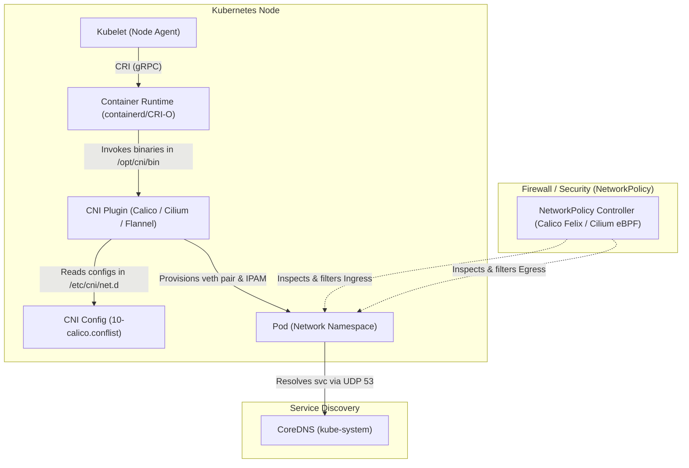

# Exercise 05 — NetworkPolicy

> Related: [NetworkPolicy skeleton](../../skeletons/networkpolicy.yaml) | [README — Services & Networking](../../README.md#domain-5--services--networking-20)

Create NetworkPolicies to control pod-to-pod traffic. Watch out for the DNS gotcha.

## Tasks

1. Create a namespace called `exercise-05`
2. Deploy two pods:
   - `frontend` with image `nginx:1.27` and label `role=frontend`
   - `backend` with image `nginx:1.27` and label `role=backend`
3. Verify that `frontend` can reach `backend` on port 80 (should work before any policy)
4. Create a NetworkPolicy named `backend-policy` that:
   - Applies to pods with label `role=backend`
   - Allows ingress only from pods with label `role=frontend` on port 80
   - Allows egress to DNS (UDP port 53) — if you skip this, DNS breaks
5. Verify that `frontend` can still reach `backend`
6. Create a third pod `attacker` with label `role=attacker` and verify it cannot reach `backend`

## Hints

<details>
<summary>Stuck? Click to reveal hints</summary>

- Once you apply any NetworkPolicy to a pod, all traffic not explicitly allowed is denied
- You almost always need to allow DNS egress (UDP port 53), or the pod can't resolve service names
- Test connectivity with `k exec <pod> -- curl -m2 http://<target-ip>`

</details>

## What tripped me up

> I wrote a perfect ingress rule but forgot egress entirely. The backend pod could receive traffic but couldn't respond to DNS lookups — so any test using service names failed. I thought my ingress rule was wrong and spent 8 minutes rewriting it. The fix was two lines: allow UDP 53 egress. I've made this mistake three separate times during practice. Now I write the DNS egress rule FIRST, before anything else.
>
> AND vs OR tripped me up too. Two selectors in the *same* `from` block = AND (must match both). Two separate `from` blocks = OR (match either). I had `podSelector` and `namespaceSelector` in separate blocks when they should have been in the same one — it allowed traffic from any pod in the right namespace OR any pod with the right label in any namespace.

## Verify

```bash
# Get backend IP
BACKEND_IP=$(k get pod backend -n exercise-05 -o jsonpath='{.status.podIP}')

# Frontend -> Backend: should work
k exec frontend -n exercise-05 -- curl -m2 http://$BACKEND_IP

# Attacker -> Backend: should time out
k exec attacker -n exercise-05 -- curl -m2 http://$BACKEND_IP
```

## CNI Troubleshooting

NetworkPolicy assumes the Container Network Interface (CNI) is installed and working. If pods can't communicate at all, NetworkPolicy isn't the problem — CNI is.

### Verify CNI is running

```bash
# Check if CNI pods are deployed:
# - In standard/exam clusters: usually calico, flannel, or cilium
# - In Kind clusters: kindnet
k get pods -n kube-system -l app=kindnet   # For Kind
k get pods -n kube-system | grep -E "kindnet|calico|flannel|cilium"
k get pods -n calico-system               # For Calico operator
k get pods -n kube-system | grep -i cni
k get pods -n kube-system | grep -i calico
k get pods -n calico-system

# Check if CNI daemonset is running on all nodes
k get daemonset -n kube-system
k get daemonset -n calico-system

# Verify CNI configuration files exist on nodes:
# Option A: Real VM / Bare-metal / CKA Exam environment (uses SSH)
ssh <node> ls -la /etc/cni/net.d/
ssh <node> ls -la /opt/cni/bin/
ssh <node> cat /etc/kubernetes/kubelet.conf | grep cni

# Option B: Local Kind cluster (nodes are Docker containers, no SSH daemon)
docker exec <node-container-name> ls -la /etc/cni/net.d/
docker exec <node-container-name> ls -la /opt/cni/bin/
docker exec -it <node-container-name> bash
```

### Common CNI issues

**Pods can't communicate even without NetworkPolicy:**
- CNI plugin not deployed (check kube-system pods)
- Kubelet CNI configuration missing (check /etc/kubernetes/kubelet.conf)
- CNI binary not present on node (check /opt/cni/bin/)
- Pod IP is 10.244.x.x but nodes can't route to it

**Pod networking works but DNS fails:**
- CoreDNS pod can't reach internet (check CoreDNS pod events)
- CNI doesn't allow DNS traffic by default
- firewalld or iptables blocking DNS on the node

**NetworkPolicy appears to block everything:**
- CNI not configured for network policies (Calico needs NetworkPolicy RBAC and CRD)
- NetworkPolicy controller not running (check events on policies)
- Existing policies deny all traffic by default

### Debug pod network when connectivity fails

```bash
# Check if pod has an IP address
k get pod frontend -n exercise-05 -o wide

# If pod is CrashLoopBackOff or can't get IP:
k describe pod frontend -n exercise-05  # Check Events section
k logs frontend -n exercise-05  # Check for startup errors

# If pod has IP but can't connect to another pod:
# Step 1: Ping from pod to pod
k exec frontend -n exercise-05 -- ping -c 2 <backend-pod-ip>

# Step 2: Check if routes exist on node
ssh <node> ip route show | grep 10.244

# Step 3: Check CNI plugin logs
ssh <node> journalctl -u kubelet -n 50  # Kubelet logs
ssh <node> journalctl -u cri-docker -n 50  # Container runtime logs
ssh <node> tail -f /var/log/calico/calico.log  # If using Calico

# Step 4: Check iptables rules created by CNI
ssh <node> sudo iptables -L -n
ssh <node> sudo iptables -L -n -t nat

# Step 5: Verify service connectivity
k exec frontend -n exercise-05 -- curl -m2 http://kubernetes.default.svc.cluster.local
k exec frontend -n exercise-05 -- nslookup kubernetes.default
```

### Before blaming NetworkPolicy

1. Verify pods get IPs: `k get pod -n exercise-05 -o wide`
2. Test without NetworkPolicy: `k delete netpol --all -n exercise-05` then test connectivity
3. If connectivity works without the policy but fails with it, then the NetworkPolicy is the problem
4. If connectivity fails even without the policy, debug CNI first

## Cleanup

```bash
k delete ns exercise-05
```

<details>
<summary>Solution</summary>

```bash
k create ns exercise-05

# Create pods
k run frontend -n exercise-05 --image=nginx:1.27 --labels=role=frontend
k run backend -n exercise-05 --image=nginx:1.27 --labels=role=backend
k run attacker -n exercise-05 --image=nginx:1.27 --labels=role=attacker

# Wait for all pods
k get pods -n exercise-05 -w
```

```yaml
apiVersion: networking.k8s.io/v1
kind: NetworkPolicy
metadata:
  name: backend-policy
  namespace: exercise-05
spec:
  podSelector:
    matchLabels:
      role: backend
  policyTypes:
  - Ingress
  - Egress
  ingress:
  - from:
    - podSelector:
        matchLabels:
          role: frontend
    ports:
    - protocol: TCP
      port: 80
  egress:
  - to: []
    ports:
    - protocol: UDP
      port: 53
```

```bash
k apply -f netpol.yaml

# Test
BACKEND_IP=$(k get pod backend -n exercise-05 -o jsonpath='{.status.podIP}')
k exec frontend -n exercise-05 -- curl -m2 http://$BACKEND_IP
k exec attacker -n exercise-05 -- curl -m2 http://$BACKEND_IP
```

</details>

---

## Core Networking & NetworkPolicy Concepts Explained (English)

Kubernetes networking follows a clean layered model: **CNI** establishes the physical and virtual wire between containers, **Kubelet** initiates the networking lifecycle via the Container Runtime Interface (CRI), **CoreDNS** translates human-readable service names to IP addresses, and **NetworkPolicy** enforces Layer 3/4 firewall boundaries.



---

### 1. CNI (Container Network Interface)

* **Definition**: The **Container Network Interface (CNI)** is a CNCF specification and set of libraries that standardizes how container runtimes configure network interfaces for Linux containers. In Kubernetes, CNI plugins dynamically allocate IP addresses (IPAM) and connect Pods to the node network via virtual ethernet (`veth`) pairs.
* **The Kubernetes Fundamental Network Model**:
  1. Every Pod receives its own unique, routable IP address within the cluster CIDR.
  2. Pods on any node can communicate with all pods on any other node without Network Address Translation (NAT).
  3. Node agents (Kubelet, system daemons) can communicate with all Pods on that same node.
  4. The IP that a Pod sees for itself is the exact same IP that all other Pods see for it.

#### Important Filesystem Locations on Nodes:
* `/etc/cni/net.d/`: Directory containing CNI configuration files (JSON or `.conflist`). Evaluated in alphabetical order. The first valid file becomes the active cluster network configuration.
* `/opt/cni/bin/`: Directory containing executable CNI plugin binaries:
  * **Main plugins**: `bridge`, `ptp` (point-to-point), `macvlan`, `ipvlan`, `host-device`.
  * **IPAM plugins**: `host-local` (allocates IPs out of a local subnet), `dhcp`.
  * **Meta plugins**: `portmap` (maps host ports to containers), `tuning`, `firewall`.

#### Example CNI Configuration (`/etc/cni/net.d/10-calico.conflist`):
```json
{
  "name": "k8s-pod-network",
  "cniVersion": "0.3.1",
  "plugins": [
    {
      "type": "calico",
      "log_level": "info",
      "datastore_type": "kubernetes",
      "nodename": "node01",
      "ipam": {
        "type": "calico-ipam",
        "assign_ipv4": "true"
      }
    },
    {
      "type": "portmap",
      "snat": true,
      "capabilities": {"portMappings": true}
    }
  ]
}
```

#### How CNI is Deployed: DaemonSet Manifest Pattern
In production Kubernetes, CNI plugins run as a **DaemonSet** across all nodes. An `initContainer` copies binaries into `/opt/cni/bin` and writes the network configuration into `/etc/cni/net.d` via hostPath volume mounts:

```yaml
apiVersion: apps/v1
kind: DaemonSet
metadata:
  name: cni-node-agent
  namespace: kube-system
  labels:
    k8s-app: cni-node-agent
spec:
  selector:
    matchLabels:
      k8s-app: cni-node-agent
  template:
    metadata:
      labels:
        k8s-app: cni-node-agent
    spec:
      hostNetwork: true               # Runs in the host network namespace
      tolerations:
      - operator: Exists              # Runs on control-plane and worker nodes alike
      initContainers:
      # 1. Installs CNI binary plugins & writes conflist to host filesystem
      - name: install-cni
        image: calico/cni:v3.28.0
        command: ["/install-cni.sh"]
        volumeMounts:
        - name: cni-bin-dir
          mountPath: /host/opt/cni/bin
        - name: cni-net-dir
          mountPath: /host/etc/cni/net.d
      containers:
      # 2. Main agent that programs routing and firewall rules on node
      - name: cni-daemon
        image: calico/node:v3.28.0
        securityContext:
          privileged: true
        volumeMounts:
        - name: cni-net-dir
          mountPath: /etc/cni/net.d
      volumes:
      - name: cni-bin-dir
        hostPath:
          path: /opt/cni/bin
      - name: cni-net-dir
        hostPath:
          path: /etc/cni/net.d
```

#### Major CNI Plugins Comparison:

| CNI Plugin | Network Mechanism | Supports NetworkPolicy? | Best Used For |
| :--- | :--- | :--- | :--- |
| **Calico** | BGP / VXLAN / WireGuard / eBPF |  Yes (Full iptables/eBPF policy engine) | Production clusters & CKA standard |
| **Cilium** | eBPF (Kernel-level data path) |  Yes (Layer 3/4 + Layer 7 API policies) | High throughput, observability (Hubble) |
| **Flannel** | Layer 3 Overlay (VXLAN / host-gw) | ❌ No (Needs Canal or Calico for policies) | Lightweight / edge clusters |
| **Kindnet** | Simple PTP + host-local | ⚠️ Basic/Experimental in newer Kind | Local development & testing in Kind |

---

### 2. Kubelet CNI Configuration

* **Definition**: Kubelet is the primary node agent. When Kubelet receives a Pod specification, it communicates with the Container Runtime to prepare the Pod sandbox and attach the network.
* **Modern Architecture (Kubernetes v1.24+)**:
  - *Historically (Dockershim)*: Kubelet directly invoked CNI plugins using flags `--network-plugin=cni`, `--cni-conf-dir=/etc/cni/net.d`, and `--cni-bin-dir=/opt/cni/bin`.
  - *Modern containerd / CRI-O*: Kubelet delegates all container lifecycle management through the **CRI (Container Runtime Interface)** via a UNIX domain socket (e.g. `/run/containerd/containerd.sock`). The **Container Runtime** is now the component that reads `/etc/cni/net.d/` and invokes the binaries in `/opt/cni/bin/`.

#### Kubelet Configuration Manifest (`/var/lib/kubelet/config.yaml`):
```yaml
apiVersion: kubelet.config.k8s.io/v1beta1
kind: KubeletConfiguration
cgroupDriver: systemd
clusterDNS:
  - 10.96.0.10            # Injected into every Pod's /etc/resolv.conf
clusterDomain: cluster.local
containerRuntimeEndpoint: unix:///run/containerd/containerd.sock
```

#### Container Runtime CNI Configuration (`/etc/containerd/config.toml`):
```toml
[plugins."io.containerd.grpc.v1.cri".cni]
  bin_dir = "/opt/cni/bin"
  conf_dir = "/etc/cni/net.d"
  max_conf_num = 1
```

#### The `NetworkPluginNotReady` Node State (CKA Troubleshooting Classic):
If `/etc/cni/net.d/` is empty, missing, or references a binary not found in `/opt/cni/bin/`, the node transitions to `NotReady`:
```
Conditions:
  Type              Status  Reason                       Message
  ----              ------  ------                       -------
  Ready             False   KubeletNotReady              container runtime network not ready: NetworkReady=false reason:NetworkPluginNotReady message:Network plugin returns error: cni plugin not initialized
```

**How to Troubleshoot on CKA**:
```bash
# 1. Identify which node is NotReady
kubectl get nodes

# 2. Check the node's condition message
kubectl describe node <node-name> | grep -A 5 Conditions

# 3. Access the node (ssh <node> on real VMs, or docker exec on Kind)
ssh <node>

# 4. Check whether CNI config file exists
ls -la /etc/cni/net.d/

# 5. Check if CNI binaries exist
ls -la /opt/cni/bin/

# 6. Check CNI DaemonSet status
kubectl get daemonset -n kube-system
```

---

### 3. CoreDNS

* **Definition**: CoreDNS is an extensible, DNS-compliant server deployed as a Deployment (`kube-system/coredns`) in Kubernetes. It serves internal domain resolution for Services, StatefulSet Pods, and external forwarders.
* **How Pods Locate CoreDNS**:
  Whenever Kubelet spawns a Pod, it automatically mounts a customized `/etc/resolv.conf` into the container:
  ```ini
  nameserver 10.96.0.10             # ClusterIP of the kube-dns Service
  search default.svc.cluster.local svc.cluster.local cluster.local
  options ndots:5
  ```

#### Standard Kubernetes DNS Record Formats:
* **ClusterIP Service**: `<service-name>.<namespace>.svc.cluster.local` (e.g. `backend.exercise-05.svc.cluster.local`)
* **Pod IP (Hyphenated)**: `<ip-with-hyphens>.<namespace>.pod.cluster.local` (e.g. `10-244-1-12.exercise-05.pod.cluster.local`)
* **Headless Service / StatefulSet**: `<pod-name>.<service-name>.<namespace>.svc.cluster.local` (resolves directly to the Pod's individual IP)

#### CoreDNS ConfigMap Manifest (`Corefile`):
```yaml
apiVersion: v1
kind: ConfigMap
metadata:
  name: coredns
  namespace: kube-system
data:
  Corefile: |
    .:53 {
        errors                      # Logs errors to stdout
        health {                    # Health check endpoint at http://localhost:8080/health
           lameduck 5s
        }
        ready                       # Ready endpoint at http://localhost:8181/ready
        kubernetes cluster.local in-addr.arpa ip6.arpa {
           pods insecure            # Resolves pod IPs based on IP-dashed format
           fallthrough in-addr.arpa ip6.arpa
           ttl 30
        }
        prometheus :9153            # Exports Prometheus metrics
        forward . /etc/resolv.conf  # Forwards non-cluster queries to node's upstream DNS
        cache 30                    # Caches DNS queries for up to 30 seconds
        loop                        # Detects and halts simple forwarding loops
        reload                      # Allows automatic reload of modified Corefile
        loadbalance                 # Round-robin A/AAAA/MX records
    }
```

#### CoreDNS Service Manifest (`kube-system/kube-dns`):
Pods do NOT send DNS queries directly to CoreDNS pod IPs. Instead, queries hit the **`kube-dns` Service** ClusterIP (`10.96.0.10`), which `kube-proxy` distributes to healthy CoreDNS pods:

```yaml
apiVersion: v1
kind: Service
metadata:
  name: kube-dns
  namespace: kube-system
  labels:
    k8s-app: kube-dns
spec:
  selector:
    k8s-app: kube-dns          # Selects CoreDNS deployment pods
  clusterIP: 10.96.0.10        # Injected into every pod's /etc/resolv.conf
  ports:
  - name: dns
    port: 53
    protocol: UDP
  - name: dns-tcp
    port: 53
    protocol: TCP
```

#### CoreDNS Debugging Commands:
```bash
# Check if CoreDNS pods are running
kubectl get pods -n kube-system -l k8s-app=kube-dns

# View CoreDNS logs (identifies forward loops or upstream DNS issues)
kubectl logs -n kube-system -l k8s-app=kube-dns --tail=50

# Test DNS directly from a test pod
kubectl run dns-test --image=busybox:1.36 --rm -it -- nslookup kubernetes.default
```

---

### 4. NetworkPolicy: Architecture & Isolation

* **Definition**: A Kubernetes declarative resource (`apiVersion: networking.k8s.io/v1`, `kind: NetworkPolicy`) that specifies how groups of Pods are allowed to communicate with each other and with other network endpoints.
* **Prerequisite**: NetworkPolicies are **only enforced** if the cluster has a CNI plugin that implements the NetworkPolicy specification (e.g., Calico, Cilium, Weave Net). If a cluster runs a non-policy CNI (like default Flannel), NetworkPolicy manifests will be accepted by the API server but completely ignored!

#### The Default State vs Isolated State:
* **Default State (Non-isolated)**: By default, pod network traffic is completely open. Any pod can send traffic to any pod, and any pod can receive traffic from any pod.
* **Isolated State**: The moment a Pod is selected by any NetworkPolicy's `spec.podSelector`:
  - It becomes **isolated** for the traffic directions listed in `policyTypes` (`Ingress`, `Egress`, or both).
  - Any traffic not explicitly matched by an `ingress` or `egress` whitelist rule is **DENIED** (Default Deny).

```
+-----------------------------------------------------------------------+
|  No NetworkPolicy targets Pod A   -->  Traffic ALLOWED (Non-isolated) |
|  NetworkPolicy targets Pod A      -->  Default DENY for selected types|
|                                        (Only whitelisted traffic gets |
|                                         through!)                     |
+-----------------------------------------------------------------------+
```

> [!NOTE]
> ### NetworkPolicies are Stateful (Connection Tracking)
> NetworkPolicies rely on Linux kernel connection tracking (`conntrack`). When an incoming Ingress packet is accepted, the return response packets traveling back are **automatically allowed**, even if there is no Egress rule permitting outbound traffic to that client! You do not need to mirror Ingress allow rules into Egress.

> [!TIP]
> ### Multiple NetworkPolicies Combine with UNION (OR)
> If multiple NetworkPolicies select the exact same Pod, their rules are **additive**. If Policy A allows port 80 and Policy B allows port 443, traffic on both port 80 and port 443 is permitted.

---

### 5. Ingress in NetworkPolicy (Incoming Traffic)

* **Definition**: Governs inbound traffic attempting to enter the pods selected by `spec.podSelector`.
* **The Whitelist Sources (`ingress[].from`)**:
  1. `podSelector`: Matches source Pods with specific labels in the **same namespace**.
  2. `namespaceSelector`: Matches **all Pods** in namespaces that have specific labels.
  3. `podSelector` + `namespaceSelector` (in the same list item): Matches specific Pods inside specific namespaces (**AND** logic).
  4. `ipBlock`: Specifies external or non-pod CIDR IP ranges (e.g. external load balancers or client subnets) with optional `except` subnets.
* **`ports`**: Array of destination ports on the selected pod (`protocol: TCP|UDP|SCTP`, `port: <number|name>`). Supports port ranges via `endPort` (Kubernetes 1.25+).

#### Example YAML: Ingress Rule with Multi-Selectors, Port Range & Named Port
```yaml
apiVersion: networking.k8s.io/v1
kind: NetworkPolicy
metadata:
  name: api-ingress-guard
  namespace: exercise-05
spec:
  # The Target: Apply this policy to pods labeled app=api-server
  podSelector:
    matchLabels:
      app: api-server
  policyTypes:
    - Ingress
  ingress:
    # Rule 1: Allow traffic from pods with app=web in the SAME namespace on TCP 8080
    - from:
        - podSelector:
            matchLabels:
              app: web
      ports:
        - protocol: TCP
          port: 8080

    # Rule 2: Allow port ranges (endPort) for active/passive NodePort traffic (e.g., 30000-32767)
    - from:
        - ipBlock:
            cidr: 10.0.0.0/8
      ports:
        - protocol: TCP
          port: 30000
          endPort: 32767

    # Rule 3: Allow traffic using a Named Port (defined in container spec.containers[].ports)
    - from:
        - podSelector:
            matchLabels:
              app: prometheus
      ports:
        - protocol: TCP
          port: metrics
```

---

### 6. Egress in NetworkPolicy (Outgoing Traffic)

* **Definition**: Governs outbound traffic leaving the selected Pods towards external servers, other Pods, or internal cluster services.
* **The Whitelist Targets (`egress[].to`)**:
  Same selector types as Ingress (`podSelector`, `namespaceSelector`, `ipBlock`).

> [!CAUTION]
> ### The Dreaded "DNS Egress Gotcha" (Heavily Tested on CKA)
> As soon as you add `policyTypes: ["Egress"]` to a NetworkPolicy, **ALL outbound traffic is blocked by default**, including DNS resolution!
> If your pod tries to access `http://db-service:5432`, the pod must first resolve `db-service` via CoreDNS on **UDP port 53**. If your policy does not have an explicit egress rule for port 53, the DNS lookup will time out, causing the application to fail!

> [!TIP]
> ### Built-in `kubernetes.io/metadata.name` Label
> In Kubernetes v1.22+, all namespaces are automatically labeled with their own name: `kubernetes.io/metadata.name: <namespace-name>`. You do not need to manually label namespaces when creating cross-namespace `namespaceSelector` rules!

#### Example YAML: Complete Egress Policy with DNS Allowed
```yaml
apiVersion: networking.k8s.io/v1
kind: NetworkPolicy
metadata:
  name: backend-egress-guard
  namespace: exercise-05
spec:
  podSelector:
    matchLabels:
      app: backend
  policyTypes:
    - Egress
  egress:
    # 1. CRITICAL: Allow DNS resolution to any destination on UDP & TCP 53
    - to: []
      ports:
        - protocol: UDP
          port: 53
        - protocol: TCP
          port: 53

    # 2. Allow outbound database traffic only to pods labeled role=db in namespace=database
    # Notice the use of the automatic built-in namespace label!
    - to:
        - namespaceSelector:
            matchLabels:
              kubernetes.io/metadata.name: database
          podSelector:
            matchLabels:
              role: db
      ports:
        - protocol: TCP
          port: 5432
```

---

### 7. Crucial CKA Distinction: AND vs OR Selectors

A single misplaced dash (`-`) completely changes the security behavior of your policy:

#### Example A: "AND" Logic (Same list item — no leading dash on podSelector)
*Meaning*: Traffic is allowed ONLY from pods labeled `role=frontend` **AND** located inside a namespace labeled `env=prod`.

```yaml
  ingress:
  - from:
    - namespaceSelector:
        matchLabels:
          env: prod
      podSelector:               # Notice: NO dash (-) here!
        matchLabels:
          role: frontend
```

#### Example B: "OR" Logic (Separate list items — each has a leading dash)
*Meaning*: Traffic is allowed from ANY pod in namespaces labeled `env=prod` **OR** from pods labeled `role=frontend` in the LOCAL namespace.

```yaml
  ingress:
  - from:
    - namespaceSelector:         # Dash 1
        matchLabels:
          env: prod
    - podSelector:               # Dash 2 (Separate entry in the array!)
        matchLabels:
          role: frontend
```

---

### 8. Common Baseline Patterns (Default Deny / Default Allow)

#### Pattern 1: Default Deny All Ingress Traffic
Isolates all pods in the namespace so they accept zero incoming connections unless another policy explicitly permits them:

```yaml
apiVersion: networking.k8s.io/v1
kind: NetworkPolicy
metadata:
  name: default-deny-ingress
  namespace: exercise-05
spec:
  podSelector: {}            # Matches ALL pods in this namespace
  policyTypes:
    - Ingress
  # Empty ingress list = Deny all inbound
```

#### Pattern 2: Default Deny All Ingress AND Egress Traffic
Locks down the namespace entirely (zero in, zero out):

```yaml
apiVersion: networking.k8s.io/v1
kind: NetworkPolicy
metadata:
  name: default-deny-all
  namespace: exercise-05
spec:
  podSelector: {}
  policyTypes:
    - Ingress
    - Egress
```

#### Pattern 3: Default Allow All Ingress Traffic
```yaml
apiVersion: networking.k8s.io/v1
kind: NetworkPolicy
metadata:
  name: default-allow-ingress
  namespace: exercise-05
spec:
  podSelector: {}
  policyTypes:
    - Ingress
  ingress:
    - {}                     # Matches all sources on all ports
```

---

### 9. Comprehensive Enterprise Example (3-Tier Architecture)

The following manifest demonstrates a production-grade NetworkPolicy for a 3-tier application:

```yaml
apiVersion: networking.k8s.io/v1
kind: NetworkPolicy
metadata:
  name: secure-backend-tier
  namespace: exercise-05
spec:
  # Target: Backend API pods
  podSelector:
    matchLabels:
      app: backend
      tier: api
  policyTypes:
    - Ingress
    - Egress

  # INGRESS RULES:
  ingress:
    # Allow inbound HTTP/8080 only from frontend pods in the same namespace
    - from:
        - podSelector:
            matchLabels:
              app: frontend
              tier: web
      ports:
        - protocol: TCP
          port: 8080

  # EGRESS RULES:
  egress:
    # 1. DNS Resolution (Required for any name lookups)
    - to: []
      ports:
        - protocol: UDP
          port: 53
        - protocol: TCP
          port: 53

    # 2. Database connectivity to PostgreSQL pods
    - to:
        - podSelector:
            matchLabels:
              app: postgres
              tier: database
      ports:
        - protocol: TCP
          port: 5432

    # 3. Outbound HTTPS (443) to external third-party payment API
    - to:
        - ipBlock:
            cidr: 203.0.113.0/24
      ports:
        - protocol: TCP
          port: 443
```

---

---

### తెలుగు వివరణ (Telugu Explanation)

కుబెర్‌నెటిస్ (Kubernetes) లో నెట్‌వర్కింగ్ మరియు సెక్యూరిటీ సమర్థవంతంగా పనిచేయడానికి **CNI**, **Kubelet**, **CoreDNS**, మరియు **NetworkPolicy** అనేవి అత్యంత ముఖ్యమైన విభాగాలు.

#### నిజ జీవిత ఉదాహరణ (Real-World Analogy):
* **CNI (కంటైనర్ నెట్‌వర్క్ ఇంటర్‌ఫేస్)**: ఒక కొత్త అపార్ట్‌మెంట్‌లోని ప్రతి ఫ్లాట్‌కి (Pod) రోడ్డు, కరెంట్, వాటర్ లైన్ (IP అడ్రస్ & ఇంటర్‌ఫేస్) వేసే **ఇన్‌ఫ్రాస్ట్రక్చర్ కాంట్రాక్టర్**.
* **Kubelet & CNI Configuration**: ఆ కాంట్రాక్టర్‌కి మునిసిపాలిటీ ఇచ్చిన నియమ నిబంధనల కాగితం (`/etc/cni/net.d/`). ఇది లేకపోతే ఇల్లు కట్టడం ఆగిపోతుంది (`NetworkPluginNotReady`).
* **CoreDNS**: అపార్ట్‌మెంట్ బిల్డింగ్ డైరెక్టరీ లేదా **ఫోన్ డైరీ**. పేరు (`backend`) చెబితే వారి ఫ్లాట్ నంబర్ (IP అడ్రస్) ఇస్తుంది.
* **NetworkPolicy**: ప్రతి ఫ్లాట్ తలుపు దగ్గర ఉండే **సెక్యూరిటీ గార్డ్ (Firewall)**:
  * **Ingress**: లోపలికి ఎవరెవరు రావచ్చు (ఉదా: కేవలం డెలివరీ బాయ్ మాత్రమే ఫ్రంట్ డోర్ నుండి రావచ్చు).
  * **Egress**: ఆ ఫ్లాట్ లోపల ఉన్నవారు బయట ఎక్కడికి వెళ్ళవచ్చు (ఉదా: కేవలం మెయిన్ గేట్ లేదా పాల బూత్ వరకు మాత్రమే వెళ్ళవచ్చు).

---

#### 1. CNI (Container Network Interface)
* **వివరణ**: కుబెర్‌నెటిస్‌లో పాడ్స్ తయారైనప్పుడు వాటికి IP అడ్రస్‌లను కేటాయించి, వేర్వేరు నోడ్స్‌పై ఉన్న పాడ్స్ మధ్య సంభాషణను సాధ్యం చేసే నెట్‌వర్క్ ప్లగిన్.
* **ముఖ్యమైన డైరెక్టరీలు**:
  * `/etc/cni/net.d/`: CNI కాన్ఫిగరేషన్ ఫైల్స్ (JSON / conflist).
  * `/opt/cni/bin/`: CNI కి సంబంధించిన ఎగ్జిక్యూటబుల్ బైనరీలు (`bridge`, `host-local`, `portmap`).
* **CNI ఎలా డిప్లాయ్ అవుతుంది?**: CNI ఒక **DaemonSet** గా నడుస్తూ, `initContainer` ద్వారా హోస్ట్ నోడ్ యొక్క `/opt/cni/bin` మరియు `/etc/cni/net.d` లోకి ఫైళ్లను కాపీ చేస్తుంది.
* **ప్రసిద్ధ CNI ప్లగిన్లు**: **Calico** (నెట్‌వర్క్ పాలసీలకు బెస్ట్), **Cilium** (eBPF ఆధారితం), **Flannel** (సింపుల్ ఓవర్‌లే, డీఫాల్ట్‌గా నెట్‌వర్క్ పాలసీలను సపోర్ట్ చేయదు).

#### 2. Kubelet CNI కాన్ఫిగరేషన్ & `NetworkPluginNotReady`
* ఆధునిక కుబెర్‌నెటిస్ (v1.24+) లో Kubelet నేరుగా CNI ని పిలవదు; అది **Container Runtime (containerd/CRI-O)** ద్వారా CNI ని రన్ చేస్తుంది.
* Kubelet తన కాన్ఫిగరేషన్ (`/var/lib/kubelet/config.yaml`) లో `clusterDNS: [10.96.0.10]` ను పాడ్స్ కోసం సూచిస్తుంది.
* ఒక నోడ్‌పై `/etc/cni/net.d/` లో ఎలాంటి కాన్ఫిగరేషన్ లేకపోతే, ఆ నోడ్ **`NotReady`** స్థితికి వెళ్ళిపోతుంది. Kubelet `NetworkPluginNotReady: cni plugin not initialized` అనే లోపాన్ని చూపిస్తుంది.

#### 3. CoreDNS (సర్వీస్ డిస్కవరీ)
* పాడ్స్‌లు ఒకదానితో ఒకటి మాట్లాడుకోవడానికి IP అడ్రస్‌లను కాకుండా సర్వీస్ పేర్లను (ఉదా: `backend.exercise-05.svc.cluster.local`) వాడతాయి.
* ప్రతి Pod లోని `/etc/resolv.conf` లో **`kube-dns` Service IP (`10.96.0.10`)** నమోదవుతుంది. ఈ సర్వీస్ DNS రిక్వెస్ట్‌లను CoreDNS పాడ్స్‌కి పంపుతుంది.

#### 4. NetworkPolicy (పాడ్-స్థాయి ఫైర్‌వాల్)
* డీఫాల్ట్‌గా కుబెర్‌నెటిస్‌లో అన్ని పాడ్స్ ఓపెన్‌గా ఉంటాయి (ఎవరైనా ఎవరితోనైనా మాట్లాడవచ్చు).
* ఎప్పుడైతే ఒక Pod కి `NetworkPolicy` వర్తింపజేస్తామో, ఆ Pod **ఐసోలేట్ (Isolate)** అవుతుంది. అంటే అనుమతి ఇచ్చిన ట్రాఫిక్ తప్ప మిగిలిన ట్రాఫిక్ అంతా **బ్లాక్ (Deny)** చేయబడుతుంది.
* **పాలసీలు స్టేట్‌ఫుల్ (Stateful Conntrack)**: ఇన్‌బౌండ్ (Ingress) కనెక్షన్‌కి అనుమతి ఉంటే, ఆ కనెక్షన్ యొక్క రిప్లై డేటా వెళ్ళడానికి ప్రత్యేకంగా Egress రూల్ అవసరం లేదు! కెర్నల్ Conntrack ఆటోమేటిక్‌గా రిప్లైని అనుమతిస్తుంది.
* **`endPort` (పోర్ట్ రేంజ్)**: ఒకేసారి గ్రూప్ ఆఫ్ పోర్ట్స్ (ఉదా: 30000 నుండి 32767) ని `endPort` ద్వారా కవర్ చేయవచ్చు.

#### 5. Ingress మరియు Egress మధ్య తేడా:
* **Ingress (ఇన్‌గ్రెస్)**: పాడ్ లోపలికి వచ్చే **ఇన్‌బౌండ్ (Inbound)** ట్రాఫిక్‌ను నియంత్రిస్తుంది.
  * ఉదాహరణ: `frontend` పాడ్స్ నుండి మాత్రమే TCP పోర్ట్ 80 పై డేటా రావాలి.
* **Egress (ఇగ్రెస్)**: పాడ్ నుండి బయటకు వెళ్ళే **అవుట్‌బౌండ్ (Outbound)** ట్రాఫిక్‌ను నియంత్రిస్తుంది.
  * ఉదాహరణ: డేటాబేస్ పాడ్స్ వైపు మాత్రమే పోర్ట్ 5432 పై వెళ్ళాలి.

#### 6. CKA ఎగ్జామ్ గోల్డెన్ టిప్ — DNS Egress ట్రాప్:
మీరు ఒక పాలసీలో `policyTypes: ["Egress"]` అని రాస్తే, డీఫాల్ట్‌గా బయటకు వెళ్ళే అన్ని కనెక్షన్లు కట్ అవుతాయి. చివరకు CoreDNS కి వెళ్ళే DNS రిక్వెస్ట్ కూడా బ్లాక్ అవుతుంది!
అందువల్ల, **ఎప్పుడైనా Egress పాలసీ రాసినప్పుడు CoreDNS కోసం UDP/TCP పోర్ట్ 53 ని తప్పనిసరిగా అలౌ (Allow) చేయాలి!**


