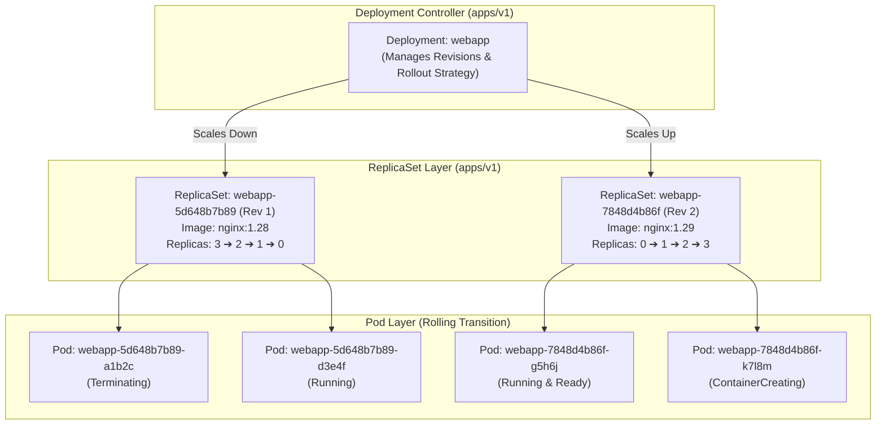
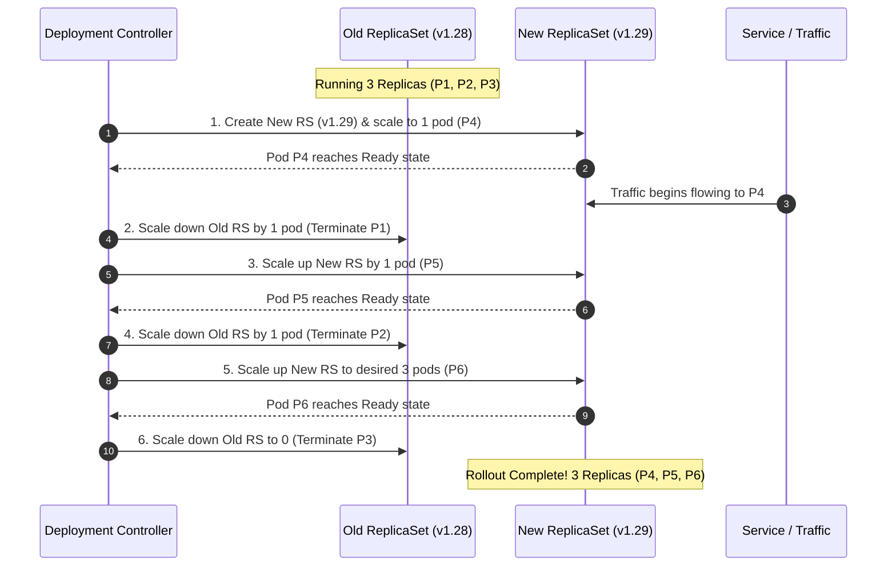
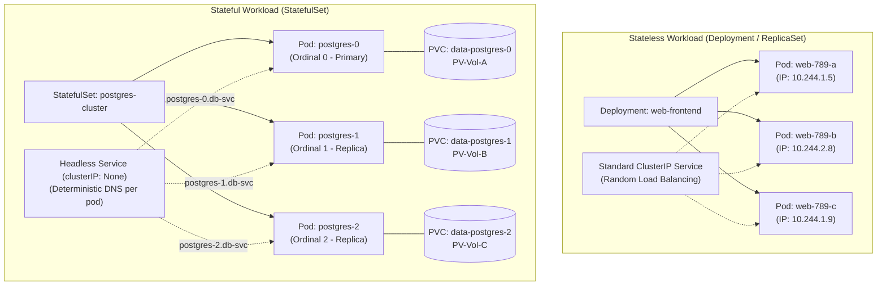
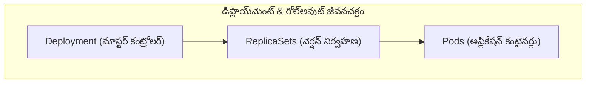

# Exercise 06 — Deployment Rolling Update and Rollback

> Related: [Deployment skeleton](../../skeletons/deployment.yaml) | [README — Workloads & Scheduling](../../README.md#domain-3--workloads--scheduling-15)

Create a Deployment, perform a rolling update, check rollout history, and rollback.

## Tasks

1. Create a namespace called `exercise-06`
2. Create a Deployment named `webapp` with:
   - 3 replicas
   - Image: `nginx:1.28`
   - Strategy: RollingUpdate with maxSurge=1, maxUnavailable=0
   - Record the change cause
3. Verify all 3 replicas are running
4. Update the image to `nginx:1.29` and record the change
5. Watch the rollout status
6. Check rollout history — you should see 2 revisions
7. Rollback to the previous version (nginx:1.28)
8. Verify the rollback worked by checking the image

## Hints

<details>
<summary>Stuck? Click to reveal hints</summary>

- `k create deployment webapp --image=nginx:1.28 --replicas=3`
- `k set image deployment/webapp` to update
- `k rollout status`, `k rollout history`, `k rollout undo`
- Annotate with `kubernetes.io/change-cause` to track changes in rollout history

</details>

## What tripped me up

> I used `--record` on every deployment command because that's what older guides taught. It's deprecated and removed in v1.35 — the CHANGE-CAUSE column shows `<none>`. The correct way: annotate the deployment with `kubernetes.io/change-cause` after each change. It's one extra command but it actually works.
>
> Also: I forgot that `k rollout undo` creates a NEW revision, not a revert. After undo, I had revision 1, 3 (not 1, 2). My history looked weird and I thought something broke. That's just how it works — undo creates revision N+1 with the old spec.
>
> **Why `--overwrite` on the second annotation?** The `kubernetes.io/change-cause` annotation lives on the Deployment object itself, not on individual revisions. When you update the image, the Deployment object remains the same. The old annotation persists, so you need `--overwrite` to change its value. First annotation (initial deploy) doesn't need it because the key doesn't exist yet. Second annotation (after update) needs it because the key already exists. Without `--overwrite`, the command would error with "annotation already exists".

## Verify

```bash
# After initial deploy
k get deploy webapp -n exercise-06
k get rs -n exercise-06

# After rollback — image should be nginx:1.28
k get deploy webapp -n exercise-06 -o jsonpath='{.spec.template.spec.containers[0].image}'
```

## Cleanup

```bash
k delete ns exercise-06
```

<details>
<summary>Solution</summary>

```bash
k create ns exercise-06

# Create deployment
k create deployment webapp -n exercise-06 --image=nginx:1.28 --replicas=3 $do > deploy.yaml
```

Edit `deploy.yaml` to add rolling update strategy, then apply:

```yaml
apiVersion: apps/v1
kind: Deployment
metadata:
  name: webapp
  namespace: exercise-06
spec:
  replicas: 3
  selector:
    matchLabels:
      app: webapp
  strategy:
    type: RollingUpdate
    rollingUpdate:
      maxSurge: 1
      maxUnavailable: 0
  template:
    metadata:
      labels:
        app: webapp
    spec:
      containers:
      - name: nginx
        image: nginx:1.28
```

```bash
k apply -f deploy.yaml
# First annotation — no --overwrite needed because the key doesn't exist yet
k annotate deployment webapp -n exercise-06 kubernetes.io/change-cause="initial deploy nginx:1.28"

# Verify
k get deploy webapp -n exercise-06
k get pods -n exercise-06

# Update image
k set image deployment/webapp nginx=nginx:1.29 -n exercise-06
# Second annotation — MUST use --overwrite because kubernetes.io/change-cause already exists on the Deployment object
# The annotation key lives on the Deployment, not on individual revisions, so it persists across updates
k annotate deployment webapp -n exercise-06 kubernetes.io/change-cause="update to nginx:1.29" --overwrite

# Watch rollout
k rollout status deployment/webapp -n exercise-06

# Check history
k rollout history deployment/webapp -n exercise-06

# Rollback
k rollout undo deployment/webapp -n exercise-06

# Verify rollback
k get deploy webapp -n exercise-06 -o jsonpath='{.spec.template.spec.containers[0].image}'
# Should output: nginx:1.28
```

</details>

---

## Deployment & Rollout Architecture Explained (English)

In Kubernetes, workloads are managed declaratively using controllers. A **Deployment** manages a series of **ReplicaSets**, which in turn manage individual **Pods**. When you update a Deployment's specification (e.g., container image or environment variables), the Deployment Controller orchestrates a progressive **Rolling Update** across ReplicaSets to ensure uninterrupted service availability.



---

### 1. Deployment

* **Definition**: A Kubernetes **Deployment** is a higher-level declarative controller (`apps/v1`) that automates the lifecycle of **stateless application instances**. It defines the desired state for a set of identical Pods, automatically creating and managing the underlying `ReplicaSet` objects required to maintain that state.
* **Why Not Raw Pods or ReplicaSets?**:
  - **Raw Pods**: If a worker node crashes or the container exits, a standalone Pod is not rescheduled or restarted on another node.
  - **ReplicaSets**: Ensure a fixed number of Pod replicas are always running, but do **not** natively support zero-downtime rolling updates, canary testing, pauses, or rollbacks.
  - **Deployments**: Sit on top of ReplicaSets to provide automated updates, health checks, rollback history, and revision tracking.

#### Core Specification Fields:
1. `spec.replicas`: Desired number of identical Pods (e.g., `3`).
2. `spec.selector.matchLabels`: Label selector identifying which Pods belong to this Deployment.
   > [!IMPORTANT]
   > **`spec.selector` is Immutable**: Once created, you **cannot** alter `spec.selector`. Attempting to do so results in `field is immutable` errors. To change selectors, you must delete and recreate the Deployment.
3. `spec.template`: The blueprint for generating new Pods (contains `metadata.labels`, container images, environment variables, ports, resource limits, and health probes).
4. `spec.strategy`: Strategy used to replace old Pods with new Pods (`RollingUpdate` or `Recreate`).
5. `spec.minReadySeconds`: Minimum number of seconds a newly created Pod must run without crashing before it is considered available and the rollout continues (default: `0`).
6. `spec.progressDeadlineSeconds`: Number of seconds the deployment controller waits before flagging the rollout condition as failed (`ProgressDeadlineExceeded`, default: `600`).
7. `spec.revisionHistoryLimit`: Number of old ReplicaSets retained for rollback purposes (default: `10`).

#### Production-Grade Deployment Manifest:
```yaml
apiVersion: apps/v1
kind: Deployment
metadata:
  name: webapp-production
  namespace: exercise-06
  labels:
    app.kubernetes.io/name: webapp
    app.kubernetes.io/tier: frontend
spec:
  replicas: 3
  revisionHistoryLimit: 10
  minReadySeconds: 5
  progressDeadlineSeconds: 300
  selector:
    matchLabels:
      app: webapp
  strategy:
    type: RollingUpdate
    rollingUpdate:
      maxSurge: 1
      maxUnavailable: 0
  template:
    metadata:
      labels:
        app: webapp
    spec:
      containers:
      - name: nginx
        image: nginx:1.28
        ports:
        - containerPort: 80
          name: http
        resources:
          requests:
            cpu: "100m"
            memory: "128Mi"
          limits:
            cpu: "500m"
            memory: "256Mi"
        livenessProbe:
          httpGet:
            path: /
            port: 80
          initialDelaySeconds: 5
          periodSeconds: 10
        readinessProbe:
          httpGet:
            path: /
            port: 80
          initialDelaySeconds: 2
          periodSeconds: 5
```

#### Fast Imperative Commands for CKA:
```bash
# 1. Generate skeleton deployment YAML quickly:
kubectl create deployment webapp --image=nginx:1.28 --replicas=3 --dry-run=client -o yaml > deploy.yaml

# 2. Scale deployment instantly:
kubectl scale deployment webapp --replicas=5 -n exercise-06

# 3. Update container image imperatively:
kubectl set image deployment/webapp nginx=nginx:1.29 -n exercise-06

# 4. View deployment and underlying ReplicaSets:
kubectl get deployment webapp -n exercise-06
kubectl get rs -l app=webapp -n exercise-06
```

#### The Anatomy of Pod Names & `pod-template-hash`:
Why do pods managed by a Deployment look like `webapp-5d648b7b89-a1b2c`?
```
webapp           - 5d648b7b89              - a1b2c
──────           ───────────               ─────
Deployment Name    pod-template-hash         Random 5-char Pod Suffix
                   (Hash of spec.template)   (Generated by ReplicaSet)
```
1. **Deployment Name** (`webapp`): Identifies the parent workload.
2. **`pod-template-hash`** (`5d648b7b89`): Computed by the Deployment controller by hashing the entire `spec.template`. The Deployment applies this label to the ReplicaSet it spawns, and the ReplicaSet propagates it to all child Pods. This hash ensures the controller can distinguish Pods belonging to different revisions during a rollout.
3. **Random Suffix** (`a1b2c`): Generated by the ReplicaSet controller to ensure unique names for identical replicas.

> [!CAUTION]
> **Never manually apply or alter the `pod-template-hash` label!** Kubernetes reserves this label for controller-managed rollout state tracking. Manual interference causes ReplicaSets to adopt or orphan unintended Pods.

#### Alternative Strategy: `Recreate` Deployment Manifest
While `RollingUpdate` is the default, certain workloads require the `Recreate` strategy. Under `Recreate`, Kubernetes **terminates all old Pods simultaneously** before spinning up any new Pods:

* **When is `Recreate` Mandatory?**:
  1. When using storage with **`ReadWriteOnce` (RWO)** access mode (e.g., AWS EBS, GCP Persistent Disk) that cannot be mounted concurrently by two nodes during a rolling transition.
  2. When running legacy applications that do not permit two database schema versions or application versions to access the datastore concurrently.
  3. When application licenses restrict execution to an exact number of active instances.

```yaml
apiVersion: apps/v1
kind: Deployment
metadata:
  name: legacy-app
  namespace: exercise-06
spec:
  replicas: 3
  selector:
    matchLabels:
      app: legacy-app
  strategy:
    type: Recreate   # Terminates all 3 old pods before creating any new pods (downtime occurs)
  template:
    metadata:
      labels:
        app: legacy-app
    spec:
      containers:
      - name: app
        image: nginx:1.28
        ports:
        - containerPort: 80
```

---

### 2. Rollout & Rollout Lifecycle

* **Definition**: A **Rollout** is the sequential process initiated whenever the Deployment's **Pod template (`spec.template`)** is modified. The Deployment Controller creates a new `ReplicaSet`, assigns it a unique hash revision, and incrementally transitions traffic to the new revision according to the defined rollout strategy.
* **What Triggers a Rollout?**:
  - Updating container images (`nginx:1.28` ➔ `nginx:1.29`)
  - Changing environment variables or ConfigMap/Secret references
  - Updating resource requests/limits or ports
  - Updating pod labels or annotations inside `spec.template.metadata`
  > [!NOTE]
  > Changing `spec.replicas` (scaling up/down) modifies the existing ReplicaSet directly; it **does NOT** trigger a new rollout revision!

#### Essential Rollout CLI Commands:
```bash
# 1. Watch rollout progression in real time:
kubectl rollout status deployment/webapp -n exercise-06

# 2. View revision history:
kubectl rollout history deployment/webapp -n exercise-06

# 3. Inspect the pod spec of a specific historical revision:
kubectl rollout history deployment/webapp --revision=1 -n exercise-06

# 4. Pause a rollout (useful for canary deployments or batching multiple edits):
kubectl rollout pause deployment/webapp -n exercise-06

# 5. Resume a paused rollout:
kubectl rollout resume deployment/webapp -n exercise-06

# 6. Trigger a rolling restart of all pods without changing configuration:
# (Crucial for picking up external ConfigMap/Secret changes or reloading certificates)
kubectl rollout restart deployment/webapp -n exercise-06
```

#### How `kubectl rollout restart` Works Internally:
When you update a ConfigMap or Secret mounted in a Deployment, Kubernetes does not automatically restart the Pods because `spec.template` did not change.
Running:
```bash
kubectl rollout restart deployment/webapp -n exercise-06
```
works by injecting/updating an annotation into `spec.template.metadata.annotations`:
```yaml
spec:
  template:
    metadata:
      annotations:
        kubectl.kubernetes.io/restartedAt: "2026-10-27T14:15:00Z"
```
Because the Pod template has changed, the Deployment Controller treats it as a standard rollout and executes a zero-downtime rolling restart!

#### Hands-on Canary Release Pattern with `rollout pause` & `resume`:
You can implement a basic Canary deployment natively in Kubernetes without external service meshes:

```bash
# 1. Update the image to trigger the rollout:
kubectl set image deployment/webapp nginx=nginx:1.29 -n exercise-06

# 2. Immediately pause the rollout:
kubectl rollout pause deployment/webapp -n exercise-06

# 3. Observe the fleet:
kubectl get pods -n exercise-06 -l app=webapp
# One new canary pod (nginx:1.29) runs alongside the old pods (nginx:1.28)!

# 4. Route test traffic or inspect logs from the canary pod:
CANARY_POD=$(kubectl get pods -n exercise-06 -l app=webapp -o jsonpath='{.items[?(@.spec.containers[0].image=="nginx:1.29")].metadata.name}')
kubectl logs $CANARY_POD -n exercise-06

# 5. If healthy, resume the rollout to complete upgrading the remaining pods:
kubectl rollout resume deployment/webapp -n exercise-06

# If faulty, abort and undo:
kubectl rollout undo deployment/webapp -n exercise-06
```

#### Change Cause Tracking (`kubernetes.io/change-cause`):
In Kubernetes versions prior to v1.35, candidate documentation often suggested `--record`. That flag has been **deprecated and removed**; running `--record` now produces `<none>` in the `CHANGE-CAUSE` column.
The modern, officially supported technique is annotating the Deployment object directly:

```bash
# Initial annotation when deploying:
kubectl annotate deployment webapp -n exercise-06 kubernetes.io/change-cause="Initial deploy nginx:1.28"

# Subsequent updates — MUST use --overwrite:
kubectl annotate deployment webapp -n exercise-06 kubernetes.io/change-cause="Upgrade to nginx:1.29" --overwrite
```

> [!IMPORTANT]
> **Why `--overwrite` is Mandatory**:
> The `kubernetes.io/change-cause` annotation is stored on the Deployment object itself (not inside individual revisions). When you update the image, the Deployment metadata remains unchanged, so the old annotation persists. Calling `kubectl annotate` without `--overwrite` fails with an `already has a value` error.

---

### 3. Rolling Update Strategy (`RollingUpdate`)

* **Definition**: A **Rolling Update** is the default deployment update strategy in Kubernetes (`spec.strategy.type: RollingUpdate`). It gradually replaces instances of the previous Pod version with instances of the new Pod version, ensuring the service maintains adequate capacity and encounters **zero downtime**.
* **Contrast with `Recreate` Strategy**:
  - **`Recreate`**: Kills all existing Pods simultaneously before launching any new Pods.
    - *Advantage*: Guarantees that two different versions of the application never run at the same time.
    - *Disadvantage*: Causes complete application downtime while new Pods start and pass readiness probes.
  - **`RollingUpdate`**: Runs old and new Pods concurrently for a brief window until the new Pods are healthy, ensuring continuous traffic handling.



#### Deep Dive: `maxSurge` and `maxUnavailable`
These two parameters govern the speed, capacity, and resource overhead during a rolling update:

| Parameter | Definition | Default Value | Can be Absolute Number or %? | Rounding Behavior |
| :--- | :--- | :--- | :--- | :--- |
| **`maxSurge`** | Maximum number of Pods that can be provisioned **above** the desired replica count during an update. | `25%` | Both (e.g., `1` or `25%`) | Rounded **UP** (e.g., 25% of 3 = 0.75 ➔ 1) |
| **`maxUnavailable`** | Maximum number of Pods that can be **unavailable** (unready or terminating) relative to the desired replica count. | `25%` | Both (e.g., `0` or `25%`) | Rounded **DOWN** (e.g., 25% of 3 = 0.75 ➔ 0) |

#### Three Common Configuration Scenarios:

##### Scenario A: Zero Downtime & Maximum Availability (Best for Web & APIs)
```yaml
strategy:
  type: RollingUpdate
  rollingUpdate:
    maxSurge: 1
    maxUnavailable: 0
```
* **With 3 desired replicas**:
  - Max total pods during rollout: $3 + 1 = 4$
  - Minimum available pods at all times: $3 - 0 = 3$
  - The controller creates 1 new pod, waits until it passes readiness checks, and only then terminates 1 old pod. Service capacity never drops below 100%.

##### Scenario B: Resource-Constrained Clusters (Strict Node Memory/CPU Quotas)
```yaml
strategy:
  type: RollingUpdate
  rollingUpdate:
    maxSurge: 0
    maxUnavailable: 1
```
* **With 3 desired replicas**:
  - Max total pods during rollout: $3 + 0 = 3$ (never exceeds cluster quota)
  - Minimum available pods: $3 - 1 = 2$
  - The controller terminates 1 old pod first to free resources, then creates 1 new pod. Service capacity drops to 66% temporarily.

##### Scenario C: Rapid High-Throughput Rollout (Large Clusters)
```yaml
strategy:
  type: RollingUpdate
  rollingUpdate:
    maxSurge: 50%
    maxUnavailable: 25%
```
* Suitable for large fleets (e.g., 20 replicas) where scaling pods in batches speeds up deployment time.

#### The Forbidden Configuration: Why `maxSurge: 0` and `maxUnavailable: 0` Is Rejected
A common exam trick asks if you can configure both `maxSurge: 0` and `maxUnavailable: 0`:

```yaml
strategy:
  type: RollingUpdate
  rollingUpdate:
    maxSurge: 0
    maxUnavailable: 0   # REJECTED!
```

**Why does Kubernetes reject this?**
- `maxSurge: 0` means the cluster can **never** exceed the desired replica count (cannot create a new Pod first).
- `maxUnavailable: 0` means the cluster can **never** have fewer than the desired replica count (cannot terminate an old Pod first).
Together, they create a logical deadlock where no pod can be created and no pod can be deleted. Kubernetes admission control will immediately reject the manifest with:
```
spec.strategy.rollingUpdate.maxUnavailable: Invalid value: 0: maxSurge and maxUnavailable cannot both be zero
```

#### StatefulSet Rolling Update & The Partition Parameter (`partition: N`)
Unlike Deployments which manage ReplicaSets, a **StatefulSet** manages its Pods directly:
1. **Reverse Ordinal Rolling Update**: When updating a StatefulSet with 3 replicas (`mysql-0`, `mysql-1`, `mysql-2`), Kubernetes updates them in reverse order:
   `mysql-2` ➔ wait until Ready ➔ `mysql-1` ➔ wait until Ready ➔ `mysql-0`.
2. **StatefulSet Canary via `partition`**:
   The `spec.updateStrategy.rollingUpdate.partition` field allows you to partition updates. Only Pods with an ordinal **greater than or equal to** `partition` are updated:
   ```yaml
   updateStrategy:
     type: RollingUpdate
     rollingUpdate:
       partition: 2   # In a 3-replica set (0, 1, 2), ONLY mysql-2 is updated to the new image!
   ```
   `mysql-0` and `mysql-1` remain on the old version, allowing safe canary validation for stateful databases!

#### The Crucial Role of `readinessProbe`:
A rolling update is only as reliable as your **`readinessProbe`**. If your container takes 15 seconds to boot (e.g., warming cache or opening database pools) and you omit `readinessProbe`, Kubernetes marks the Pod `Ready` as soon as the container process starts (`PID 1`). Kubernetes then immediately terminates the old healthy Pods, routing user traffic to unready new Pods and resulting in `502 Bad Gateway` errors!

---

### 4. Rollback (`kubectl rollout undo`)

* **Definition**: A **Rollback** reverts a Deployment from its current revision to a previously recorded healthy revision. It is Kubernetes' native safety mechanism for recovering from bad images, runtime crashes, memory leaks, or erroneous configuration changes.
* **How Rollback Works Under the Hood**:
  1. Kubernetes inspects the Deployment's historical `ReplicaSet` objects.
  2. It identifies the target revision's `PodTemplateSpec` and copies that specification.
  3. It increments the revision counter and creates a **NEW** revision (e.g., rolling back from revision 2 to revision 1 creates **revision 3** with the configuration of revision 1).
  4. The Deployment scales up the old ReplicaSet (if it still exists in the cluster) and scales down the broken ReplicaSet.

```
Initial Deploy (Rev 1) ──> Failed Update (Rev 2) ──> Rollback (Rev 3 = Rev 1 spec)
ReplicaSet: webapp-aaa     ReplicaSet: webapp-bbb    ReplicaSet: webapp-aaa
Replicas: 3 ➔ 0            Replicas: 0 ➔ 3 (Crashes) Replicas: 0 ➔ 3 (Restored!)
```

#### Revision Numbering Deep Dive (Before & After Table)
When `kubectl rollout undo` is invoked, Kubernetes does not revert history or erase past numbers. It generates revision $N+1$ using the spec from the target revision:

| Step | Action Executed | Active Revision Number | Configuration Deployed | Rollout History Retained |
| :--- | :--- | :--- | :--- | :--- |
| **1** | Initial deployment | **Rev 1** | `nginx:1.28` | `[Rev 1]` |
| **2** | Update image to v1.29 | **Rev 2** | `nginx:1.29` | `[Rev 1, Rev 2]` |
| **3** | Update image to v1.30 (broken) | **Rev 3** | `nginx:1.30` | `[Rev 1, Rev 2, Rev 3]` |
| **4** | `kubectl rollout undo --to-revision=2` | **Rev 4** | `nginx:1.29` | `[Rev 1, Rev 3, Rev 4]` |

> [!NOTE]
> Notice that after undoing to revision 2, the old revision 2 becomes revision 4. Kubernetes moves the target revision to the newest revision number.

#### Step-by-Step Failure & Rollback Scenario:

##### 1. Inject an Invalid Image:
```bash
# Deploy a typo / non-existent image
kubectl set image deployment/webapp nginx=nginx:invalid-version-999 -n exercise-06
kubectl annotate deployment webapp -n exercise-06 kubernetes.io/change-cause="Deploy v999 (broken)" --overwrite
```

##### 2. Observe the Stalled Rollout:
```bash
kubectl rollout status deployment/webapp -n exercise-06
# Output shows the rollout is blocked:
# Waiting for deployment "webapp" rollout to finish: 1 out of 3 new replicas have been updated...

kubectl get pods -n exercise-06
# Output shows ErrImagePull / ImagePullBackOff on the new pod:
# webapp-7848d4b86f-g5h6j   0/1   ImagePullBackOff   0   35s
# webapp-5d648b7b89-a1b2c   1/1   Running            0   5m
# webapp-5d648b7b89-d3e4f   1/1   Running            0   5m
```
> [!NOTE]
> Because `maxUnavailable: 0` was configured, the 2 old healthy pods remain running and continue serving traffic! The outage is contained.

##### 3. Check Rollout History:
```bash
kubectl rollout history deployment/webapp -n exercise-06
# REVISION  CHANGE-CAUSE
# 1         Initial deploy nginx:1.28
# 2         Deploy v999 (broken)
```

##### 4. Execute Instant Rollback:
```bash
# Rollback to the immediate previous revision:
kubectl rollout undo deployment/webapp -n exercise-06

# OR rollback to a specific revision by number:
kubectl rollout undo deployment/webapp --to-revision=1 -n exercise-06

# Verify rollout completed successfully:
kubectl rollout status deployment/webapp -n exercise-06
# Output: deployment "webapp" successfully rolled out
```

---

### 5. Stateless vs. Stateful Workloads

In Kubernetes, workloads are categorized based on how they manage client data, network identities, and storage persistence:



#### Detailed Definitions:

#### A. Stateless Workloads:
* **Definition**: Applications that process client requests independently without storing session state, client context, or files on local container storage. Any request can be served by any pod replica.
* **Core Traits**:
  - **Interchangeable & Disposable**: If a pod crashes, it is replaced by an entirely new pod with a random name and new IP address.
  - **Horizontal Elasticity**: Instances can be scaled from 2 to 200 replicas instantly without synchronization.
  - **Shared / External State**: State is stored externally in databases (PostgreSQL, MySQL), caches (Redis), or object storage (Amazon S3, Google Cloud Storage).
  - **Managed By**: `Deployment` or `ReplicaSet`.
  - **Examples**: Nginx web servers, Node.js/Python REST APIs, microservice gateways.

#### B. Stateful Workloads:
* **Definition**: Applications that maintain client data, consensus state, transactional logs, or distributed cluster roles locally. Each instance requires a persistent, unique identity that survives pod restarts and rescheduling.
* **Core Traits**:
  - **Unique Ordinal Index**: Pods are named sequentially starting from zero (`db-0`, `db-1`, `db-2`).
  - **Sticky Dedicated Storage**: Each replica receives its own dedicated `PersistentVolumeClaim` generated dynamically via `spec.volumeClaimTemplates`. When `db-1` is deleted, its replacement reattaches to `data-db-1`.
  - **Deterministic Network Identity**: A **Headless Service** (`clusterIP: None`) provides direct DNS resolution for each individual pod (`<pod-name>.<service-name>.<namespace>.svc.cluster.local`).
  - **Ordered Startup and Teardown**: Pods initialize in ascending order (`0 ➔ 1 ➔ 2`) and terminate in reverse descending order (`2 ➔ 1 ➔ 0`).
  - **Managed By**: `StatefulSet`.
  - **Examples**: Database clusters (PostgreSQL, MySQL replication), distributed queues (Kafka, RabbitMQ), consensus engines (etcd, ZooKeeper, Elasticsearch).

---

### Comparison Matrix: Deployment vs. StatefulSet

| Dimension | Stateless (`Deployment`) | Stateful (`StatefulSet`) |
| :--- | :--- | :--- |
| **API Object** | `apps/v1` `Deployment` | `apps/v1` `StatefulSet` |
| **Pod Naming** | Random alphanumeric hash (e.g., `webapp-7848d4b86f-x9z2p`) | Predictable ordinal index (e.g., `redis-0`, `redis-1`, `redis-2`) |
| **Storage Binding** | Ephemeral or shared volume across pods | Dedicated persistent volume per pod via `volumeClaimTemplates` |
| **Storage on Pod Deletion** | Replaced pod gets a blank ephemeral container | Replaced pod binds back to its existing dedicated PVC |
| **Storage on Controller Deletion** | N/A | PVCs are **never deleted automatically** (prevents data loss) |
| **Network Routing** | Shared ClusterIP Service (random round-robin) | Headless Service (`clusterIP: None`) with direct pod DNS |
| **Startup / Scaling Order** | Simultaneous (parallel creation) | Sequential (`0 ➔ 1 ➔ 2`), waits for previous pod to be Ready |
| **Termination Order** | Simultaneous (random deletion) | Reverse sequential (`2 ➔ 1 ➔ 0`) for graceful cluster failover |
| **Typical Use Cases** | Web servers, REST APIs, Microservices | Databases, Kafka, etcd, Redis, ZooKeeper |

---

### Manifest Comparison: Stateless vs. Stateful

#### Manifest 1: Stateless Deployment with Standard ClusterIP Service
```yaml
apiVersion: apps/v1
kind: Deployment
metadata:
  name: stateless-web
  namespace: exercise-06
spec:
  replicas: 3
  selector:
    matchLabels:
      app: stateless-web
  template:
    metadata:
      labels:
        app: stateless-web
    spec:
      containers:
      - name: nginx
        image: nginx:1.28
        ports:
        - containerPort: 80
---
apiVersion: v1
kind: Service
metadata:
  name: web-service
  namespace: exercise-06
spec:
  type: ClusterIP
  selector:
    app: stateless-web
  ports:
  - port: 80
    targetPort: 80
```

#### Manifest 2: StatefulSet with Headless Service & Volume Claim Template
```yaml
apiVersion: v1
kind: Service
metadata:
  name: database-headless
  namespace: exercise-06
spec:
  clusterIP: None        # Headless Service: creates individual DNS records for each pod
  selector:
    app: stateful-db
  ports:
  - port: 5432
    name: postgres
---
apiVersion: apps/v1
kind: StatefulSet
metadata:
  name: stateful-db
  namespace: exercise-06
spec:
  serviceName: database-headless   # Links to Headless Service for DNS resolution
  replicas: 3
  podManagementPolicy: OrderedReady # Strict ordering (0 -> 1 -> 2)
  # Modern PVC retention policy (v1.27+, GA in v1.32+):
  persistentVolumeClaimRetentionPolicy:
    whenDeleted: Retain            # Retain storage if StatefulSet is deleted
    whenScaled: Delete             # Delete PVCs when scaled down from 3 to 1
  selector:
    matchLabels:
      app: stateful-db
  template:
    metadata:
      labels:
        app: stateful-db
    spec:
      containers:
      - name: postgres
        image: postgres:16-alpine
        ports:
        - containerPort: 5432
          name: postgres
        env:
        - name: POSTGRES_PASSWORD
          value: "cka-exam-pass"
        volumeMounts:
        - name: db-data
          mountPath: /var/lib/postgresql/data
  # Automatically generates a unique PVC for each pod replica:
  volumeClaimTemplates:
  - metadata:
      name: db-data
    spec:
      accessModes: ["ReadWriteOnce"]
      resources:
        requests:
          storage: 2Gi
```

#### StatefulSet Headless Service DNS Record Anatomy:
Because StatefulSets utilize a Headless Service (`clusterIP: None`), CoreDNS creates direct A/AAAA records for each individual pod:

```
┌───────────────────────────────────────────────────────────────────────────┐
│              Fully Qualified Domain Name (FQDN) Format                    │
│                                                                           │
│   stateful-db-0 . database-headless . exercise-06 . svc.cluster.local    │
│   ─────────────   ─────────────────   ───────────   ─────────────────    │
│   Pod Name        Headless Service     Namespace     Cluster Domain       │
└───────────────────────────────────────────────────────────────────────────┘
```
This enables distributed clusters (e.g., PostgreSQL primary-replica or Kafka brokers) to communicate directly with specific member nodes using permanent hostnames rather than volatile pod IP addresses.

---

### When to Use Which: Decision Guide

```
Does the application store persistent data directly inside the container filesystem?
├── NO  ──> Use DEPLOYMENT (Stateless)
│           (e.g., Nginx, Python Flask API, Go backend, Node.js)
│
└── YES ──> Does each replica require its own independent, non-shared storage disk?
            ├── NO  ──> Use DEPLOYMENT with ReadWriteMany (RWX) NFS/Ceph/EFS volume
            └── YES ──> Does the application require fixed hostnames or ordered clustering?
                        ├── YES ──> Use STATEFULSET (e.g., PostgreSQL, Kafka, Redis)
                        └── NO  ──> Use STATEFULSET with podManagementPolicy: Parallel
```

---

### CKA Exam Golden Tips & Common Traps

1. **`--record` is Dead**:
   Never use `--record` during your exam. It was deprecated and removed in Kubernetes v1.35. Always use `kubectl annotate deployment <name> kubernetes.io/change-cause="..." [--overwrite]`.
2. **`spec.selector` is Immutable**:
   If an exam question asks you to change labels or fix selector mismatches on an existing Deployment, you cannot simply `kubectl apply` an altered `spec.selector`. You must either delete the deployment (`kubectl delete deployment <name> --cascade=orphan` to preserve pods, or edit carefully) or recreate it.
3. **`maxSurge: 0` and `maxUnavailable: 0` is Impossible**:
   Both cannot be set to 0 simultaneously. It results in a deployment controller deadlock and the admission controller will fail your YAML validation.
4. **`pod-template-hash` is Controller-Reserved**:
   Never write `pod-template-hash` in your `spec.selector` or `spec.template.metadata.labels`. It is computed automatically.
5. **Rollout Undo Creates a New Revision**:
   When you run `kubectl rollout undo`, Kubernetes does **not** delete the current revision from history; it appends a new revision $N+1$ containing the restored template. If you had revision 1 and revision 2, undoing creates revision 3 (which looks like revision 1).
6. **`kubectl rollout restart` Injects an Annotation**:
   Running a restart updates `spec.template.metadata.annotations` with `kubectl.kubernetes.io/restartedAt`. Because the template changes, a zero-downtime rolling update is triggered automatically.
7. **Readiness Probe is Essential for Zero Downtime**:
   A rolling update with `maxUnavailable: 0` will still drop user traffic if containers have no `readinessProbe` and take a few seconds to initialize.
8. **StatefulSet Rolling Updates Run in Reverse**:
   StatefulSet updates roll in reverse ordinal order (`2 ➔ 1 ➔ 0`), and can be canary tested using `spec.updateStrategy.rollingUpdate.partition: <N>`.
9. **StatefulSet PVC Persistence**:
   Deleting a `StatefulSet` does **not** delete its `PersistentVolumeClaims`. If an exam question asks you to clean up a StatefulSet completely, remember to run `kubectl delete pvc -l app=...` as well.

---

---

### తెలుగు వివరణ (Telugu Explanation)

కుబెర్‌నెటిస్ (Kubernetes) లో అప్లికేషన్లను సమర్థవంతంగా రన్ చేయడానికి, అప్‌డేట్ చేయడానికి మరియు డేటాను నిల్వ చేయడానికి **Deployment**, **Rolling Update**, **Rollout**, **Rollback**, **Stateless** మరియు **Stateful** అనేవి అత్యంత ప్రాథమిక భావనలు.



#### నిజ జీవిత ఉదాహరణలు (Real-World Analogies):
* **Deployment (డిప్లాయ్‌మెంట్) & Stateless (స్టేట్‌లెస్)**:
  - ఒక ఆర్టీసీ బస్సు లేదా ట్యాక్సీ సర్వీస్ లాంటిది. అన్ని ట్యాక్సీలు (Pods) ఒకేలా ఉంటాయి. ఒక ట్యాక్సీ పాడైపోతే వెంటనే మరో కొత్త ట్యాక్సీ వస్తుంది. ప్రయాణికుడు ఏ ట్యాక్సీలో కూర్చున్నా ఒకటే (Interchangeable).
* **StatefulSet (స్టేట్‌ఫుల్ సెట్) & Stateful (స్టేట్‌ఫుల్)**:
  - ఒక ప్రైవేట్ స్కూల్‌లోని రిజర్వ్‌డ్ డెస్క్‌లు లేదా బ్యాంక్ లాకర్ల లాంటిది. ప్రతి ఒక్కరికీ ఒక ఫిక్స్‌డ్ నంబర్ (`student-0`, `student-1`) మరియు సొంత తాళం వేసిన లాకర్ (Dedicated PVC) ఉంటుంది. స్టూడెంట్ మారినా లాకర్ మాత్రం ఆ సీటుకే అటాచ్ అయి ఉంటుంది.
* **Rolling Update (రోలింగ్ అప్‌డేట్)**:
  - ఒక రైలు నడుస్తూనే ఉన్నప్పుడు, ప్రయాణికులకు ఎలాంటి ఇబ్బంది లేకుండా ఒక్కో పాత బోగీని తీసివేసి దాని స్థానంలో కొత్త బోగీని తగిలించడం (జీరో డౌన్‌టైమ్).
* **Recreate Strategy (రీక్రియేట్ స్ట్రాటజీ)**:
  - ఒకే ఒక్క తాళం ఉన్న ఇల్లు లాంటిది. పాత వారు ఇల్లు ఖాళీ చేసి వెళ్ళిన తర్వాతే కొత్త వారు లోపలికి రాగలరు (మధ్యలో కొంత సమయం ఇల్లు ఖాళీగా ఉంటుంది = డౌన్‌టైమ్).
* **Rollout & Rollback (రోల్‌అవుట్ & రోల్‌బ్యాక్)**:
  - మీ మొబైల్ యాప్ అప్‌డేట్ లాంటిది. కొత్త వెర్షన్ డౌన్‌లోడ్ అయ్యి సరిగ్గా పనిచేస్తే సరే, ఒకవేళ క్రాష్ అయితే వెంటనే మునుపటి వెర్షన్‌కి రీస్టోర్ (Ctrl+Z / Rollback) చేయడం.

---

#### 1. Deployment (డిప్లాయ్‌మెంట్)
* **వివరణ**: కుబెర్‌నెటిస్‌లో స్టేట్‌లెస్ (Stateless) అప్లికేషన్లను నడపడానికి వాడే ప్రాథమిక కంట్రోలర్. ఇది నేరుగా Pods ని కాకుండా, కింద ఉన్న **ReplicaSet** ల ద్వారా Pods ని మేనేజ్ చేస్తుంది.
* **`pod-template-hash` అంటే ఏమిటి?**:
  - ఒక Pod పేరు `webapp-5d648b7b89-a1b2c` లాగా ఎందుకుంటుంది?
  - `webapp`: డిప్లాయ్‌మెంట్ పేరు.
  - `5d648b7b89`: `spec.template` కి కుబెర్‌నెటిస్ వేసిన హాష్ కోడ్. దీని ద్వారానే ఏ Pod ఏ వెర్షన్‌కు చెందినదో కుబెర్‌నెటిస్ గుర్తిస్తుంది.
  - `a1b2c`: ReplicaSet ఇచ్చిన రాండమ్ కోడ్.
* **Recreate స్ట్రాటజీ ఎప్పుడు వాడాలి?**:
  - `ReadWriteOnce` (RWO) వాల్యూమ్స్ ఉన్నప్పుడు (ఒకేసారి రెండు Pods ఒకే డిస్క్‌ను మౌంట్ చేసుకోలేవు).
  - పాత మరియు కొత్త వెర్షన్లు ఒకేసారి డేటాబేస్‌తో మాట్లాడకూడదు అనుకున్నప్పుడు.
* **ముఖ్యమైన నిబంధన**: Deployment లోని `spec.selector` ఒకసారి సృష్టించిన తర్వాత మార్చలేము (**Immutable**).

#### 2. Rollout (రోల్‌అవుట్)
* **వివరణ**: Deployment లోని Pod టెంప్లేట్ (`spec.template`) లో ఏ చిన్న మార్పు చేసినా (ఇమేజ్ మార్చడం, ఎన్విరాన్‌మెంట్ వేరియబుల్స్ మార్చడం) కొత్త **Rollout** మొదలవుతుంది.
* **కీలకమైన కమాండ్‌లు**:
  - స్టేటస్ చూడటానికి: `kubectl rollout status deployment/<name>`
  - హిస్టరీ చూడటానికి: `kubectl rollout history deployment/<name>`
  - రీస్టార్ట్ చేయడానికి: `kubectl rollout restart deployment/<name>` (ఇది Pod టెంప్లేట్‌కి `restartedAt` అనోటేషన్ జోడించి జీరో డౌన్‌టైమ్‌తో రీస్టార్ట్ చేస్తుంది).
  - పాజ్/రెజ్యూమ్: `kubectl rollout pause` మరియు `kubectl rollout resume` (కెనరీ టెస్టింగ్ కోసం).
* **Change-Cause గమనిక**: పాత వెర్షన్‌లలో వాడిన `--record` ఫ్లాగ్ కుబెర్‌నెటిస్ v1.35 లో పూర్తిగా తొలగించబడింది. సరైన విధానం:
  `kubectl annotate deployment <name> kubernetes.io/change-cause="వివరణ" --overwrite`

#### 3. Rolling Update (రోలింగ్ అప్‌డేట్)
* **వివరణ**: సర్వీస్ ఎక్కడా ఆగకుండా (Zero Downtime) పాత వెర్షన్ Pods ని తీసివేసి కొత్త వెర్షన్ Pods ని నిదానంగా తీసుకువచ్చే విధానం.
* **రెండు ముఖ్యమైన పారామీటర్లు**:
  1. **`maxSurge`**: అప్‌డేట్ సమయంలో అసలు సంఖ్య కంటే గరిష్టంగా ఎన్ని అదనపు Pods ని సృష్టించవచ్చు (ఉదా: `1` లేదా `25%`).
  2. **`maxUnavailable`**: అప్‌డేట్ సమయంలో కనీసం అందుబాటులో లేకపోయినా పర్వాలేదు అనుకునే Pods సంఖ్య (ఉదా: `0` అంటే ఒక్క Pod కూడా డౌన్ అవ్వకూడదు).
* **ముఖ్యమైన ఎర్రర్ ట్రాప్**: `maxSurge: 0` మరియు `maxUnavailable: 0` రెండూ ఒకేసారి సున్నాగా పెట్టలేము! అలా చేస్తే అడ్మిషన్ కంట్రోలర్ ఆ YAML ని రిజెక్ట్ చేస్తుంది.
* **CKA గోల్డెన్ రూల్**: `maxSurge: 1` మరియు `maxUnavailable: 0` వాడితే ఎప్పటికీ కెపాసిటీ తగ్గదు. కానీ దీనికి Pods లో **`readinessProbe`** తప్పనిసరిగా ఉండాలి!

#### 4. Rollback (రోల్‌బ్యాక్ — `rollout undo`)
* **వివరణ**: కొత్తగా వేసిన అప్‌డేట్‌లో ఏదైనా బగ్ లేదా తప్పు ఇమేజ్ ఉంటే, వెనువెంటనే మునుపటి క్లీన్ వెర్షన్‌కి మారిపోవడం.
* **ఎలా పనిచేస్తుంది?**:
  - రోల్‌బ్యాక్ చేసినప్పుడు కుబెర్‌నెటిస్ హిస్టరీని డిలీట్ చేయదు.
  - పాత వెర్షన్ కాన్ఫిగరేషన్‌తో ఒక **కొత్త రివిజన్ (Revision N+1)** ని తయారుచేస్తుంది.
* **కమాండ్**:
  `kubectl rollout undo deployment/<name> -n <namespace>`
  `kubectl rollout undo deployment/<name> --to-revision=1 -n <namespace>`

#### 5. Stateless vs Stateful (స్టేట్‌లెస్ వర్సెస్ స్టేట్‌ఫుల్)

| ఫీచర్ | Stateless (Deployment) | Stateful (StatefulSet) |
| :--- | :--- | :--- |
| **అప్లికేషన్ రకం** | వెబ్ సర్వర్లు, REST API లు, మైక్రోసర్వీసులు | డేటాబేస్‌లు (PostgreSQL, MySQL), Kafka, Redis |
| **Pod పేరు** | రాండమ్ హాష్ (ఉదా: `webapp-7848-abcde`) | వరుస క్రమ సంఖ్య (ఉదా: `mysql-0`, `mysql-1`) |
| **డేటా స్టోరేజ్** | టెంపరరీ (Pod డిలీట్ అయితే డేటా పోతుంది) | ప్రతి Pod కి సొంత Dedicated PVC ఉంటుంది (`volumeClaimTemplates`) |
| **స్టోరేజ్ డిలీషన్** | వర్తించదు | StatefulSet డిలీట్ చేసినా **PVC లు డిలీట్ కావు** (డేటా భద్రత కోసం) |
| **నెట్‌వర్క్ DNS** | కామన్ ClusterIP సర్వీస్ | Headless Service (`clusterIP: None`) ద్వారా ప్రతి Pod కి సొంత DNS |
| **స్టార్టప్ ఆర్డర్** | అన్నీ ఒకేసారి ప్యారలల్‌గా స్టార్ట్ అవుతాయి | ఆర్డర్ ప్రకారం ఒకదాని తర్వాత ఒకటి (`0 ➔ 1 ➔ 2`) |
| **రోలింగ్ అప్‌డేట్** | ReplicaSets ద్వారా జరుగుతుంది | రివర్స్ ఆర్డర్‌లో జరుగుతుంది (`2 ➔ 1 ➔ 0`) మరియు `partition` సపోర్ట్ చేస్తుంది |

---

