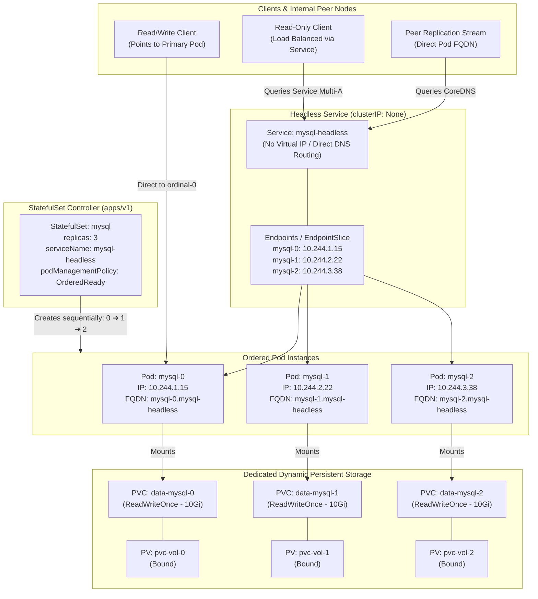
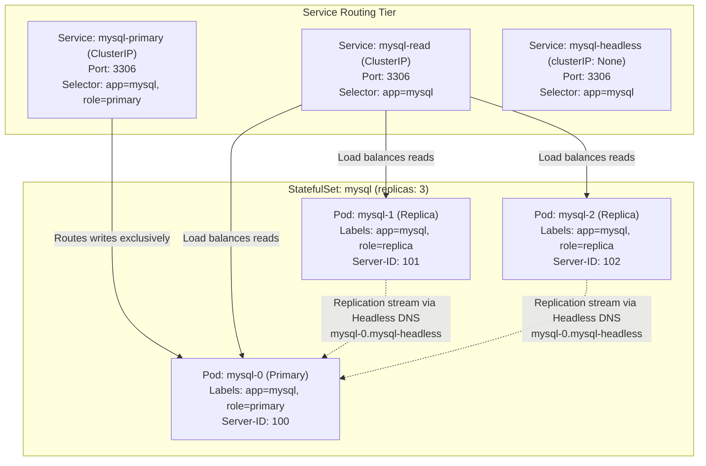
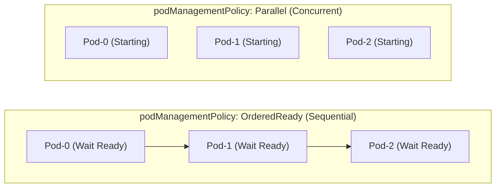
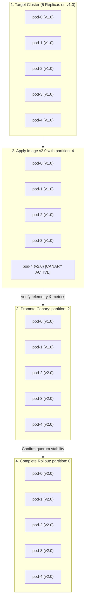
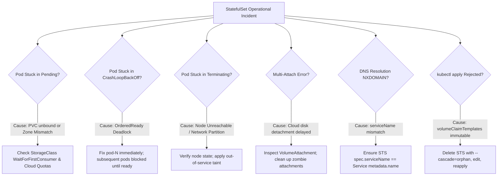

# Exercise 07 — StatefulSet Deployment

> Related: [README — Workloads and Scheduling](../../README.md#domain-1--workloads-and-scheduling-15)

Deploy a stateful application using StatefulSet. This exercise teaches ordered pod initialization, persistent storage, and stable network identities—critical for databases and distributed systems on the CKA.

## Context

StatefulSets are for applications that need:
- Stable, predictable pod names (not randomly generated like Deployments)
- Ordered pod startup and shutdown
- Persistent storage per pod replica
- Stable network identities (DNS names with ordinal suffixes)

Unlike Deployments where pod identity doesn't matter, StatefulSets maintain identity across restarts. Example: a MySQL cluster needs predictable names like `mysql-0`, `mysql-1`, `mysql-2` that survive pod recreations.

## Tasks

1. Create a headless Service for the StatefulSet (required for DNS routing)
2. Create a StatefulSet with 3 replicas using the `nginx:1.28` image
3. Verify pods start in order (mysql-0 first, then mysql-1, then mysql-2)
4. Verify each pod has a persistent volume claim attached
5. Delete a pod and observe it respawn with the same name and storage
6. Scale the StatefulSet up and down using `kubectl scale`
7. Delete the StatefulSet and verify PVCs persist (data survives)

## Hints

<details>
<summary>Stuck? Click to reveal hints</summary>

- Headless Service: set `spec.clusterIP: None` in the Service definition
- StatefulSet pods get DNS names like `nginx-0.nginx.default.svc.cluster.local`
- Use `.spec.serviceName` to reference the headless Service
- `.spec.volumeClaimTemplates` automatically creates a PVC for each replica
- Pod ordinals matter: `mysql-0` runs before `mysql-1` (controlled by `podManagementPolicy: OrderedReady`)
- `k get pvc` will show each pod's persistent claim

</details>

## What tripped me up

> I initially thought StatefulSet worked like Deployment with just named pods. Wrong. When I deleted the Service, the StatefulSet was still there but the pods lost their DNS names. Then I couldn't reach mysql-0 by name from other pods. The headless Service is not optional—it's the foundation for stable identities.
>
> Another gotcha: when you scale down a StatefulSet, pods are terminated in reverse order (mysql-2, then mysql-1, then mysql-0). This is important for graceful shutdown in databases. I scaled down expecting random termination, but it follows the spec.
>
> PVC persistence is real: when you delete the StatefulSet, the PVCs don't automatically delete. If you create a new StatefulSet with the same name and storage class, the pods will bind to their old volumes and recover data. I skipped this step on my first attempt and didn't understand why data persisted.

## Verify

```bash
# Headless Service created
k get svc mysql

# StatefulSet created
k get statefulset

# All 3 pods are Running and in order
k get pods -l app=mysql -o wide

# Each pod has storage
k get pvc

# Persistent DNS names work
k run debug --image=busybox:1.37 --rm -it -- nslookup mysql-0.mysql.default.svc.cluster.local

# Pod names are stable after deletion
k delete pod mysql-1
sleep 5
k get pods
# mysql-1 is recreated with the same name
```

## Cleanup

```bash
# Delete StatefulSet (pods will also be deleted)
k delete statefulset mysql

# Delete headless Service
k delete svc mysql

# Delete PVCs (volumes survive StatefulSet deletion)
k delete pvc --all
```

<details>
<summary>Solution</summary>

Create a headless Service:

```yaml
apiVersion: v1
kind: Service
metadata:
  name: mysql
  labels:
    app: mysql
spec:
  ports:
  - port: 3306
    name: mysql
  clusterIP: None  # This makes it headless
  selector:
    app: mysql
```

Create the StatefulSet:

```yaml
apiVersion: apps/v1
kind: StatefulSet
metadata:
  name: mysql
spec:
  serviceName: mysql
  replicas: 3
  selector:
    matchLabels:
      app: mysql
  template:
    metadata:
      labels:
        app: mysql
    spec:
      containers:
      - name: nginx
        image: nginx:1.28
        ports:
        - containerPort: 3306
          name: mysql
        volumeMounts:
        - name: data
          mountPath: /data
  volumeClaimTemplates:
  - metadata:
      name: data
    spec:
      accessModes: [ "ReadWriteOnce" ]
      resources:
        requests:
          storage: 1Gi
```

Deploy with imperative commands (if needed):

```bash
# Apply the YAML files
kubectl apply -f service.yaml
kubectl apply -f statefulset.yaml

# Watch pods start in order
k get pods -w

# Verify pod identities persist
k get pods -l app=mysql -o custom-columns=NAME:.metadata.name,IP:.status.podIP

# Check PVCs exist
k get pvc

# Test DNS
k run -it --image=busybox:1.37 --rm -- nslookup mysql-0.mysql

# Scale up
k scale statefulset mysql --replicas=4

# Scale down
k scale statefulset mysql --replicas=2
```

</details>
---

## StatefulSet & Headless Service Architecture Deep Dive (English)

### 1. What is a StatefulSet?

A **StatefulSet** (`apps/v1`) is the core Kubernetes workload controller purpose-built for managing stateful applications. Unlike a Deployment—which creates interchangeable pods backed by a shared ReplicaSet—a StatefulSet guarantees:
- **Stable, unique network identifiers** for each pod.
- **Stable, persistent storage** uniquely mapped to each pod ordinal.
- **Ordered, graceful deployment and scaling**.
- **Ordered, automated rolling updates**.



---

### 2. The Headless Service (`clusterIP: None`) Explained

#### Why Does a StatefulSet Need a Headless Service?
Standard Kubernetes Services assign a virtual cluster IP (e.g., `10.96.12.45`). When traffic reaches this virtual IP, `kube-proxy` transparently distributes packets across backend pods using iptables or IPVS connection tracking.

While this load-balancing behavior is ideal for stateless web servers, it breaks distributed databases:
1. In a primary-replica database (e.g., MySQL or PostgreSQL), write queries sent to a random follower will fail with read-only transaction errors. The client must reach the **primary** node directly.
2. In a quorum-based consensus system (e.g., etcd, ZooKeeper, Raft), peer nodes must communicate directly with each other by identity to conduct leader elections, sync logs, and exchange heartbeats.
3. If replica `mysql-1` dies and restarts on a different worker node with a new IP address, peer nodes need a stable DNS hostname that automatically points to the new IP without requiring a cluster-wide restart.

#### What Makes a Service "Headless"?
Setting `.spec.clusterIP: None` suppresses the allocation of a cluster IP. No virtual IP is reserved in the cluster's CIDR, and `kube-proxy` completely ignores the service.

Instead, the Headless Service instructs CoreDNS to return direct DNS `A` / `AAAA` records pointing directly to the Pod IPs backing the service endpoints.

```yaml
apiVersion: v1
kind: Service
metadata:
  name: mysql-headless
  namespace: default
spec:
  clusterIP: None
  selector:
    app: mysql
  ports:
  - port: 3306
    name: mysql
```

#### Headless Service Structure Breakdown (Visual Annotated Format):

```text
KUBERNETES service.yaml (HEADLESS) STRUCTURE BREAKDOWN
──────────────────────────────────────────────────────────────────────────────────────────────────────────
apiVersion: v1 ──────────────────────────────────────────► Core Kubernetes API group for Service objects
kind: Service ───────────────────────────────────────────► Declares resource type as a Kubernetes Service
metadata:
  name: mysql-headless ──────────────────────────────────► Service name (MUST match StatefulSet spec.serviceName)
  namespace: default ────────────────────────────────────► Logical partition where the service is registered
spec:
  clusterIP: None ───────────────────────────────────────► CRITICAL: "None" suppresses virtual IP; turns service Headless
  selector: ─────────────────────────────────────────────► Labels used to identify target pods for DNS routing
    app: mysql ──────────────────────────────────────────► Matches pods with label "app: mysql"
  ports: ────────────────────────────────────────────────► Network ports exposed by the headless service
  - port: 3306 ──────────────────────────────────────────► Port number used by clients and peer replicas
    name: mysql ─────────────────────────────────────────► Port identifier; required for SRV record generation
```

#### The DNS Naming Contract: `hostname` and `subdomain`
When a pod is managed by a StatefulSet with `.spec.serviceName: mysql-headless`:
- The kubelet assigns the Pod's internal hostname matching its ordinal: `hostname = mysql-0`.
- The kubelet assigns the Pod's DNS subdomain matching the service: `subdomain = mysql-headless`.

CoreDNS resolves three distinct record types for this configuration:

| DNS Query Type | Record Format | Example Output / Resolution | Purpose |
| :--- | :--- | :--- | :--- |
| **Direct Pod A Record** | `<pod-name>.<service-name>.<namespace>.svc.<cluster-domain>` | `mysql-0.mysql-headless.default.svc.cluster.local ➔ 10.244.1.15` | Connect directly to a specific node (e.g., primary or specific shard). |
| **Headless Multi-A Record** | `<service-name>.<namespace>.svc.<cluster-domain>` | `mysql-headless.default.svc.cluster.local ➔ [10.244.1.15, 10.244.2.22, 10.244.3.38]` | Node discovery; client libraries obtain the full list of active cluster members. |
| **SRV Record (Port Discovery)** | `_<port-name>._<protocol>.<service-name>.<namespace>.svc.<cluster-domain>` | `_mysql._tcp.mysql-headless.default.svc.cluster.local ➔ 0 33 3306 mysql-0.mysql-headless...` | Discover both hostnames and port numbers dynamically. |

#### The Crucial `publishNotReadyAddresses: true` Parameter
By default, Kubernetes Services remove unready pods from their Endpoints. 

> [!CRITICAL]
> **The Quorum Bootstrapping Deadlock**:
> In distributed consensus systems (ZooKeeper, etcd, MongoDB ReplicaSets), node `0` cannot become `Ready` until it establishes communication with a majority quorum of its peers (`node-1` and `node-2`).
>
> If `publishNotReadyAddresses: false` (the default), CoreDNS will **not return any DNS records** for `node-0`, `node-1`, or `node-2` because their readiness probes have not passed yet. The nodes cannot resolve each other's hostnames, so they cannot form a quorum, so their readiness probes never pass!
>
> To break this circular deadlock, set `publishNotReadyAddresses: true` on your Headless Service.

```yaml
apiVersion: v1
kind: Service
metadata:
  name: zookeeper-headless
spec:
  clusterIP: None
  publishNotReadyAddresses: true
  selector:
    app: zookeeper
  ports:
  - port: 2888
    name: peer
  - port: 3888
    name: leader-election
```

#### Quorum Headless Service Structure Breakdown (Visual Annotated Format):

```text
KUBERNETES service.yaml (QUORUM BOOTSTRAP) STRUCTURE BREAKDOWN
──────────────────────────────────────────────────────────────────────────────────────────────────────────
apiVersion: v1 ──────────────────────────────────────────► Core Kubernetes API group
kind: Service ───────────────────────────────────────────► Declares resource type as a Kubernetes Service
metadata:
  name: zookeeper-headless ──────────────────────────────► Unique identifier for ZooKeeper peer network
spec:
  clusterIP: None ───────────────────────────────────────► Disables virtual IP for direct pod-to-pod routing
  publishNotReadyAddresses: true ────────────────────────► CRITICAL: Publishes DNS A-records BEFORE pods are Ready!
  selector: ─────────────────────────────────────────────► Pod label selector
    app: zookeeper ──────────────────────────────────────► Selects all ZooKeeper consensus nodes
  ports:
  - port: 2888 ──────────────────────────────────────────► ZooKeeper quorum communication and peer sync port
    name: peer ──────────────────────────────────────────► Named port for intra-cluster communication
  - port: 3888 ──────────────────────────────────────────► ZooKeeper leader election protocol port
    name: leader-election ───────────────────────────────► Named port for consensus voting
```

---

### 3. Core Specification Fields of StatefulSet

```yaml
apiVersion: apps/v1
kind: StatefulSet
metadata:
  name: database
spec:
  serviceName: "db-headless"
  replicas: 3
  ordinals:
    start: 0
  podManagementPolicy: OrderedReady
  minReadySeconds: 10
  revisionHistoryLimit: 10
  updateStrategy:
    type: RollingUpdate
    rollingUpdate:
      partition: 0
      maxUnavailable: 1
  persistentVolumeClaimRetentionPolicy:
    whenDeleted: Retain
    whenScaled: Delete
  selector:
    matchLabels:
      app: database
  template:
    metadata:
      labels:
        app: database
    spec:
      containers:
      - name: db
        image: postgres:16-alpine
        ports:
        - containerPort: 5432
          name: postgres
        volumeMounts:
        - name: data
          mountPath: /var/lib/postgresql/data
  volumeClaimTemplates:
  - metadata:
      name: data
    spec:
      accessModes: [ "ReadWriteOnce" ]
      storageClassName: standard
      resources:
        requests:
          storage: 10Gi
```

#### Master StatefulSet Structure Breakdown (Visual Annotated Format):

```text
KUBERNETES statefulset.yaml (MASTER SPECIFICATION) STRUCTURE BREAKDOWN
──────────────────────────────────────────────────────────────────────────────────────────────────────────
apiVersion: apps/v1 ─────────────────────────────────────► API group and version for StatefulSet workloads
kind: StatefulSet ───────────────────────────────────────► Declares resource as a stateful controller
metadata:
  name: database ────────────────────────────────────────► Base name; generates pods: database-0, database-1...
spec:
  serviceName: "db-headless" ────────────────────────────► Name of the governing Headless Service for DNS routing
  replicas: 3 ───────────────────────────────────────────► Desired number of ordinal pods (0, 1, 2)
  ordinals: ─────────────────────────────────────────────► (k8s v1.27+ beta, v1.31+ GA) Ordinal index control
    start: 0 ────────────────────────────────────────────► Starting ordinal number (can be non-zero for multi-cluster)
  podManagementPolicy: OrderedReady ─────────────────────► OrderedReady (sequential: 0➔1➔2) or Parallel (concurrent)
  minReadySeconds: 10 ───────────────────────────────────► Pod must remain Ready for 10s before rollout advances
  revisionHistoryLimit: 10 ──────────────────────────────► Keeps 10 ControllerRevisions for rollback operations
  updateStrategy: ───────────────────────────────────────► Rollout strategy configuration
    type: RollingUpdate ─────────────────────────────────► Progressively updates pods in reverse order (2➔1➔0)
    rollingUpdate:
      partition: 0 ──────────────────────────────────────► Canary gate: only pods with ordinal >= partition update
      maxUnavailable: 1 ─────────────────────────────────► (k8s 1.24+ beta/1.32+ GA) Max pods down during rollout
  persistentVolumeClaimRetentionPolicy: ─────────────────► (k8s v1.27+ GA) Lifecycle control for dynamic PVCs
    whenDeleted: Retain ─────────────────────────────────► Retain or Delete PVCs when StatefulSet is deleted
    whenScaled: Delete ──────────────────────────────────► Delete or Retain PVCs when replicas decrease (scale down)
  selector:
    matchLabels:
      app: database ─────────────────────────────────────► Label selector (IMMUTABLE after creation)
  template: ─────────────────────────────────────────────► Pod blueprint for each ordinal replica
    metadata:
      labels:
        app: database ───────────────────────────────────► Labels applied to each replica pod
    spec:
      containers: ───────────────────────────────────────► Container specifications running in each pod
      - name: db ────────────────────────────────────────► Container name
        image: postgres:16-alpine ───────────────────────► Container runtime image
        ports:
        - containerPort: 5432 ───────────────────────────► Port exposed internally by PostgreSQL
          name: postgres ────────────────────────────────► Port name used for SRV discovery
        volumeMounts: ───────────────────────────────────► Volume attachments inside the container
        - name: data ────────────────────────────────────► Matches the name defined in volumeClaimTemplates
          mountPath: /var/lib/postgresql/data ───────────► Mount target path inside the container filesystem
  volumeClaimTemplates: ─────────────────────────────────► Dedicated storage blueprint generated for each ordinal
  - metadata:
      name: data ────────────────────────────────────────► Claim prefix: generates PVCs data-database-0, data-database-1...
    spec:
      accessModes: [ "ReadWriteOnce" ] ──────────────────► Single node read-write mount mode
      storageClassName: standard ────────────────────────► Storage provider provisioner
      resources:
        requests:
          storage: 10Gi ─────────────────────────────────► Dedicated disk capacity requested per pod
```

#### Detailed Breakdown of Key Fields:

#### A. `podManagementPolicy`: `OrderedReady` vs. `Parallel`
- **`OrderedReady` (Default)**:
  - Pods are created strictly in order: `0` must enter `Running & Ready` before `1` is created.
  - Pods are terminated in strict reverse order: `N-1` is completely stopped and removed before `N-2` begins termination.
  - Required for: Relational databases, primary-replica bootstrapping, consensus systems where order matters.
- **`Parallel`**:
  - All pods are created or terminated simultaneously without waiting for predecessors to become ready.
  - Identities (`app-0`, `app-1`) and dedicated PVCs are still maintained!
  - Ideal for: Elasticsearch data nodes, Cassandra, batch distributed jobs where nodes can initialize independently and cluster convergence happens via application-layer gossip protocols.

#### B. `volumeClaimTemplates` (Dynamic Per-Pod Storage)
Unlike a Deployment where all replicas mount the same PVC (which requires `ReadWriteMany` storage like NFS), a StatefulSet generates an independent PVC for each replica from the template:
$$	ext{PVC Name} = \langle	ext{volumeClaimTemplate.name}
angle-\langle	ext{statefulset.name}
angle-\langle	ext{ordinal}
angle$$
- Pod `mysql-0` mounts `data-mysql-0`.
- Pod `mysql-1` mounts `data-mysql-1`.
- If Pod `mysql-1` crashes, dies, or is rescheduled onto a different node, the new `mysql-1` pod **automatically re-attaches to `data-mysql-1`**, ensuring zero data loss.

#### C. `persistentVolumeClaimRetentionPolicy` (k8s v1.27+ GA)
Historically, Kubernetes never deleted PVCs created by StatefulSets. While safe, this led to massive cloud waste during horizontal auto-scaling. The retention policy provides fine-grained declarative control:

```yaml
persistentVolumeClaimRetentionPolicy:
  whenDeleted: Retain  # When StatefulSet is deleted: keep PVCs safe
  whenScaled: Delete   # When scaling down (e.g., 5 -> 3): auto-delete PVCs 4 and 3
```

| Policy Field | Value: `Retain` (Default) | Value: `Delete` |
| :--- | :--- | :--- |
| **`whenDeleted`** | PVCs survive when the StatefulSet is deleted (`kubectl delete statefulset`). Recreating the StatefulSet rebinds old data. | PVCs are automatically garbage collected when the StatefulSet is deleted. |
| **`whenScaled`** | Scaling down (e.g., 5 to 2) leaves `pvc-4`, `pvc-3`, `pvc-2` intact. Scaling back up to 5 rebinds them. | Scaling down immediately deletes the PVCs belonging to terminated ordinals, freeing cloud disk costs. |

#### D. `spec.ordinals.start` (Non-Zero Starting Ordinal — k8s v1.27+ beta, v1.31+ GA)
By default, StatefulSets number pods starting from `0`. The `ordinals.start` field allows initiating pods from an arbitrary integer.
```yaml
spec:
  replicas: 3
  ordinals:
    start: 3  # Creates pods: db-3, db-4, db-5
```
**Why was this introduced?**
- **Multi-Cluster Active-Passive or Active-Active Clusters**: Run `db-0`, `db-1`, `db-2` in Cluster A (East Region) and `db-3`, `db-4`, `db-5` in Cluster B (West Region). Both form a single logical 6-node distributed cluster without colliding on ordinal hostnames or DNS records.
- **Phased Namespace Migration**: Migrating stateful workloads across clusters or namespaces without downtime.

#### E. `spec.minReadySeconds` and `spec.revisionHistoryLimit`
- **`minReadySeconds`**: Defines the minimum number of seconds a newly created pod must remain `Ready` without crashing before Kubernetes considers it fully healthy and advances to upgrading the next ordinal. This prevents rolling updates from rolling through a cluster when a database crashes 15 seconds after booting due to memory warmup issues.
- **`revisionHistoryLimit`**: Number of `ControllerRevision` objects preserved in history (default: `10`). These historical objects are what power `kubectl rollout undo statefulset/<name>`.

#### F. `spec.updateStrategy`: `RollingUpdate` vs. `OnDelete`
- **`RollingUpdate` (Default)**: Automatically terminates and recreates pods in reverse order (`N-1` down to `0`), observing `partition` and `maxUnavailable`.
- **`OnDelete`**: The controller does **not** automatically update pods when the `.spec.template` is modified. Instead, the pod specification changes take effect only when an administrator or automated script manually deletes a specific pod (`kubectl delete pod db-1`). This is preferred in mission-critical DBA environments where manual failover commands must precede any restart.

---

## Production-Grade StatefulSet Scenarios & Manifests

### Scenario 1: Primary-Replica Database Architecture (MySQL) with Split Routing

In enterprise database clusters, writes must go exclusively to the Primary node (ordinal `0`), while reads can be distributed across read replicas (ordinals `1, 2`). Furthermore, internal MySQL replication requires direct peer-to-peer network communication using predictable server IDs.



#### Production Manifest: Primary-Replica MySQL (`mysql-production.yaml`)

```yaml
apiVersion: v1
kind: ConfigMap
metadata:
  name: mysql-config
  namespace: default
data:
  primary.cnf: |
    [mysqld]
    log-bin=mysql-bin
    innodb_flush_log_at_trx_commit=1
    sync_binlog=1
  replica.cnf: |
    [mysqld]
    super-read-only=1
---
# 1. Headless Service: For stable peer discovery and replication stream
apiVersion: v1
kind: Service
metadata:
  name: mysql-headless
  namespace: default
spec:
  clusterIP: None
  selector:
    app: mysql
  ports:
  - port: 3306
    name: mysql
---
# 2. Primary Write Service: Routes write traffic ONLY to ordinal 0
apiVersion: v1
kind: Service
metadata:
  name: mysql-primary
  namespace: default
spec:
  type: ClusterIP
  selector:
    app: mysql
    role: primary
  ports:
  - port: 3306
    targetPort: 3306
    name: mysql-write
---
# 3. Read Service: Load balances queries across all healthy instances
apiVersion: v1
kind: Service
metadata:
  name: mysql-read
  namespace: default
spec:
  type: ClusterIP
  selector:
    app: mysql
  ports:
  - port: 3306
    targetPort: 3306
    name: mysql-read
---
apiVersion: apps/v1
kind: StatefulSet
metadata:
  name: mysql
  namespace: default
spec:
  serviceName: mysql-headless
  replicas: 3
  podManagementPolicy: OrderedReady
  selector:
    matchLabels:
      app: mysql
  template:
    metadata:
      labels:
        app: mysql
    spec:
      initContainers:
      - name: init-mysql
        image: mysql:8.0
        command:
        - bash
        - -c
        - |
          set -ex
          [[ $(hostname) =~ -([0-9]+)$ ]] || exit 1
          ORDINAL=${BASH_REMATCH[1]}
          echo [mysqld] > /mnt/conf.d/server-id.cnf
          echo "server-id=$((100 + $ORDINAL))" >> /mnt/conf.d/server-id.cnf
          if [[ $ORDINAL -eq 0 ]]; then
            cp /mnt/config-map/primary.cnf /mnt/conf.d/
          else
            cp /mnt/config-map/replica.cnf /mnt/conf.d/
          fi
        volumeMounts:
        - name: conf
          mountPath: /mnt/conf.d
        - name: config-map
          mountPath: /mnt/config-map
      containers:
      - name: mysql
        image: mysql:8.0
        env:
        - name: MYSQL_ROOT_PASSWORD
          value: "ClusterAdminSecr3t!"
        ports:
        - containerPort: 3306
          name: mysql
        volumeMounts:
        - name: data
          mountPath: /var/lib/mysql
        - name: conf
          mountPath: /etc/mysql/conf.d
        resources:
          requests:
            cpu: 250m
            memory: 512Mi
          limits:
            cpu: 1000m
            memory: 1Gi
        livenessProbe:
          exec:
            command: ["mysqladmin", "ping", "-pClusterAdminSecr3t!"]
          initialDelaySeconds: 30
          periodSeconds: 10
          timeoutSeconds: 5
        readinessProbe:
          exec:
            command: ["mysql", "-h", "127.0.0.1", "-pClusterAdminSecr3t!", "-e", "SELECT 1"]
          initialDelaySeconds: 15
          periodSeconds: 5
          timeoutSeconds: 2
      volumes:
      - name: conf
        emptyDir: {}
      - name: config-map
        configMap:
          name: mysql-config
  volumeClaimTemplates:
  - metadata:
      name: data
    spec:
      accessModes: [ "ReadWriteOnce" ]
      resources:
        requests:
          storage: 10Gi
```

#### MySQL Primary-Replica Architecture Structure Breakdown (Visual Annotated Format):

```text
KUBERNETES mysql-configmap.yaml STRUCTURE BREAKDOWN
──────────────────────────────────────────────────────────────────────────────────────────────────────────
apiVersion: v1 ──────────────────────────────────────────► Core Kubernetes API group
kind: ConfigMap ─────────────────────────────────────────► Key-value configuration storage decoupled from containers
metadata:
  name: mysql-config ────────────────────────────────────► ConfigMap resource identifier
  namespace: default ────────────────────────────────────► Namespace scope
data:
  primary.cnf: | ────────────────────────────────────────► Custom MySQL master server configuration
    [mysqld]
    log-bin=mysql-bin ───────────────────────────────────► Enables binary logging (mandatory for master replication)
    innodb_flush_log_at_trx_commit=1 ────────────────────► ACID guarantee: flushes transaction logs to disk on commit
    sync_binlog=1 ───────────────────────────────────────► Flushes binary log to disk after every transaction
  replica.cnf: | ────────────────────────────────────────► Custom MySQL replica configuration
    [mysqld]
    super-read-only=1 ───────────────────────────────────► Prevents accidental write queries on read-only replicas
```

```text
KUBERNETES mysql-routing-services.yaml STRUCTURE BREAKDOWN
──────────────────────────────────────────────────────────────────────────────────────────────────────────
# 1. HEADLESS SERVICE (Internal Replication Channel)
apiVersion: v1 ──────────────────────────────────────────► API version for core Service
kind: Service ───────────────────────────────────────────► Resource type
metadata:
  name: mysql-headless ──────────────────────────────────► Matches StatefulSet spec.serviceName exactly
spec:
  clusterIP: None ───────────────────────────────────────► Headless: returns direct Pod IPs for peer-to-peer sync
  selector:
    app: mysql ──────────────────────────────────────────► Selects all MySQL pods (mysql-0, mysql-1, mysql-2)
  ports:
  - port: 3306 ──────────────────────────────────────────► Standard MySQL database port
    name: mysql ─────────────────────────────────────────► Port name for DNS SRV records

# 2. WRITE SERVICE (Points Exclusively to Primary)
apiVersion: v1 ──────────────────────────────────────────► API version
kind: Service ───────────────────────────────────────────► Resource type
metadata:
  name: mysql-primary ───────────────────────────────────► Target endpoint for backend application write queries
spec:
  type: ClusterIP ───────────────────────────────────────► Allocates virtual stable IP
  selector:
    app: mysql ──────────────────────────────────────────► Targets MySQL instances
    role: primary ───────────────────────────────────────► CRITICAL: Routes traffic ONLY to Primary pod (mysql-0)
  ports:
  - port: 3306 ──────────────────────────────────────────► Client connection port
    targetPort: 3306 ────────────────────────────────────► Container destination port

# 3. READ SERVICE (Load Balances Across All Healthy Nodes)
apiVersion: v1 ──────────────────────────────────────────► API version
kind: Service ───────────────────────────────────────────► Resource type
metadata:
  name: mysql-read ──────────────────────────────────────► Target endpoint for read-only analytical and API queries
spec:
  type: ClusterIP ───────────────────────────────────────► Allocates virtual load-balancing IP
  selector:
    app: mysql ──────────────────────────────────────────► Distributes read queries across mysql-0, mysql-1, mysql-2
  ports:
  - port: 3306 ──────────────────────────────────────────► Client connection port
    targetPort: 3306 ────────────────────────────────────► Container destination port
```

```text
KUBERNETES mysql-statefulset.yaml STRUCTURE BREAKDOWN
──────────────────────────────────────────────────────────────────────────────────────────────────────────
apiVersion: apps/v1 ─────────────────────────────────────► API group for StatefulSet controller
kind: StatefulSet ───────────────────────────────────────► Declares resource as StatefulSet
metadata:
  name: mysql ───────────────────────────────────────────► StatefulSet identifier (pods: mysql-0, mysql-1, mysql-2)
spec:
  serviceName: mysql-headless ───────────────────────────► Governing Headless Service for peer discovery DNS
  replicas: 3 ───────────────────────────────────────────► 1 Primary + 2 Read Replicas
  podManagementPolicy: OrderedReady ─────────────────────► Bootstraps mysql-0 before initializing replicas
  selector:
    matchLabels:
      app: mysql ────────────────────────────────────────► Identifies managed pods
  template:
    metadata:
      labels:
        app: mysql ──────────────────────────────────────► Base application label
    spec:
      initContainers: ───────────────────────────────────► Pre-startup configuration generator
      - name: init-mysql ────────────────────────────────► Name of the initialization container
        image: mysql:8.0 ────────────────────────────────► Uses same MySQL image to leverage bash utilities
        command: ["bash", "-c", "..."] ──────────────────► Script: extracts ordinal index from hostname
                                                          # Assigns unique server-id: 100 + ORDINAL
                                                          # Copies primary.cnf if ordinal 0, else replica.cnf
        volumeMounts:
        - name: conf ────────────────────────────────────► Mounts ephemeral directory for generated configuration
          mountPath: /mnt/conf.d ────────────────────────► Destination path in init container
        - name: config-map ──────────────────────────────► Mounts template configs from ConfigMap
          mountPath: /mnt/config-map ────────────────────► Read-only source directory
      containers:
      - name: mysql ─────────────────────────────────────► Main database engine container
        image: mysql:8.0 ────────────────────────────────► Enterprise MySQL server image
        env:
        - name: MYSQL_ROOT_PASSWORD ─────────────────────► Database root password
          value: "ClusterAdminSecr3t!" ──────────────────► In production, inject from a Kubernetes Secret!
        ports:
        - containerPort: 3306 ───────────────────────────► Container port listening for SQL queries
          name: mysql ───────────────────────────────────► Named port
        volumeMounts:
        - name: data ────────────────────────────────────► Persistent storage claim
          mountPath: /var/lib/mysql ─────────────────────► Official MySQL database data directory
        - name: conf ────────────────────────────────────► Configuration directory generated by initContainer
          mountPath: /etc/mysql/conf.d ──────────────────► MySQL configuration include directory
        resources:
          requests:
            cpu: 250m ───────────────────────────────────► Guaranteed 0.25 vCPU allocated to container
            memory: 512Mi ───────────────────────────────► Guaranteed 512MiB RAM allocated
          limits:
            cpu: 1000m ──────────────────────────────────► Throttles container at 1 full vCPU
            memory: 1Gi ─────────────────────────────────► OOMKills container if memory exceeds 1GiB
        livenessProbe: ──────────────────────────────────► Restarts container if MySQL daemon deadlocks
          exec:
            command: ["mysqladmin", "ping", "..."] ──────► Executes ping command via CLI
          initialDelaySeconds: 30 ───────────────────────► Waits 30s for database engine to start up
          periodSeconds: 10 ─────────────────────────────► Checks health every 10 seconds
        readinessProbe: ─────────────────────────────────► Removes pod from Service if database cannot accept queries
          exec:
            command: ["mysql", "-e", "SELECT 1"] ────────► Verifies database engine can execute SQL queries
          initialDelaySeconds: 15 ───────────────────────► Begins checking 15s after container starts
          periodSeconds: 5 ──────────────────────────────► Polls readiness every 5 seconds
      volumes:
      - name: conf ──────────────────────────────────────► Ephemeral scratch space shared between init and main container
        emptyDir: {} ────────────────────────────────────► Wiped when pod terminates; recreated on startup
      - name: config-map ────────────────────────────────► Mounts Kubernetes ConfigMap as a directory
        configMap:
          name: mysql-config ────────────────────────────► References ConfigMap created earlier
  volumeClaimTemplates: ─────────────────────────────────► Dynamic disk generation per replica pod
  - metadata:
      name: data ────────────────────────────────────────► Generates PVCs: data-mysql-0, data-mysql-1, data-mysql-2
    spec:
      accessModes: [ "ReadWriteOnce" ] ──────────────────► Mountable as read/write by a single worker node
      resources:
        requests:
          storage: 10Gi ─────────────────────────────────► Allocates 10GiB persistent block storage per pod
```

---

### Scenario 2: Distributed Quorum & Consensus Cluster (ZooKeeper / Kafka / etcd)

Distributed consensus algorithms (Paxos, Raft, Zab) require an odd number of replicas ($2N+1$) to survive $N$ node failures. Key technical challenges in Kubernetes:
1. Nodes must not run on the same physical worker node to survive rack/node failure.
2. Nodes must discover peers before entering `Ready` state.
3. Every node needs an integer ID (e.g., `myid = 1, 2, 3`).

#### Production Manifest: ZooKeeper Quorum (`zookeeper.yaml`)

```yaml
apiVersion: v1
kind: Service
metadata:
  name: zk-headless
  namespace: default
spec:
  clusterIP: None
  publishNotReadyAddresses: true
  selector:
    app: zookeeper
  ports:
  - port: 2888
    name: peer
  - port: 3888
    name: leader-election
  - port: 2181
    name: client
---
apiVersion: apps/v1
kind: StatefulSet
metadata:
  name: zk
  namespace: default
spec:
  serviceName: zk-headless
  replicas: 3
  podManagementPolicy: Parallel
  selector:
    matchLabels:
      app: zookeeper
  template:
    metadata:
      labels:
        app: zookeeper
    spec:
      affinity:
        podAntiAffinity:
          requiredDuringSchedulingIgnoredDuringExecution:
          - labelSelector:
              matchExpressions:
              - key: app
                operator: In
                values: ["zookeeper"]
            topologyKey: "kubernetes.io/hostname"
      initContainers:
      - name: init-myid
        image: busybox:1.37
        command:
        - sh
        - -c
        - |
          ORDINAL=$(hostname | awk -F'-' '{print $NF}')
          echo "$((ORDINAL + 1))" > /data/myid
        volumeMounts:
        - name: zk-data
          mountPath: /data
      containers:
      - name: zookeeper
        image: zookeeper:3.9.2
        ports:
        - containerPort: 2181
          name: client
        - containerPort: 2888
          name: peer
        - containerPort: 3888
          name: leader-election
        env:
        - name: ZOO_SERVERS
          value: "server.1=zk-0.zk-headless:2888:3888;2181 server.2=zk-1.zk-headless:2888:3888;2181 server.3=zk-2.zk-headless:2888:3888;2181"
        - name: ZOO_MY_ID
          valueFrom:
            fieldRef:
              fieldPath: metadata.name
        volumeMounts:
        - name: zk-data
          mountPath: /data
        resources:
          requests:
            cpu: 100m
            memory: 256Mi
          limits:
            cpu: 500m
            memory: 512Mi
        readinessProbe:
          exec:
            command: ["sh", "-c", "echo ruok | nc 127.0.0.1 2181 | grep imok"]
          initialDelaySeconds: 10
          periodSeconds: 5
  volumeClaimTemplates:
  - metadata:
      name: zk-data
    spec:
      accessModes: [ "ReadWriteOnce" ]
      resources:
        requests:
          storage: 5Gi
```

#### ZooKeeper Quorum Structure Breakdown (Visual Annotated Format):

```text
KUBERNETES zookeeper.yaml STRUCTURE BREAKDOWN
──────────────────────────────────────────────────────────────────────────────────────────────────────────
# HEADLESS PEER SERVICE
apiVersion: v1 ──────────────────────────────────────────► Core Kubernetes API
kind: Service ───────────────────────────────────────────► Declares resource as Service
metadata:
  name: zk-headless ─────────────────────────────────────► Headless service name matching StatefulSet spec.serviceName
spec:
  clusterIP: None ───────────────────────────────────────► Suppresses ClusterIP for direct peer routing
  publishNotReadyAddresses: true ────────────────────────► CRITICAL: Resolves peer hostnames before cluster quorum forms!
  selector:
    app: zookeeper ──────────────────────────────────────► Selects ZooKeeper nodes
  ports:
  - port: 2888 ──────────────────────────────────────────► Peer synchronization port
    name: peer ──────────────────────────────────────────► Named port
  - port: 3888 ──────────────────────────────────────────► Leader election port
    name: leader-election ───────────────────────────────► Named port
  - port: 2181 ──────────────────────────────────────────► Client connection port
    name: client ────────────────────────────────────────► Named port

# STATEFULSET CONSENSUS CLUSTER
apiVersion: apps/v1 ─────────────────────────────────────► Workloads API group
kind: StatefulSet ───────────────────────────────────────► Manages ordinal replicas
metadata:
  name: zk ──────────────────────────────────────────────► Base name (generates zk-0, zk-1, zk-2)
spec:
  serviceName: zk-headless ──────────────────────────────► Links to Headless Service for DNS hostname creation
  replicas: 3 ───────────────────────────────────────────► Odd number for 2N+1 quorum consensus
  podManagementPolicy: Parallel ─────────────────────────► Starts all nodes simultaneously; quorum syncs over network
  selector:
    matchLabels:
      app: zookeeper ────────────────────────────────────► Pod label selector
  template:
    metadata:
      labels:
        app: zookeeper ──────────────────────────────────► Pod label
    spec:
      affinity:
        podAntiAffinity: ────────────────────────────────► Anti-Affinity rules
          requiredDuringSchedulingIgnoredDuringExecution: ► HARD RULE: Pod will NOT schedule if condition is violated
          - labelSelector:
              matchExpressions:
              - key: app ────────────────────────────────► Matches app=zookeeper
                operator: In
                values: ["zookeeper"]
            topologyKey: "kubernetes.io/hostname" ───────► CRITICAL: Enforces 1 ZooKeeper pod per physical worker node!
      initContainers:
      - name: init-myid ─────────────────────────────────► Generates ZooKeeper server identifier
        image: busybox:1.37 ─────────────────────────────► Lightweight utility container
        command: ["sh", "-c", "..."] ──────────────────► Script: calculates myid = ORDINAL + 1 (zk-0 ➔ 1, zk-1 ➔ 2...)
        volumeMounts:
        - name: zk-data ─────────────────────────────────► Mounts persistent storage
          mountPath: /data ──────────────────────────────► Writes /data/myid
      containers:
      - name: zookeeper ─────────────────────────────────► Main ZooKeeper engine
        image: zookeeper:3.9.2 ──────────────────────────► Apache ZooKeeper official image
        env:
        - name: ZOO_SERVERS ─────────────────────────────► Dynamic peer cluster connection string using Headless DNS
          value: "server.1=zk-0.zk-headless:2888:3888;2181..."
        volumeMounts:
        - name: zk-data ─────────────────────────────────► Mounts dedicated disk
          mountPath: /data ──────────────────────────────► ZooKeeper transaction log and snapshot directory
  volumeClaimTemplates:
  - metadata:
      name: zk-data ─────────────────────────────────────► Generates zk-data-zk-0, zk-data-zk-1, zk-data-zk-2
    spec:
      accessModes: [ "ReadWriteOnce" ] ──────────────────► RWO block storage
      resources:
        requests:
          storage: 5Gi ──────────────────────────────────► 5GiB dedicated disk space per quorum member
```

---

### Scenario 3: Sharded Distributed Store with `Parallel` Pod Management

In systems like **Elasticsearch**, **ClickHouse**, or **MongoDB Shards**, nodes communicate over a cluster discovery bus. If 20 nodes restart after a power outage or maintenance, `OrderedReady` would force sequential startup—taking over an hour.

Using `podManagementPolicy: Parallel` starts all 20 nodes concurrently while retaining deterministic hostnames (`es-0` through `es-19`) and dedicated storage bindings.



#### Production Manifest: Parallel Distributed Store (`elasticsearch-data.yaml`)

```yaml
apiVersion: v1
kind: Service
metadata:
  name: es-transport
  namespace: default
spec:
  clusterIP: None
  selector:
    app: elasticsearch
  ports:
  - port: 9300
    name: transport
---
apiVersion: apps/v1
kind: StatefulSet
metadata:
  name: es-data
  namespace: default
spec:
  serviceName: es-transport
  replicas: 3
  podManagementPolicy: Parallel
  selector:
    matchLabels:
      app: elasticsearch
  template:
    metadata:
      labels:
        app: elasticsearch
    spec:
      terminationGracePeriodSeconds: 120
      containers:
      - name: elasticsearch
        image: elasticsearch:8.15.0
        ports:
        - containerPort: 9200
          name: http
        - containerPort: 9300
          name: transport
        lifecycle:
          preStop:
            exec:
              command:
              - sh
              - -c
              - |
                curl -X POST "http://localhost:9200/_flush/synced" || true
        volumeMounts:
        - name: storage
          mountPath: /usr/share/elasticsearch/data
  volumeClaimTemplates:
  - metadata:
      name: storage
    spec:
      accessModes: [ "ReadWriteOnce" ]
      resources:
        requests:
          storage: 50Gi
```

#### Elasticsearch Parallel Store Structure Breakdown (Visual Annotated Format):

```text
KUBERNETES elasticsearch-data.yaml STRUCTURE BREAKDOWN
──────────────────────────────────────────────────────────────────────────────────────────────────────────
apiVersion: apps/v1 ─────────────────────────────────────► API group for workloads
kind: StatefulSet ───────────────────────────────────────► Manages stateful Elasticsearch data shards
metadata:
  name: es-data ─────────────────────────────────────────► Base name (generates es-data-0, es-data-1, es-data-2)
spec:
  serviceName: es-transport ─────────────────────────────► Headless service name for internal transport communication
  replicas: 3 ───────────────────────────────────────────► 3 data nodes
  podManagementPolicy: Parallel ─────────────────────────► CRITICAL: Boots or stops all pods simultaneously without waiting!
  selector:
    matchLabels:
      app: elasticsearch ────────────────────────────────► Matches target pods
  template:
    metadata:
      labels:
        app: elasticsearch ──────────────────────────────► Pod label
    spec:
      terminationGracePeriodSeconds: 120 ────────────────► CRITICAL: Gives container 2 minutes to flush dirty pages on shutdown
      containers:
      - name: elasticsearch ─────────────────────────────► Main search engine container
        image: elasticsearch:8.15.0 ─────────────────────► Elasticsearch binary image
        ports:
        - containerPort: 9200 ───────────────────────────► REST API port
          name: http ────────────────────────────────────► Named port
        - containerPort: 9300 ───────────────────────────► Inter-node cluster communication port
          name: transport ───────────────────────────────► Named port
        lifecycle:
          preStop: ──────────────────────────────────────► Graceful shutdown hook executed BEFORE container receives SIGTERM
            exec:
              command: ["sh", "-c", "..."] ─────────────► Flushes in-memory indexes to disk before pod stops
        volumeMounts:
        - name: storage ─────────────────────────────────► Mounted PVC
          mountPath: /usr/share/elasticsearch/data ──────► Target persistent directory for Lucene index files
  volumeClaimTemplates:
  - metadata:
      name: storage ─────────────────────────────────────► Generates PVCs: storage-es-data-0, storage-es-data-1...
    spec:
      accessModes: [ "ReadWriteOnce" ] ──────────────────► Single node read-write mode
      resources:
        requests:
          storage: 50Gi ─────────────────────────────────► 50GiB disk per node
```

---

### Scenario 4: Phased Canary Rolling Upgrades with `partition: N`

Updating stateful databases with standard rolling updates poses high risk. If a new schema or binary has a subtle bug, an automatic rollout could update all nodes sequentially, corrupting the entire cluster before engineers can intervene.

The `partition` parameter provides a declarative **Canary Gate**:
$$	ext{Update Condition: A pod is updated if and only if: } 	ext{Ordinal} \ge 	ext{partition}$$



#### Canary Rolling Update Specification (`canary-partition.yaml`):

```yaml
spec:
  updateStrategy:
    type: RollingUpdate
    rollingUpdate:
      partition: 4
  template:
    spec:
      containers:
      - name: redis
        image: redis:7.4
```

#### Canary Rollout Structure Breakdown (Visual Annotated Format):

```text
KUBERNETES canary-partition.yaml STRUCTURE BREAKDOWN
──────────────────────────────────────────────────────────────────────────────────────────────────────────
spec:
  updateStrategy: ───────────────────────────────────────► StatefulSet rollout strategy definition
    type: RollingUpdate ─────────────────────────────────► Default progressive rolling update strategy
    rollingUpdate:
      partition: 4 ──────────────────────────────────────► CRITICAL: Only pods with ordinal index >= 4 are updated!
                                                          # In a 5-replica cluster (0..4), ONLY pod-4 updates.
                                                          # Pods 0, 1, 2, 3 remain strictly on the old version.
  template:
    spec:
      containers:
      - name: redis ─────────────────────────────────────► Target container
        image: redis:7.4 ────────────────────────────────► New canary container image being validated
```

#### Step-by-Step Canary Upgrade Procedure:

1. **Inspect current 5-replica StatefulSet running `redis:7.2`**:
   ```bash
   kubectl get pods -l app=redis -o custom-columns=NAME:.metadata.name,IMAGE:.spec.containers[0].image
   ```

2. **Trigger Canary on Pod `redis-4` only (`partition: 4`)**:
   ```bash
   kubectl patch statefulset redis --type='json' -p='[
     {"op": "replace", "path": "/spec/updateStrategy/rollingUpdate/partition", "value": 4},
     {"op": "replace", "path": "/spec/template/spec/containers/0/image", "value": "redis:7.4"}
   ]'
   ```

3. **Verify Canary Health & Telemetry**:
   Monitor logs, latency, and query errors on `redis-4.redis-headless`.

4. **Progressively advance the rollout (`partition: 2`)**:
   ```bash
   kubectl patch statefulset redis --type='json' -p='[
     {"op": "replace", "path": "/spec/updateStrategy/rollingUpdate/partition", "value": 2}
   ]'
   ```

5. **Complete Full Rollout (`partition: 0`)**:
   ```bash
   kubectl patch statefulset redis --type='json' -p='[
     {"op": "replace", "path": "/spec/updateStrategy/rollingUpdate/partition", "value": 0}
   ]'
   ```

---

### Scenario 5: Managing PVC Lifecycle with `persistentVolumeClaimRetentionPolicy`

In cloud environments (AWS, GCP, Azure), auto-scaling a StatefulSet from 10 down to 2 replicas without a retention policy leaves 8 cloud disks allocated and accumulating storage costs.

```yaml
apiVersion: apps/v1
kind: StatefulSet
metadata:
  name: cache-node
  namespace: default
spec:
  serviceName: cache-headless
  replicas: 5
  persistentVolumeClaimRetentionPolicy:
    whenDeleted: Retain
    whenScaled: Delete
  selector:
    matchLabels:
      app: cache
  template:
    metadata:
      labels:
        app: cache
    spec:
      containers:
      - name: redis
        image: redis:7.4-alpine
        volumeMounts:
        - name: appendonly
          mountPath: /data
  volumeClaimTemplates:
  - metadata:
      name: appendonly
    spec:
      accessModes: [ "ReadWriteOnce" ]
      storageClassName: standard
      resources:
        requests:
          storage: 20Gi
```

#### PVC Retention Policy Structure Breakdown (Visual Annotated Format):

```text
KUBERNETES pvc-retention-policy.yaml STRUCTURE BREAKDOWN
──────────────────────────────────────────────────────────────────────────────────────────────────────────
apiVersion: apps/v1 ─────────────────────────────────────► Apps API group
kind: StatefulSet ───────────────────────────────────────► Resource kind
metadata:
  name: cache-node ──────────────────────────────────────► Name of StatefulSet
spec:
  serviceName: cache-headless ───────────────────────────► Headless service name
  replicas: 5 ───────────────────────────────────────────► 5 cache replicas
  persistentVolumeClaimRetentionPolicy: ─────────────────► (k8s v1.27+ GA) Automatic disk cleanup rules
    whenDeleted: Retain ─────────────────────────────────► SAFETY: Keeps PVCs intact if entire StatefulSet is deleted
    whenScaled: Delete ──────────────────────────────────► COST OPTIMIZATION: Auto-deletes PVCs when scaled down (e.g. 5➔2)
  selector:
    matchLabels:
      app: cache ────────────────────────────────────────► Pod label selector
  template:
    metadata:
      labels:
        app: cache
    spec:
      containers:
      - name: redis ─────────────────────────────────────► Redis container
        image: redis:7.4-alpine ─────────────────────────► In-memory key-value store
        volumeMounts:
        - name: appendonly ──────────────────────────────► Mounts persistent append-only file
          mountPath: /data ──────────────────────────────► Redis persistence path
  volumeClaimTemplates:
  - metadata:
      name: appendonly ──────────────────────────────────► Template name
    spec:
      accessModes: [ "ReadWriteOnce" ] ──────────────────► Single node block volume
      storageClassName: standard ────────────────────────► Cloud default dynamic volume provisioner
      resources:
        requests:
          storage: 20Gi ─────────────────────────────────► 20GiB per node
```

---

### Scenario 6: Node Failure, Network Partitions & The Split-Brain Dilemma

Understanding how StatefulSets respond to worker node failures is vital for production operations and a classic CKA troubleshooting concept.

#### Why StatefulSets Do NOT Automatically Reschedule Pods
If a worker node crashes or experiences a network partition, the node controller marks it `NotReady`. In a Deployment, pods on that node are evicted after 5 minutes (`pod-eviction-timeout`) and scheduled onto healthy nodes.

**In a StatefulSet, the control plane will NOT automatically recreate the pod on another node.**

> [!CAUTION]
> **The Danger of Split-Brain & Data Corruption**:
> The master node cannot distinguish between:
> 1. A node that has completely powered off.
> 2. A node that is still running, but has temporarily lost network connectivity to the API server.
>
> If Kubernetes automatically spun up a replacement `mysql-0` on another node and attached the same storage volume, **two instances of `mysql-0` would be writing to the same disk simultaneously**, corrupting the file system and database transactions beyond repair.

#### The Safe Recovery Procedure for Stuck `Terminating` Pods:
If you manually delete a pod on an unreachable node (`kubectl delete pod mysql-0`), it stays stuck in `Terminating` status waiting for the kubelet to acknowledge volume detachment.

**Step 1: Verify the physical node is genuinely shut down or powered off.**

**Step 2: Apply the `out-of-service` taint (Kubernetes v1.26+ Standard)**:
Instead of unsafe force-deletion, taint the dead node to safely signal shutdown to the StatefulSet controller:
```bash
kubectl taint nodes <node-name> node.kubernetes.io/out-of-service=nodeshutdown:NoExecute
```
*Effect*: The StatefulSet controller safely detaches the `VolumeAttachment`, terminates the stuck pod, and allows the replacement pod to start on an available healthy node without risk of split-brain!

---

### Scenario 7: Multi-AZ High Availability with Topology Spread Constraints & Zonal Storage Lock-in

Cloud persistent disks (AWS EBS gp3, GCP pd-ssd, Azure Disk) are physically locked to a specific Availability Zone (e.g., `us-east-1a`). If replica `db-0` binds a volume in `us-east-1a`, but is later scheduled onto a node in `us-east-1b`, volume attachment fails with:
`FailedAttachVolume: volume is in zone us-east-1a, node is in us-east-1b`.

Two configurations solve this in production:
1. **`topologySpreadConstraints`**: Evenly balances StatefulSet pods across availability zones.
2. **`volumeBindingMode: WaitForFirstConsumer`**: Defers PV allocation until the pod is actually scheduled onto a worker node, locking the PVC to the exact zone where the pod was placed.

```yaml
apiVersion: storage.k8s.io/v1
kind: StorageClass
metadata:
  name: ebs-gp3-wait
provisioner: ebs.csi.aws.com
volumeBindingMode: WaitForFirstConsumer
allowVolumeExpansion: true
parameters:
  type: gp3
---
apiVersion: apps/v1
kind: StatefulSet
metadata:
  name: cockroachdb
  namespace: default
spec:
  serviceName: cockroachdb-headless
  replicas: 3
  selector:
    matchLabels:
      app: cockroachdb
  template:
    metadata:
      labels:
        app: cockroachdb
    spec:
      topologySpreadConstraints:
      - maxSkew: 1
        topologyKey: "topology.kubernetes.io/zone"
        whenUnsatisfiable: DoNotSchedule
        labelSelector:
          matchLabels:
            app: cockroachdb
      containers:
      - name: cockroachdb
        image: cockroachdb/cockroach:v24.1.0
        ports:
        - containerPort: 26257
          name: sql
        - containerPort: 8080
          name: http
        volumeMounts:
        - name: datadir
          mountPath: /cockroach/cockroach-data
  volumeClaimTemplates:
  - metadata:
      name: datadir
    spec:
      accessModes: [ "ReadWriteOnce" ]
      storageClassName: ebs-gp3-wait
      resources:
        requests:
          storage: 50Gi
```

#### Multi-AZ Topology Spread Structure Breakdown (Visual Annotated Format):

```text
KUBERNETES storageclass.yaml (MULTI-AZ SAFE) STRUCTURE BREAKDOWN
──────────────────────────────────────────────────────────────────────────────────────────────────────────
apiVersion: storage.k8s.io/v1 ───────────────────────────► Storage API group
kind: StorageClass ──────────────────────────────────────► Defines dynamic storage provisioner rules
metadata:
  name: ebs-gp3-wait ────────────────────────────────────► Custom StorageClass name
provisioner: ebs.csi.aws.com ────────────────────────────► AWS EBS Container Storage Interface (CSI) plugin
volumeBindingMode: WaitForFirstConsumer ────────────────► CRITICAL: Delays EBS volume creation until Pod is scheduled!
                                                          # Prevents creating EBS in us-east-1a while pod lands in us-east-1b
allowVolumeExpansion: true ──────────────────────────────► Allows in-place PVC resizing without recreating volumes
parameters:
  type: gp3 ─────────────────────────────────────────────► AWS General Purpose SSD gp3
```

```text
KUBERNETES cockroachdb-topology.yaml STRUCTURE BREAKDOWN
──────────────────────────────────────────────────────────────────────────────────────────────────────────
apiVersion: apps/v1 ─────────────────────────────────────► Apps API group
kind: StatefulSet ───────────────────────────────────────► Workload controller
metadata:
  name: cockroachdb ─────────────────────────────────────► CockroachDB distributed database cluster
spec:
  serviceName: cockroachdb-headless ─────────────────────► Headless DNS service
  replicas: 3 ───────────────────────────────────────────► 3 distributed SQL nodes
  selector:
    matchLabels:
      app: cockroachdb ──────────────────────────────────► Pod selector
  template:
    metadata:
      labels:
        app: cockroachdb
    spec:
      topologySpreadConstraints: ────────────────────────► Zone balancing configuration
      - maxSkew: 1 ──────────────────────────────────────► Max difference in replica count between zones is 1
        topologyKey: "topology.kubernetes.io/zone" ──────► Balances pods across AWS/GCP Availability Zones
        whenUnsatisfiable: DoNotSchedule ────────────────► HARD RULE: Do not place pods if zone balance cannot be maintained
        labelSelector:
          matchLabels:
            app: cockroachdb ────────────────────────────► Identifies pods to distribute
      containers:
      - name: cockroachdb ───────────────────────────────► Distributed SQL engine
        image: cockroachdb/cockroach:v24.1.0 ────────────► CockroachDB binary
        volumeMounts:
        - name: datadir ─────────────────────────────────► Mounted volume
          mountPath: /cockroach/cockroach-data ──────────► Data directory
  volumeClaimTemplates:
  - metadata:
      name: datadir ─────────────────────────────────────► PVC template prefix
    spec:
      accessModes: [ "ReadWriteOnce" ] ──────────────────► RWO mode
      storageClassName: ebs-gp3-wait ────────────────────► Uses WaitForFirstConsumer StorageClass!
      resources:
        requests:
          storage: 50Gi ─────────────────────────────────► 50GiB per database node
```

---

### Scenario 8: In-Place Storage Resizing Runbook for StatefulSets

In production, databases run out of disk space. However, `spec.volumeClaimTemplates` is **immutable**: modifying `storage: 10Gi` to `20Gi` directly with `kubectl apply` returns an immediate error:
`The StatefulSet "mysql" is invalid: spec: Forbidden: updates to statefulset spec for fields other than 'replicas', 'template', 'updateStrategy'... are forbidden`.

#### Production Runbook: Resizing Storage Without Data Loss

```bash
# Step 1: Ensure StorageClass allows volume expansion
kubectl get sc <storage-class-name> -o jsonpath='{.allowVolumeExpansion}'
# Must output: true

# Step 2: Expand each PVC directly (PVCs ARE mutable!)
for pvc in data-mysql-0 data-mysql-1 data-mysql-2; do
  kubectl patch pvc $pvc -p '{"spec":{"resources":{"requests":{"storage":"20Gi"}}}}'
done

# Step 3: Delete the StatefulSet controller without killing pods (--cascade=orphan)
kubectl delete statefulset mysql --cascade=orphan

# Step 4: Update the volumeClaimTemplates in the manifest to 20Gi and re-apply
# (Because the pods are still running, there is zero downtime!)
kubectl apply -f statefulset.yaml

# Step 5: Rolling restart pods sequentially to trigger filesystem expansion
kubectl rollout restart statefulset mysql
kubectl rollout status statefulset mysql

# Step 6: Verify all pods now see 20Gi on their mounted filesystems
kubectl exec -it mysql-0 -- df -h /var/lib/mysql
```

---

### Scenario 9: Non-Root Database Containers, `securityContext.fsGroup`, and Volume Permissions

Enterprise security standards forbid running containers as `root`. When running PostgreSQL as UID `999` or MySQL as UID `1001`, mounted cloud block volumes are initialized as `root:root` with permissions `0755`. The database immediately crashes on startup with:
`initdb: error: could not access directory "/var/lib/postgresql/data": Permission denied`.

#### The Fix: `fsGroup` and `fsGroupChangePolicy`
```yaml
spec:
  template:
    spec:
      securityContext:
        runAsNonRoot: true
        runAsUser: 999
        fsGroup: 999
        fsGroupChangePolicy: "OnRootMismatch"
```

#### SecurityContext Structure Breakdown (Visual Annotated Format):

```text
KUBERNETES securitycontext.yaml STRUCTURE BREAKDOWN
──────────────────────────────────────────────────────────────────────────────────────────────────────────
spec:
  template:
    spec:
      securityContext: ──────────────────────────────────► Pod-level security configuration
        runAsNonRoot: true ──────────────────────────────► HARD CHECK: Blocks container if image attempts to run as root
        runAsUser: 999 ──────────────────────────────────► Runs container processes as user ID 999 (e.g. postgres)
        fsGroup: 999 ────────────────────────────────────► CRITICAL: Modifies volume group ownership to GID 999
                                                          # Allows non-root postgres user to read/write to /var/lib/postgresql/data
        fsGroupChangePolicy: "OnRootMismatch" ───────────► PRODUCTION OPTIMIZATION:
                                                          # Only performs chown if root directory GID does not match 999.
                                                          # Bypasses recursive chown on millions of files, saving 30+ minutes on boot!
```

---

### Scenario 10: High-Performance Local Persistent Volumes (Local NVMe SSDs)

For distributed streaming engines and analytical databases (Apache Kafka, ScyllaDB, ClickHouse), cloud network storage (AWS EBS / GCP Persistent Disk) introduces network hop latency. Bare-metal or high-I/O instances utilize **Local NVMe SSDs** via Local PersistentVolumes.

```yaml
apiVersion: v1
kind: PersistentVolume
metadata:
  name: local-nvme-node1
spec:
  capacity:
    storage: 500Gi
  accessModes:
  - ReadWriteOnce
  persistentVolumeReclaimPolicy: Retain
  storageClassName: local-nvme
  local:
    path: /mnt/disks/ssd0
  nodeAffinity:
    required:
      nodeSelectorTerms:
      - matchExpressions:
        - key: kubernetes.io/hostname
          operator: In
          values:
          - worker-node-01
---
apiVersion: storage.k8s.io/v1
kind: StorageClass
metadata:
  name: local-nvme
provisioner: kubernetes.io/no-provisioner
volumeBindingMode: WaitForFirstConsumer
```

#### Local Persistent Volume Structure Breakdown (Visual Annotated Format):

```text
KUBERNETES local-pv.yaml STRUCTURE BREAKDOWN
──────────────────────────────────────────────────────────────────────────────────────────────────────────
apiVersion: v1 ──────────────────────────────────────────► Core API group
kind: PersistentVolume ──────────────────────────────────► Cluster-level storage resource
metadata:
  name: local-nvme-node1 ────────────────────────────────► Name of the physical local volume
spec:
  capacity:
    storage: 500Gi ──────────────────────────────────────► Total capacity of local NVMe partition
  accessModes:
  - ReadWriteOnce ───────────────────────────────────────► Single node mount mode
  persistentVolumeReclaimPolicy: Retain ─────────────────► Keeps local data on disk after PVC is deleted
  storageClassName: local-nvme ──────────────────────────► Custom storage class for local drives
  local: ────────────────────────────────────────────────► Defines physical storage type as local disk
    path: /mnt/disks/ssd0 ───────────────────────────────► Host filesystem path where NVMe drive is mounted
  nodeAffinity: ─────────────────────────────────────────► CRITICAL: Pinpoints physical worker node hosting this SSD
    required:
      nodeSelectorTerms:
      - matchExpressions:
        - key: kubernetes.io/hostname ───────────────────► Hostname label
          operator: In
          values:
          - worker-node-01 ──────────────────────────────► Disk is physically located on worker-node-01
```

```text
KUBERNETES local-storageclass.yaml STRUCTURE BREAKDOWN
──────────────────────────────────────────────────────────────────────────────────────────────────────────
apiVersion: storage.k8s.io/v1 ───────────────────────────► Storage API
kind: StorageClass ──────────────────────────────────────► Storage class resource
metadata:
  name: local-nvme ──────────────────────────────────────► Matches PV storageClassName
provisioner: kubernetes.io/no-provisioner ───────────────► Disables automated cloud dynamic provisioning
volumeBindingMode: WaitForFirstConsumer ────────────────► CRITICAL: Delays binding until Pod is scheduled to matching node
```

---

## Production Troubleshooting Guide: The 6 Classic StatefulSet Failure Modes



### 1. Pod Stuck in `Pending`
- **Symptom**: `web-0` is stuck in `Pending`. `kubectl describe pod web-0` shows `pod has unbound immediate PersistentVolumeClaims`.
- **Root Cause**: The PVC requested a storage class that does not exist, or cloud disk quotas in that zone have been exhausted.
- **Remedy**: Check `kubectl describe pvc data-web-0`. If using zonal storage, ensure the StorageClass has `volumeBindingMode: WaitForFirstConsumer`.

### 2. The `OrderedReady` Startup Deadlock
- **Symptom**: `web-0` is Running, `web-1` is in `CrashLoopBackOff`, and `web-2` is never created.
- **Root Cause**: `spec.podManagementPolicy: OrderedReady` blocks pod $N$ until pod $N-1$ is fully `Ready`.
- **Remedy**: Fix the underlying issue on `web-1` (logs, environment variables, permissions). If the application supports concurrent startup, switch to `podManagementPolicy: Parallel`.

### 3. Pod Stuck in `Terminating` During Worker Node Failure
- **Symptom**: A worker node loses power. The pod remains in `Terminating` for hours.
- **Root Cause**: The StatefulSet controller refuses to delete the pod record until the kubelet confirms storage is detached, preventing dual-primary split-brain.
- **Remedy**: Never force delete unless physical node power is confirmed off. Use `kubectl taint nodes <node> node.kubernetes.io/out-of-service=nodeshutdown:NoExecute`.

### 4. `Multi-Attach error for volume`
- **Symptom**: Pod moved to another node and reports `Multi-Attach error for volume ... Volume is already exclusively attached to one node`.
- **Root Cause**: The cloud provider CSI driver has not released the cloud disk attachment from the old node before the new node attempts to attach it.
- **Remedy**: Check `kubectl get volumeattachment`. Verify if the previous node's attachment is still marked attached.

### 5. `serviceName` Mismatch Leading to `NXDOMAIN`
- **Symptom**: Pods cannot resolve peer hostnames (`mysql-0.mysql-headless` returns `NXDOMAIN`).
- **Root Cause**: The `.spec.serviceName` field in the StatefulSet does not match the `metadata.name` of the Headless Service.
- **Remedy**: Ensure both names are identical. Verify the service has `clusterIP: None`.

### 6. `field is immutable` Error When Modifying Manifest
- **Symptom**: Running `kubectl apply -f statefulset.yaml` fails with `spec: Forbidden: updates to statefulset spec for fields other than ... are forbidden`.
- **Root Cause**: `volumeClaimTemplates`, `serviceName`, and `selector` cannot be updated in-place.
- **Remedy**: Use `kubectl delete statefulset <name> --cascade=orphan` to delete the controller without killing running pods, then reapply the modified manifest.

---

## Comparison Matrix: Deployment vs. StatefulSet

| Dimension | Deployment (`apps/v1`) | StatefulSet (`apps/v1`) |
| :--- | :--- | :--- |
| **Primary Workload** | Stateless (Web APIs, microservices, proxies) | Stateful (Databases, brokers, distributed storage) |
| **Pod Identifiers** | Ephemeral, random hash (`web-5d64-a1b2c`) | Deterministic ordinal sequence (`db-0`, `db-1`, `db-2`) |
| **Network Identity** | Shared virtual IP (`ClusterIP`) with load balancing | Individual DNS per pod via **Headless Service** (`clusterIP: None`) |
| **Storage Binding** | Shared volume (`ReadWriteMany`) or ephemeral storage | Dedicated volume per pod (`volumeClaimTemplates`), persists across restarts |
| **Initialization Order** | Parallel concurrent startup (uncontrolled) | Sequential `0 ➔ 1 ➔ 2` (or configurable via `Parallel`) |
| **Teardown Order** | Random / based on node allocation | Strict reverse order `2 ➔ 1 ➔ 0` |
| **Rolling Update** | RollingUpdate with `maxSurge` / `maxUnavailable` | RollingUpdate in reverse order with **Canary Partitions** |
| **Starting Index** | Always starts at 0 | Configurable starting index (`spec.ordinals.start`) |
| **Scale Down PVC Handling** | N/A (PVCs defined externally) | PVCs retained by default; optional declarative retention policy |

---

## Essential CLI Operations & Troubleshooting Commands

```bash
# 1. Quick skeleton generation for Headless Service:
kubectl create service clusterip my-headless --clusterip="None" --dry-run=client -o yaml > headless.yaml

# 2. View StatefulSets and active generation revisions:
kubectl get statefulset -A
kubectl describe statefulset <name>

# 3. Check PVC bindings and allocated storage:
kubectl get pvc -l app=<label> -o custom-columns=NAME:.metadata.name,STATUS:.status.phase,VOLUME:.spec.volumeName

# 4. View ControllerRevision history (revisions tracked for rollouts):
kubectl get controllerrevisions -l app=<label>

# 5. Check DNS resolution and SRV records from a debug container:
kubectl run dns-debug --image=tianon/toybox --rm -it --restart=Never --   dig SRV _mysql._tcp.mysql-headless.default.svc.cluster.local

# 6. Watch ordered rollout progress:
kubectl rollout status statefulset/<name>

# 7. Restart StatefulSet gracefully (restarts in reverse order: N-1 down to 0):
kubectl rollout restart statefulset/<name>

# 8. Undo a failed rollout:
kubectl rollout undo statefulset/<name>

# 9. Orphan delete for zero-downtime spec updates:
kubectl delete statefulset <name> --cascade=orphan
```

---

## CKA Exam Golden Tips & Common Traps

1. **The `clusterIP: None` Syntax**:
   In the exam, when asked to create a headless service, ensure `clusterIP` is spelled with exact camelCase and set to `None` (case-sensitive string). Do not leave it empty or set to `""`.
2. **`serviceName` Must Match Headless Service**:
   The StatefulSet's `.spec.serviceName` must match the `metadata.name` of your headless service. If they do not match, the pods will create, but they will not receive DNS hostnames, failing exam validation scripts!
3. **`volumeClaimTemplates` Immutability**:
   You cannot modify `volumeClaimTemplates` after creation. If a question asks you to adjust storage size or storageClassName, you must delete the StatefulSet (`kubectl delete statefulset <name>`) and reapply the YAML.
4. **PVCs Are Not Cleaned Up Automatically**:
   If an exam question asks you to "clean up all resources created for the statefulset", remember that running `kubectl delete statefulset <name>` leaves the PVCs intact. You **must explicitly run** `kubectl delete pvc -l app=<name>`.
5. **Scale Down Waits for Graceful Termination**:
   If you scale down a StatefulSet, pod `N-1` must fully terminate before pod `N-2` begins shutting down. If a container has a long `terminationGracePeriodSeconds`, do not panic—it is following the specification.

---

## తెలుగు వివరణ (Telugu Explanation)

### నిజ జీవిత ఉదాహరణలు (Real-World Analogies)

* **Deployment (డిప్లాయ్‌మెంట్) vs StatefulSet (స్టేట్‌ఫుల్ సెట్)**:
  - **Deployment**: ఒక ఆర్టీసీ బస్సు లేదా సినిమా హాల్‌లోని జనరల్ టికెట్ లాంటిది. అక్కడ సీటు నంబర్లు ఉండవు. ఒక వ్యక్తి వెళ్ళిపోతే ఆ స్థానంలో ఎవరైనా కూర్చోవచ్చు (Interchangeable). ఎవరికీ ప్రత్యేక గుర్తింపు ఉండదు.
  - **StatefulSet**: ఒక కాలేజీ క్లాస్‌రూమ్‌లో **రోల్ నంబర్లు (`0, 1, 2`)** మరియు బ్యాంక్‌లోని **సొంత లాకర్ (Dedicated PVC)** లాంటిది. ఒక విద్యార్థి సెలవు పెట్టి మరుసటి రోజు వచ్చినా, అతని రోల్ నంబర్ మారదు, అతని లాకర్ తాళం అతని వద్దే ఉంటుంది.
* **Headless Service (హెడ్‌లెస్ సర్వీస్)**:
  - సాధారణ సర్వీస్ అనేది ఒక కంపెనీ రిసెప్షనిస్ట్ లాంటిది. మీరు ఫోన్ చేస్తే రిసెప్షనిస్ట్ ఏదో ఒక ఉద్యోగికి కనెక్ట్ చేస్తారు (Load Balancing).
  - హెడ్‌లెస్ సర్వీస్ అనేది ప్రతి ఉద్యోగికి నేరుగా ఇచ్చే **డైరెక్ట్ ఫోన్ ఎక్స్‌టెన్షన్ నంబర్** లాంటిది. మీరు డైరెక్ట్‌గా మేనేజర్ (`mysql-0`) తోనే మాట్లాడాలనుకుంటే ఈ నంబర్ ద్వారా మాత్రమే సాధ్యం.

---

### 1. StatefulSet అంటే ఏమిటి?
కుబెర్‌నెటిస్‌లో డేటాబేస్‌లు (MySQL, PostgreSQL, MongoDB) మరియు మెసేజ్ బ్రోకర్లు (Kafka, RabbitMQ) వంటి డేటాను భద్రపరిచే అప్లికేషన్లను నడపడానికి ఉపయోగించే కంట్రోలర్.

దీని ముఖ్య లక్షణాలు:
1. **నిర్దిష్టమైన పేర్లు (Predictable Names)**: Pod పేర్లు రాండమ్‌గా ఉండవు. `mysql-0`, `mysql-1`, `mysql-2` అనే స్థిరమైన పేర్లు ఉంటాయి.
2. **వరుస క్రమం (Ordered Lifecycle)**:
   - స్టార్ట్ అయ్యేటప్పుడు: మొదట `mysql-0` పూర్తిగా స్టార్ట్ అయి రెడీ అయ్యాకే `mysql-1` స్టార్ట్ అవుతుంది.
   - ఆపేటప్పుడు: రివర్స్ ఆర్డర్‌లో ఆగుతాయి (`mysql-2` మొదట ఆగుతుంది, ఆ తర్వాతే `mysql-1`).
3. **సొంత స్టోరేజ్ (Dedicated Storage)**: `volumeClaimTemplates` ద్వారా ప్రతి Pod కి ఒక ప్రత్యేకమైన PVC ఆటోమేటిక్‌గా అటాచ్ అవుతుంది. ఒకవేళ `mysql-1` క్రాష్ అయినా, కొత్తగా వచ్చే `mysql-1` పాత `data-mysql-1` స్టోరేజ్‌కే తిరిగి బైండ్ అవుతుంది (డేటా నష్టపోదు).

---

### 2. Headless Service (`clusterIP: None`) ఎందుకు తప్పనిసరి?
సాధారణ సర్వీస్‌లలో ఒక వర్చువల్ క్లస్టర్ IP ఉంటుంది, అది ట్రాఫిక్‌ను రాండమ్‌గా అన్ని Pods కి పంపుతుంది. కానీ డేటాబేస్‌లలో:
- డేటాను రాయడానికి (Write Query) తప్పనిసరిగా **ప్రైమరీ/మాస్టర్ Pod (`mysql-0`)** తోనే మాట్లాడాలి.
- క్లస్టర్ నోడ్స్ తమలో తాము ఓట్లు వేసుకోవడానికి (Quorum/Leader Election) ఒకదానితో ఒకటి నేరుగా మాట్లాడుకోవాలి.

అందుకే `clusterIP: None` అని పెట్టి హెడ్‌లెస్ సర్వీస్ తయారుచేస్తారు. దీనివల్ల CoreDNS ప్రతి Pod కి ఒక స్థిరమైన DNS చిరునామాను ఇస్తుంది:
$$	ext{DNS}: 	ext{mysql-0}.	ext{mysql-headless}.	ext{default}.	ext{svc}.	ext{cluster}.	ext{local}$$

> [!IMPORTANT]
> StatefulSet లోని `spec.serviceName` మరియు Headless Service యొక్క `metadata.name` రెండూ **ఖచ్చితంగా ఒకే పేరుతో** ఉండాలి. లేదంటే Pods కి DNS పేర్లు రావు.

---

### 3. `volumeClaimTemplates` మరియు PVC భద్రత
- డిప్లాయ్‌మెంట్‌లో అన్ని Pods ఒకే స్టోరేజ్‌ను వాడుకోవాలి.
- StatefulSet లో ప్రతి Pod కి ఒక ప్రత్యేకమైన డిస్క్ వస్తుంది.
- **CKA ముఖ్యమైన రూల్**: మీరు StatefulSet ని డిలీట్ చేసినా, దాని **PVC లు మాత్రం డిలీట్ కావు!** డేటా పోకుండా ఉండటానికి కుబెర్‌నెటిస్ ఈ జాగ్రత్త తీసుకుంది. క్లౌడ్ ఖర్చులు తగ్గించుకోవాలంటే `kubectl delete pvc` అని మాన్యువల్‌గా డిలీట్ చేయాలి.

---

### 4. `partition` తో సేఫ్ కెనరీ అప్‌డేట్స్
StatefulSet లో డేటాబేస్ వెర్షన్ అప్‌గ్రేడ్ చేసేటప్పుడు రిస్క్ తీసుకోకుండా `partition` వాడతారు.
- ఉదాహరణకు 5 Pods (`0, 1, 2, 3, 4`) ఉన్నప్పుడు, `partition: 4` అని పెడితే కేవలం చివరి Pod (`mysql-4`) మాత్రమే కొత్త వెర్షన్‌కి మారుతుంది.
- మిగతా `0, 1, 2, 3` పాత వెర్షన్‌లోనే సురక్షితంగా నడుస్తాయి.
- `mysql-4` సరిగ్గా పనిచేస్తుందని నిర్ధారించుకున్నాక, `partition: 0` చేస్తే మిగిలిన Pods అన్నీ నిదానంగా అప్‌డేట్ అవుతాయి.

---

### 5. అధునాతన ప్రొడక్షన్ అంశాలు (Advanced Production Concepts)
1. **స్టోరేజ్ సైజు పెంచడం (Storage Resizing)**:
   - StatefulSet లో `volumeClaimTemplates` ఫీల్డ్ మార్చలేము (**Immutable**).
   - ప్రొడక్షన్‌లో డౌన్‌టైమ్ లేకుండా సైజు పెంచాలంటే: ముందుగా PVC ని ఎడిట్ చేసి, ఆ తర్వాత `--cascade=orphan` తో StatefulSet ని డిలీట్ చేసి, కొత్త సైజుతో మళ్లీ క్రియేట్ చేయాలి.
2. **మల్టీ-AZ మరియు `WaitForFirstConsumer`**:
   - AWS EBS / GCP క్లౌడ్ డిస్క్‌లు ఒక నిర్దిష్ట డేటా సెంటర్‌కి (AZ) లాక్ అయి ఉంటాయి.
   - StorageClass లో `volumeBindingMode: WaitForFirstConsumer` వాడితేనే Pod ఏ నోడ్‌పై షెడ్యూల్ అవుతుందో ఆ జోన్‌లోనే డిస్క్ క్రియేట్ అవుతుంది.
3. **పర్మిషన్ సమస్యలు మరియు `fsGroup`**:
   - రూట్ యూజర్ కాకుండా (`runAsUser: 999`) డేటాబేస్ రన్ అయినప్పుడు వాల్యూమ్ పర్మిషన్ ఎర్రర్ రాకుండా `fsGroup: 999` ఇవ్వాలి. భారీ డిస్క్‌లపై వేగంగా బూట్ అవ్వడానికి `fsGroupChangePolicy: "OnRootMismatch"` వాడాలి.
4. **`ordinals.start`**:
   - Pod నంబర్లను 0 కాకుండా 3 లేదా 5 నుండి ప్రారంభించడానికి కుబెర్‌నెటిస్ 1.31+ లో వచ్చిన కొత్త ఫీచర్. మల్టీ-రీజియన్ క్లస్టర్ల మధ్య డేటాబేస్ సెటప్ చేయడానికి ఇది ఉపయోగపడుతుంది.

---

### 6. CKA పరీక్షలో గుర్తుంచుకోవాల్సిన గోల్డెన్ టిప్స్
1. హెడ్‌లెస్ సర్వీస్‌కి `clusterIP: None` అని రాయాలి (`None` లో 'N' క్యాపిటల్ ఉండాలి).
2. `serviceName` మిస్ అయితే Pod DNS పనిచేయదు.
3. StatefulSet లోని `volumeClaimTemplates` ని ఎడిట్ చేయలేము (**Immutable**). మార్చాలంటే పాతది డిలీట్ చేసి మళ్లీ క్రియేట్ చేయాలి.
4. స్కేల్ డౌన్ చేసేటప్పుడు పెద్ద నంబర్ ఉన్న Pod మొదట డిలీట్ అవుతుంది (`mysql-2` ➔ `mysql-1`).
