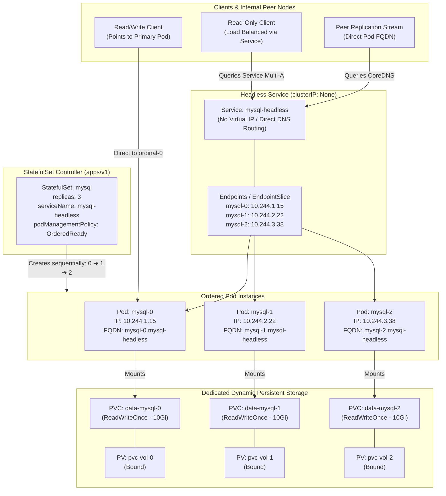
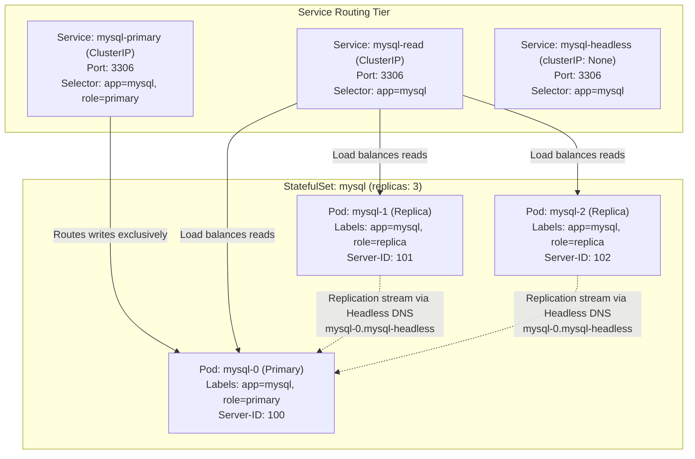
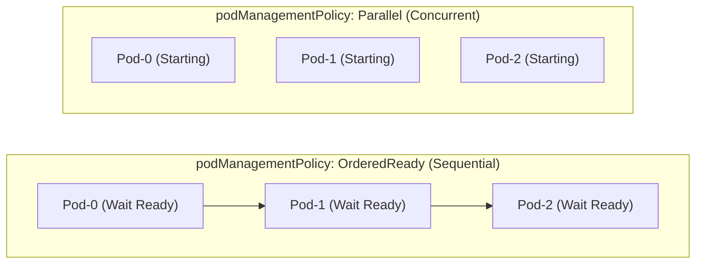
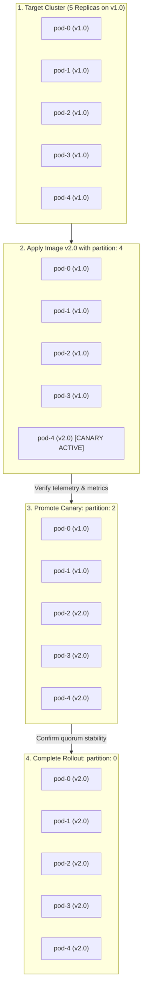

# Exercise 07 — StatefulSet Deployment

> Related: [README — Workloads and Scheduling](../../README.md#domain-1--workloads-and-scheduling-15)

Deploy a stateful application using StatefulSet. This exercise teaches ordered pod initialization, persistent storage, and stable network identities—critical for databases and distributed systems on the CKA.

## Context

StatefulSets are for applications that need:
- Stable, predictable pod names (not randomly generated like Deployments)
- Ordered pod startup and shutdown
- Persistent storage per pod replica
- Stable network identities (DNS names with ordinal suffixes)

Unlike Deployments where pod identity doesn't matter, StatefulSets maintain identity across restarts. Example: a MySQL cluster needs predictable names like `mysql-0`, `mysql-1`, `mysql-2` that survive pod recreations.

## Tasks

1. Create a headless Service for the StatefulSet (required for DNS routing)
2. Create a StatefulSet with 3 replicas using the `nginx:1.28` image
3. Verify pods start in order (mysql-0 first, then mysql-1, then mysql-2)
4. Verify each pod has a persistent volume claim attached
5. Delete a pod and observe it respawn with the same name and storage
6. Scale the StatefulSet up and down using `kubectl scale`
7. Delete the StatefulSet and verify PVCs persist (data survives)

## Hints

<details>
<summary>Stuck? Click to reveal hints</summary>

- Headless Service: set `spec.clusterIP: None` in the Service definition
- StatefulSet pods get DNS names like `nginx-0.nginx.default.svc.cluster.local`
- Use `.spec.serviceName` to reference the headless Service
- `.spec.volumeClaimTemplates` automatically creates a PVC for each replica
- Pod ordinals matter: `mysql-0` runs before `mysql-1` (controlled by `podManagementPolicy: OrderedReady`)
- `k get pvc` will show each pod's persistent claim

</details>

## What tripped me up

> I initially thought StatefulSet worked like Deployment with just named pods. Wrong. When I deleted the Service, the StatefulSet was still there but the pods lost their DNS names. Then I couldn't reach mysql-0 by name from other pods. The headless Service is not optional—it's the foundation for stable identities.
>
> Another gotcha: when you scale down a StatefulSet, pods are terminated in reverse order (mysql-2, then mysql-1, then mysql-0). This is important for graceful shutdown in databases. I scaled down expecting random termination, but it follows the spec.
>
> PVC persistence is real: when you delete the StatefulSet, the PVCs don't automatically delete. If you create a new StatefulSet with the same name and storage class, the pods will bind to their old volumes and recover data. I skipped this step on my first attempt and didn't understand why data persisted.

## Verify

```bash
# Headless Service created
k get svc mysql

# StatefulSet created
k get statefulset

# All 3 pods are Running and in order
k get pods -l app=mysql -o wide

# Each pod has storage
k get pvc

# Persistent DNS names work
k run debug --image=busybox:1.37 --rm -it -- nslookup mysql-0.mysql.default.svc.cluster.local

# Pod names are stable after deletion
k delete pod mysql-1
sleep 5
k get pods
# mysql-1 is recreated with the same name
```

## Cleanup

```bash
# Delete StatefulSet (pods will also be deleted)
k delete statefulset mysql

# Delete headless Service
k delete svc mysql

# Delete PVCs (volumes survive StatefulSet deletion)
k delete pvc --all
```

<details>
<summary>Solution</summary>

Create a headless Service:

```yaml
apiVersion: v1
kind: Service
metadata:
  name: mysql
  labels:
    app: mysql
spec:
  ports:
  - port: 3306
    name: mysql
  clusterIP: None  # This makes it headless
  selector:
    app: mysql
```

Create the StatefulSet:

```yaml
apiVersion: apps/v1
kind: StatefulSet
metadata:
  name: mysql
spec:
  serviceName: mysql
  replicas: 3
  selector:
    matchLabels:
      app: mysql
  template:
    metadata:
      labels:
        app: mysql
    spec:
      containers:
      - name: nginx
        image: nginx:1.28
        ports:
        - containerPort: 3306
          name: mysql
        volumeMounts:
        - name: data
          mountPath: /data
  volumeClaimTemplates:
  - metadata:
      name: data
    spec:
      accessModes: [ "ReadWriteOnce" ]
      resources:
        requests:
          storage: 1Gi
```

Deploy with imperative commands (if needed):

```bash
# Apply the YAML files
kubectl apply -f service.yaml
kubectl apply -f statefulset.yaml

# Watch pods start in order
k get pods -w

# Verify pod identities persist
k get pods -l app=mysql -o custom-columns=NAME:.metadata.name,IP:.status.podIP

# Check PVCs exist
k get pvc

# Test DNS
k run -it --image=busybox:1.37 --rm -- nslookup mysql-0.mysql

# Scale up
k scale statefulset mysql --replicas=4

# Scale down
k scale statefulset mysql --replicas=2
```

</details>

---

## StatefulSet & Headless Service Architecture Deep Dive (English)

### 1. What is a StatefulSet?

A **StatefulSet** (`apps/v1`) is the primary Kubernetes controller designed specifically for managing stateful workloads. In a stateless application (managed by a `Deployment`), individual Pod instances are disposable and interchangeable. If a pod crashes, the ReplicaSet brings up a new pod with an arbitrary hash in its name (e.g., `web-6d7b5f94c8-k9x2w`) and a new dynamic Pod IP. 

For stateful systems such as databases (MySQL, PostgreSQL, MongoDB), distributed consensus algorithms (ZooKeeper, etcd, Raft), and message streaming platforms (Apache Kafka, RabbitMQ), this stateless model breaks down:
- A database follower must know the fixed network address of the primary node.
- A cluster node must retain its local data directory across restarts without relying on slow network remounts.
- Pods must bootstrap sequentially so leader election and schema initialization can complete before worker nodes connect.

StatefulSets solve this by enforcing:
1. **Deterministic Naming**: Every Pod receives a stable ordinal index from $0$ up to $N-1$ (e.g., `mysql-0`, `mysql-1`, `mysql-2`).
2. **Dedicated Storage per Replica**: Each pod replica is paired with its own persistent volume via `volumeClaimTemplates`. When a pod restarts or moves to another node, it reattaches to its exact original storage.
3. **Stable Network Identity**: Paired with a **Headless Service**, each Pod receives a predictable, addressable FQDN that resolves directly to the Pod's current IP address.
4. **Ordered Execution**: Sequential startup (`0 ➔ 1 ➔ 2`) and sequential reverse teardown (`2 ➔ 1 ➔ 0`) by default.



---

### 2. The Headless Service (`clusterIP: None`) Explained

#### Why Does a StatefulSet Need a Headless Service?
Standard Kubernetes Services assign a virtual cluster IP (e.g., `10.96.12.45`). When traffic reaches this virtual IP, `kube-proxy` transparently distributes packets across backend pods using iptables or IPVS connection tracking.

While this load-balancing behavior is ideal for stateless web servers, it breaks distributed databases:
1. In a primary-replica database (e.g., MySQL or PostgreSQL), write queries sent to a random follower will fail with read-only transaction errors. The client must reach the **primary** node directly.
2. In a quorum-based consensus system (e.g., etcd, ZooKeeper, Raft), peer nodes must communicate directly with each other by identity to conduct leader elections, sync logs, and exchange heartbeats.
3. If replica `mysql-1` dies and restarts on a different worker node with a new IP address, peer nodes need a stable DNS hostname that automatically points to the new IP without requiring a cluster-wide restart.

#### What Makes a Service "Headless"?
Setting `.spec.clusterIP: None` suppresses the allocation of a cluster IP. No virtual IP is reserved in the cluster's CIDR, and `kube-proxy` completely ignores the service.

Instead, the Headless Service instructs CoreDNS to return direct DNS `A` / `AAAA` records pointing directly to the Pod IPs backing the service endpoints.

```yaml
apiVersion: v1
kind: Service
metadata:
  name: mysql-headless
  namespace: default
spec:
  clusterIP: None  # <-- Explicitly "None" triggers Headless behavior
  selector:
    app: mysql
  ports:
  - port: 3306
    name: mysql
```

#### The DNS Naming Contract: `hostname` and `subdomain`
When a pod is managed by a StatefulSet with `.spec.serviceName: mysql-headless`:
- The kubelet assigns the Pod's internal hostname matching its ordinal: `hostname = mysql-0`.
- The kubelet assigns the Pod's DNS subdomain matching the service: `subdomain = mysql-headless`.

CoreDNS resolves three distinct record types for this configuration:

| DNS Query Type | Record Format | Example Output / Resolution | Purpose |
| :--- | :--- | :--- | :--- |
| **Direct Pod A Record** | `<pod-name>.<service-name>.<namespace>.svc.<cluster-domain>` | `mysql-0.mysql-headless.default.svc.cluster.local ➔ 10.244.1.15` | Connect directly to a specific node (e.g., primary or specific shard). |
| **Headless Multi-A Record** | `<service-name>.<namespace>.svc.<cluster-domain>` | `mysql-headless.default.svc.cluster.local ➔ [10.244.1.15, 10.244.2.22, 10.244.3.38]` | Node discovery; client libraries obtain the full list of active cluster members. |
| **SRV Record (Port Discovery)** | `_<port-name>._<protocol>.<service-name>.<namespace>.svc.<cluster-domain>` | `_mysql._tcp.mysql-headless.default.svc.cluster.local ➔ 0 33 3306 mysql-0.mysql-headless...` | Discover both hostnames and port numbers dynamically. |

#### The Crucial `publishNotReadyAddresses: true` Parameter
By default, Kubernetes Services remove unready pods from their Endpoints. 

> [!CRITICAL]
> **The Quorum Bootstrapping Deadlock**:
> In distributed consensus systems (ZooKeeper, etcd, MongoDB ReplicaSets), node `0` cannot become `Ready` until it establishes communication with a majority quorum of its peers (`node-1` and `node-2`).
>
> If `publishNotReadyAddresses: false` (the default), CoreDNS will **not return any DNS records** for `node-0`, `node-1`, or `node-2` because their readiness probes have not passed yet. The nodes cannot resolve each other's hostnames, so they cannot form a quorum, so their readiness probes never pass!
>
> To break this circular deadlock, set `publishNotReadyAddresses: true` on your Headless Service:

```yaml
apiVersion: v1
kind: Service
metadata:
  name: zookeeper-headless
spec:
  clusterIP: None
  publishNotReadyAddresses: true  # CRITICAL: Exposes DNS before readiness probes pass
  selector:
    app: zookeeper
  ports:
  - port: 2888
    name: peer
  - port: 3888
    name: leader-election
```

---

### 3. Core Specification Fields of StatefulSet

```yaml
apiVersion: apps/v1
kind: StatefulSet
metadata:
  name: database
spec:
  serviceName: "db-headless"                     # Mandatory: Links to Headless Service
  replicas: 3                                    # Desired number of ordinal pods (0, 1, 2)
  podManagementPolicy: OrderedReady              # OrderedReady (default) or Parallel
  minReadySeconds: 10                            # Buffer time before progressing to next pod
  revisionHistoryLimit: 10                       # Number of ControllerRevisions to keep
  updateStrategy:
    type: RollingUpdate
    rollingUpdate:
      partition: 0                               # Canary gate: only pods >= partition update
      maxUnavailable: 1                          # k8s 1.24+: allows parallel rolling updates
  persistentVolumeClaimRetentionPolicy:          # k8s 1.27+ GA: PVC lifecycle control
    whenDeleted: Retain                          # Retain or Delete PVCs when STS is deleted
    whenScaled: Delete                           # Retain or Delete PVCs when scaled down
  selector:
    matchLabels:
      app: database
  template:
    # Pod blueprint
  volumeClaimTemplates:
    # Dedicated storage blueprint per replica
```

#### Detailed Breakdown of Key Fields:

#### A. `podManagementPolicy`: `OrderedReady` vs. `Parallel`
- **`OrderedReady` (Default)**:
  - Pods are created strictly in order: `0` must enter `Running & Ready` before `1` is created.
  - Pods are terminated in strict reverse order: `N-1` is completely stopped and removed before `N-2` begins termination.
  - Required for: Relational databases, primary-replica bootstrapping, consensus systems where order matters.
- **`Parallel`**:
  - All pods are created or terminated simultaneously without waiting for predecessors to become ready.
  - Identities (`app-0`, `app-1`) and dedicated PVCs are still maintained!
  - Ideal for: Elasticsearch data nodes, Cassandra, batch distributed jobs where nodes can initialize independently and cluster convergence happens via application-layer gossip protocols.

#### B. `volumeClaimTemplates` (Dynamic Per-Pod Storage)
Unlike a Deployment where all replicas mount the same PVC (which requires `ReadWriteMany` storage like NFS), a StatefulSet generates an independent PVC for each replica from the template:
$$\text{PVC Name} = \langle\text{volumeClaimTemplate.name}\rangle-\langle\text{statefulset.name}\rangle-\langle\text{ordinal}\rangle$$
- Pod `mysql-0` mounts `data-mysql-0`.
- Pod `mysql-1` mounts `data-mysql-1`.
- If Pod `mysql-1` crashes, dies, or is rescheduled onto a different node, the new `mysql-1` pod **automatically re-attaches to `data-mysql-1`**, ensuring zero data loss.

#### C. `persistentVolumeClaimRetentionPolicy` (k8s v1.27+ GA)
Historically, Kubernetes never deleted PVCs created by StatefulSets. While safe, this led to massive cloud waste during horizontal auto-scaling. The retention policy provides fine-grained declarative control:

```yaml
persistentVolumeClaimRetentionPolicy:
  whenDeleted: Retain  # When StatefulSet is deleted: keep PVCs safe
  whenScaled: Delete   # When scaling down (e.g., 5 -> 3): auto-delete PVCs 4 and 3
```

| Policy Field | Value: `Retain` (Default) | Value: `Delete` |
| :--- | :--- | :--- |
| **`whenDeleted`** | PVCs survive when the StatefulSet is deleted (`kubectl delete statefulset`). Recreating the StatefulSet rebinds old data. | PVCs are automatically garbage collected when the StatefulSet is deleted. |
| **`whenScaled`** | Scaling down (e.g., 5 to 2) leaves `pvc-4`, `pvc-3`, `pvc-2` intact. Scaling back up to 5 rebinds them. | Scaling down immediately deletes the PVCs belonging to terminated ordinals, freeing cloud disk costs. |

---

## Production-Grade StatefulSet Scenarios & Manifests

### Scenario 1: Primary-Replica Database Architecture (MySQL) with Split Routing

In enterprise database clusters, writes must go exclusively to the Primary node (ordinal `0`), while reads can be distributed across read replicas (ordinals `1, 2`). Furthermore, internal MySQL replication requires direct peer-to-peer network communication using predictable server IDs.



#### Production Manifest: Primary-Replica MySQL (`mysql-production.yaml`)

```yaml
apiVersion: v1
kind: ConfigMap
metadata:
  name: mysql-config
  namespace: default
data:
  primary.cnf: |
    [mysqld]
    log-bin=mysql-bin
    innodb_flush_log_at_trx_commit=1
    sync_binlog=1
  replica.cnf: |
    [mysqld]
    super-read-only=1
---
# 1. Headless Service: For stable peer discovery and replication stream
apiVersion: v1
kind: Service
metadata:
  name: mysql-headless
  namespace: default
spec:
  clusterIP: None
  selector:
    app: mysql
  ports:
  - port: 3306
    name: mysql
---
# 2. Primary Write Service: Routes write traffic ONLY to ordinal 0
apiVersion: v1
kind: Service
metadata:
  name: mysql-primary
  namespace: default
spec:
  type: ClusterIP
  selector:
    app: mysql
    role: primary
  ports:
  - port: 3306
    targetPort: 3306
    name: mysql-write
---
# 3. Read Service: Load balances queries across all healthy instances
apiVersion: v1
kind: Service
metadata:
  name: mysql-read
  namespace: default
spec:
  type: ClusterIP
  selector:
    app: mysql
  ports:
  - port: 3306
    targetPort: 3306
    name: mysql-read
---
apiVersion: apps/v1
kind: StatefulSet
metadata:
  name: mysql
  namespace: default
spec:
  serviceName: mysql-headless
  replicas: 3
  podManagementPolicy: OrderedReady
  selector:
    matchLabels:
      app: mysql
  template:
    metadata:
      labels:
        app: mysql
    spec:
      initContainers:
      # Step A: Compute dynamic server-id and assign role based on ordinal
      - name: init-mysql
        image: mysql:8.0
        command:
        - bash
        - -c
        - |
          set -ex
          # Extract ordinal index from hostname (e.g., mysql-0 -> 0)
          [[ $(hostname) =~ -([0-9]+)$ ]] || exit 1
          ORDINAL=${BASH_REMATCH[1]}
          
          # Server ID must be unique in replication topology (100, 101, 102...)
          echo [mysqld] > /mnt/conf.d/server-id.cnf
          echo "server-id=$((100 + $ORDINAL))" >> /mnt/conf.d/server-id.cnf
          
          # Ordinal 0 is primary; others are read-only replicas
          if [[ $ORDINAL -eq 0 ]]; then
            cp /mnt/config-map/primary.cnf /mnt/conf.d/
          else
            cp /mnt/config-map/replica.cnf /mnt/conf.d/
          fi
        volumeMounts:
        - name: conf
          mountPath: /mnt/conf.d
        - name: config-map
          mountPath: /mnt/config-map
      containers:
      - name: mysql
        image: mysql:8.0
        env:
        - name: MYSQL_ROOT_PASSWORD
          value: "ClusterAdminSecr3t!"
        ports:
        - containerPort: 3306
          name: mysql
        volumeMounts:
        - name: data
          mountPath: /var/lib/mysql
        - name: conf
          mountPath: /etc/mysql/conf.d
        resources:
          requests:
            cpu: 250m
            memory: 512Mi
          limits:
            cpu: 1000m
            memory: 1Gi
        livenessProbe:
          exec:
            command: ["mysqladmin", "ping", "-pClusterAdminSecr3t!"]
          initialDelaySeconds: 30
          periodSeconds: 10
          timeoutSeconds: 5
        readinessProbe:
          exec:
            command: ["mysql", "-h", "127.0.0.1", "-pClusterAdminSecr3t!", "-e", "SELECT 1"]
          initialDelaySeconds: 15
          periodSeconds: 5
          timeoutSeconds: 2
      volumes:
      - name: conf
        emptyDir: {}
      - name: config-map
        configMap:
          name: mysql-config
  volumeClaimTemplates:
  - metadata:
      name: data
    spec:
      accessModes: [ "ReadWriteOnce" ]
      resources:
        requests:
          storage: 10Gi
```

---

### Scenario 2: Distributed Quorum & Consensus Cluster (ZooKeeper / Kafka / etcd)

Distributed consensus algorithms (Paxos, Raft, Zab) require an odd number of replicas ($2N+1$) to survive $N$ node failures. Key technical challenges in Kubernetes:
1. Nodes must not run on the same physical worker node to survive rack/node failure.
2. Nodes must discover peers before entering `Ready` state.
3. Every node needs an integer ID (e.g., `myid = 1, 2, 3`).

#### Production Manifest: ZooKeeper Quorum (`zookeeper.yaml`)

```yaml
apiVersion: v1
kind: Service
metadata:
  name: zk-headless
  namespace: default
spec:
  clusterIP: None
  publishNotReadyAddresses: true  # CRITICAL: Allows peer handshake prior to readiness
  selector:
    app: zookeeper
  ports:
  - port: 2888
    name: peer
  - port: 3888
    name: leader-election
  - port: 2181
    name: client
---
apiVersion: apps/v1
kind: StatefulSet
metadata:
  name: zk
  namespace: default
spec:
  serviceName: zk-headless
  replicas: 3
  podManagementPolicy: Parallel   # ZooKeeper nodes handle their own quorum sync
  selector:
    matchLabels:
      app: zookeeper
  template:
    metadata:
      labels:
        app: zookeeper
    spec:
      affinity:
        # High Availability: Ensure replicas are distributed across distinct physical nodes
        podAntiAffinity:
          requiredDuringSchedulingIgnoredDuringExecution:
          - labelSelector:
              matchExpressions:
              - key: app
                operator: In
                values: ["zookeeper"]
            topologyKey: "kubernetes.io/hostname"
      initContainers:
      - name: init-myid
        image: busybox:1.37
        command:
        - sh
        - -c
        - |
          # Calculate myid: zk-0 -> 1, zk-1 -> 2, zk-2 -> 3
          ORDINAL=$(hostname | awk -F'-' '{print $NF}')
          echo "$((ORDINAL + 1))" > /data/myid
        volumeMounts:
        - name: zk-data
          mountPath: /data
      containers:
      - name: zookeeper
        image: zookeeper:3.9.2
        ports:
        - containerPort: 2181
          name: client
        - containerPort: 2888
          name: peer
        - containerPort: 3888
          name: leader-election
        env:
        - name: ZOO_SERVERS
          value: "server.1=zk-0.zk-headless:2888:3888;2181 server.2=zk-1.zk-headless:2888:3888;2181 server.3=zk-2.zk-headless:2888:3888;2181"
        - name: ZOO_MY_ID
          valueFrom:
            fieldRef:
              fieldPath: metadata.name
        volumeMounts:
        - name: zk-data
          mountPath: /data
        resources:
          requests:
            cpu: 100m
            memory: 256Mi
          limits:
            cpu: 500m
            memory: 512Mi
        readinessProbe:
          exec:
            command: ["sh", "-c", "echo ruok | nc 127.0.0.1 2181 | grep imok"]
          initialDelaySeconds: 10
          periodSeconds: 5
  volumeClaimTemplates:
  - metadata:
      name: zk-data
    spec:
      accessModes: [ "ReadWriteOnce" ]
      resources:
        requests:
          storage: 5Gi
```

---

### Scenario 3: Sharded Distributed Store with `Parallel` Pod Management

In systems like **Elasticsearch**, **ClickHouse**, or **MongoDB Shards**, nodes communicate over a cluster discovery bus. If 20 nodes restart after a power outage or maintenance, `OrderedReady` would force sequential startup—taking over an hour.

Using `podManagementPolicy: Parallel` starts all 20 nodes concurrently while retaining deterministic hostnames (`es-0` through `es-19`) and dedicated storage bindings.



#### Production Manifest: Parallel Distributed Store (`elasticsearch-data.yaml`)

```yaml
apiVersion: v1
kind: Service
metadata:
  name: es-transport
  namespace: default
spec:
  clusterIP: None
  selector:
    app: elasticsearch
  ports:
  - port: 9300
    name: transport
---
apiVersion: apps/v1
kind: StatefulSet
metadata:
  name: es-data
  namespace: default
spec:
  serviceName: es-transport
  replicas: 3
  podManagementPolicy: Parallel  # CRITICAL: Rapid concurrent initialization
  selector:
    matchLabels:
      app: elasticsearch
  template:
    metadata:
      labels:
        app: elasticsearch
    spec:
      terminationGracePeriodSeconds: 120  # Allow 2 minutes for memory buffer flush
      containers:
      - name: elasticsearch
        image: elasticsearch:8.15.0
        ports:
        - containerPort: 9200
          name: http
        - containerPort: 9300
          name: transport
        lifecycle:
          preStop:
            exec:
              command:
              - sh
              - -c
              - |
                # Gracefully flush dirty in-memory pages to persistent storage before SIGTERM
                curl -X POST "http://localhost:9200/_flush/synced" || true
        volumeMounts:
        - name: storage
          mountPath: /usr/share/elasticsearch/data
  volumeClaimTemplates:
  - metadata:
      name: storage
    spec:
      accessModes: [ "ReadWriteOnce" ]
      resources:
        requests:
          storage: 50Gi
```

---

### Scenario 4: Phased Canary Rolling Upgrades with `partition: N`

Updating stateful databases with standard rolling updates poses high risk. If a new schema or binary has a subtle bug, an automatic rollout could update all nodes sequentially, corrupting the entire cluster before engineers can intervene.

The `partition` parameter provides a declarative **Canary Gate**:
$$\text{Update Condition: A pod is updated if and only if: } \text{Ordinal} \ge \text{partition}$$



#### Step-by-Step Canary Upgrade Procedure:

1. **Inspect current 5-replica StatefulSet running `redis:7.2`**:
   ```bash
   kubectl get pods -l app=redis -o custom-columns=NAME:.metadata.name,IMAGE:.spec.containers[0].image
   # redis-0 -> redis:7.2
   # redis-1 -> redis:7.2
   # redis-2 -> redis:7.2
   # redis-3 -> redis:7.2
   # redis-4 -> redis:7.2
   ```

2. **Trigger Canary on Pod `redis-4` only (`partition: 4`)**:
   ```bash
   kubectl patch statefulset redis --type='json' -p='[
     {"op": "replace", "path": "/spec/updateStrategy/rollingUpdate/partition", "value": 4},
     {"op": "replace", "path": "/spec/template/spec/containers/0/image", "value": "redis:7.4"}
   ]'
   ```
   *Behavior*: The controller terminates only `redis-4` and brings it up on `redis:7.4`. Pods `0, 1, 2, 3` remain untouched on `redis:7.2`.

3. **Verify Canary Health & Telemetry**:
   Monitor logs, latency, and query errors on `redis-4.redis-headless`.

4. **Progressively advance the rollout (`partition: 2`)**:
   ```bash
   kubectl patch statefulset redis --type='json' -p='[
     {"op": "replace", "path": "/spec/updateStrategy/rollingUpdate/partition", "value": 2}
   ]'
   ```
   *Behavior*: Pods `redis-3` and `redis-2` are sequentially updated in reverse order (`3` then `2`).

5. **Complete Full Rollout (`partition: 0`)**:
   ```bash
   kubectl patch statefulset redis --type='json' -p='[
     {"op": "replace", "path": "/spec/updateStrategy/rollingUpdate/partition", "value": 0}
   ]'
   ```
   *Behavior*: `redis-1` and `redis-0` update. The entire cluster is now running `redis:7.4`.

---

### Scenario 5: Managing PVC Lifecycle with `persistentVolumeClaimRetentionPolicy`

In cloud environments (AWS, GCP, Azure), auto-scaling a StatefulSet from 10 down to 2 replicas without a retention policy leaves 8 cloud disks allocated and accumulating storage costs.

```yaml
apiVersion: apps/v1
kind: StatefulSet
metadata:
  name: cache-node
  namespace: default
spec:
  serviceName: cache-headless
  replicas: 5
  # Declarative cleanup configuration:
  persistentVolumeClaimRetentionPolicy:
    whenDeleted: Retain  # If StatefulSet is deleted, RETAIN data for safety
    whenScaled: Delete   # If replicas decrease, DELETE unneeded PVCs to stop billing
  selector:
    matchLabels:
      app: cache
  template:
    metadata:
      labels:
        app: cache
    spec:
      containers:
      - name: redis
        image: redis:7.4-alpine
        volumeMounts:
        - name: appendonly
          mountPath: /data
  volumeClaimTemplates:
  - metadata:
      name: appendonly
    spec:
      accessModes: [ "ReadWriteOnce" ]
      storageClassName: standard
      resources:
        requests:
          storage: 20Gi
```

#### How Kubernetes Evaluates Retention:
- **`whenScaled: Delete`**: When you run `kubectl scale statefulset cache-node --replicas=3`, pods `cache-node-4` and `cache-node-3` are terminated. As soon as each pod completes termination, the StatefulSet controller issues a garbage collection call to delete `appendonly-cache-node-4` and `appendonly-cache-node-3`.
- **`whenDeleted: Retain`**: If someone executes `kubectl delete statefulset cache-node`, the pods terminate, but the remaining PVCs (`appendonly-cache-node-0`, `1`, `2`) are preserved intact.

---

### Scenario 6: Node Failure, Network Partitions & The Split-Brain Dilemma

Understanding how StatefulSets respond to worker node failures is vital for production operations and a classic CKA troubleshooting concept.

#### Why StatefulSets Do NOT Automatically Reschedule Pods
If a worker node crashes or experiences a network partition, the node controller marks it `NotReady`. In a Deployment, pods on that node are evicted after 5 minutes (`pod-eviction-timeout`) and scheduled onto healthy nodes.

**In a StatefulSet, the control plane will NOT automatically recreate the pod on another node.**

> [!CAUTION]
> **The Danger of Split-Brain & Data Corruption**:
> The master node cannot distinguish between:
> 1. A node that has completely powered off.
> 2. A node that is still running, but has temporarily lost network connectivity to the API server.
>
> If Kubernetes automatically spun up a replacement `mysql-0` on another node and attached the same storage volume, **two instances of `mysql-0` would be writing to the same disk simultaneously**, corrupting the file system and database transactions beyond repair.

#### The Safe Recovery Procedure for Stuck `Terminating` Pods:
If you manually delete a pod on an unreachable node (`kubectl delete pod mysql-0`), it stays stuck in `Terminating` status waiting for the kubelet to acknowledge volume detachment.

**Step 1: Verify the physical node is genuinely shut down or powered off.**

**Step 2: Apply the `out-of-service` taint (Kubernetes v1.26+ Standard)**:
Instead of unsafe force-deletion, taint the dead node to safely signal shutdown to the StatefulSet controller:
```bash
kubectl taint nodes <node-name> node.kubernetes.io/out-of-service=nodeshutdown:NoExecute
```
*Effect*: The StatefulSet controller safely detaches the `VolumeAttachment`, terminates the stuck pod, and allows the replacement pod to start on an available healthy node without risk of split-brain!

---

## Comparison Matrix: Deployment vs. StatefulSet

| Dimension | Deployment (`apps/v1`) | StatefulSet (`apps/v1`) |
| :--- | :--- | :--- |
| **Primary Workload** | Stateless (Web APIs, microservices, proxies) | Stateful (Databases, brokers, distributed storage) |
| **Pod Identifiers** | Ephemeral, random hash (`web-5d64-a1b2c`) | Deterministic ordinal sequence (`db-0`, `db-1`, `db-2`) |
| **Network Identity** | Shared virtual IP (`ClusterIP`) with load balancing | Individual DNS per pod via **Headless Service** (`clusterIP: None`) |
| **Storage Binding** | Shared volume (`ReadWriteMany`) or ephemeral storage | Dedicated volume per pod (`volumeClaimTemplates`), persists across restarts |
| **Initialization Order** | Parallel concurrent startup (uncontrolled) | Sequential `0 ➔ 1 ➔ 2` (or configurable via `Parallel`) |
| **Teardown Order** | Random / based on node allocation | Strict reverse order `2 ➔ 1 ➔ 0` |
| **Rolling Update** | RollingUpdate with `maxSurge` / `maxUnavailable` | RollingUpdate in reverse order with **Canary Partitions** |
| **Scale Down PVC Handling** | N/A (PVCs defined externally) | PVCs retained by default; optional declarative retention policy |

---

## Essential CLI Operations & Troubleshooting Commands

```bash
# 1. Quick skeleton generation for Headless Service:
kubectl create service clusterip my-headless --clusterip="None" --dry-run=client -o yaml > headless.yaml

# 2. View StatefulSets and active generation revisions:
kubectl get statefulset -A
kubectl describe statefulset <name>

# 3. Check PVC bindings and allocated storage:
kubectl get pvc -l app=<label> -o custom-columns=NAME:.metadata.name,STATUS:.status.phase,VOLUME:.spec.volumeName

# 4. View ControllerRevision history (revisions tracked for rollouts):
kubectl get controllerrevisions -l app=<label>

# 5. Check DNS resolution and SRV records from a debug container:
kubectl run dns-debug --image=tianon/toybox --rm -it --restart=Never -- \
  dig SRV _mysql._tcp.mysql-headless.default.svc.cluster.local

# 6. Watch ordered rollout progress:
kubectl rollout status statefulset/<name>

# 7. Restart StatefulSet gracefully (restarts in reverse order: N-1 down to 0):
kubectl rollout restart statefulset/<name>

# 8. Undo a failed rollout:
kubectl rollout undo statefulset/<name>
```

---

## CKA Exam Golden Tips & Common Traps

1. **The `clusterIP: None` Syntax**:
   In the exam, when asked to create a headless service, ensure `clusterIP` is spelled with exact camelCase and set to `None` (case-sensitive string). Do not leave it empty or set to `""`.
2. **`serviceName` Must Match Headless Service**:
   The StatefulSet's `.spec.serviceName` must match the `metadata.name` of your headless service. If they do not match, the pods will create, but they will not receive DNS hostnames, failing exam validation scripts!
3. **`volumeClaimTemplates` Immutability**:
   You cannot modify `volumeClaimTemplates` after creation. If a question asks you to adjust storage size or storageClassName, you must delete the StatefulSet (`kubectl delete statefulset <name>`) and reapply the YAML.
4. **PVCs Are Not Cleaned Up Automatically**:
   If an exam question asks you to "clean up all resources created for the statefulset", remember that running `kubectl delete statefulset <name>` leaves the PVCs intact. You **must explicitly run** `kubectl delete pvc -l app=<name>`.
5. **Scale Down Waits for Graceful Termination**:
   If you scale down a StatefulSet, pod `N-1` must fully terminate before pod `N-2` begins shutting down. If a container has a long `terminationGracePeriodSeconds`, do not panic—it is following the specification.

---

## తెలుగు వివరణ (Telugu Explanation)

### నిజ జీవిత ఉదాహరణలు (Real-World Analogies)

* **Deployment (డిప్లాయ్‌మెంట్) vs StatefulSet (స్టేట్‌ఫుల్ సెట్)**:
  - **Deployment**: ఒక ఆర్టీసీ బస్సు లేదా సినిమా హాల్‌లోని జనరల్ టికెట్ లాంటిది. అక్కడ సీటు నంబర్లు ఉండవు. ఒక వ్యక్తి వెళ్ళిపోతే ఆ స్థానంలో ఎవరైనా కూర్చోవచ్చు (Interchangeable). ఎవరికీ ప్రత్యేక గుర్తింపు ఉండదు.
  - **StatefulSet**: ఒక కాలేజీ క్లాస్‌రూమ్‌లో **రోల్ నంబర్లు (`0, 1, 2`)** మరియు బ్యాంక్‌లోని **సొంత లాకర్ (Dedicated PVC)** లాంటిది. ఒక విద్యార్థి సెలవు పెట్టి మరుసటి రోజు వచ్చినా, అతని రోల్ నంబర్ మారదు, అతని లాకర్ తాళం అతని వద్దే ఉంటుంది.
* **Headless Service (హెడ్‌లెస్ సర్వీస్)**:
  - సాధారణ సర్వీస్ అనేది ఒక కంపెనీ రిసెప్షనిస్ట్ లాంటిది. మీరు ఫోన్ చేస్తే రిసెప్షనిస్ట్ ఏదో ఒక ఉద్యోగికి కనెక్ట్ చేస్తారు (Load Balancing).
  - హెడ్‌లెస్ సర్వీస్ అనేది ప్రతి ఉద్యోగికి నేరుగా ఇచ్చే **డైరెక్ట్ ఫోన్ ఎక్స్‌టెన్షన్ నంబర్** లాంటిది. మీరు డైరెక్ట్‌గా మేనేజర్ (`mysql-0`) తోనే మాట్లాడాలనుకుంటే ఈ నంబర్ ద్వారా మాత్రమే సాధ్యం.

---

### 1. StatefulSet అంటే ఏమిటి?
కుబెర్‌నెటిస్‌లో డేటాబేస్‌లు (MySQL, PostgreSQL, MongoDB) మరియు మెసేజ్ బ్రోకర్లు (Kafka, RabbitMQ) వంటి డేటాను భద్రపరిచే అప్లికేషన్లను నడపడానికి ఉపయోగించే కంట్రోలర్.

దీని ముఖ్య లక్షణాలు:
1. **నిర్దిష్టమైన పేర్లు (Predictable Names)**: Pod పేర్లు రాండమ్‌గా ఉండవు. `mysql-0`, `mysql-1`, `mysql-2` అనే స్థిరమైన పేర్లు ఉంటాయి.
2. **వరుస క్రమం (Ordered Lifecycle)**:
   - స్టార్ట్ అయ్యేటప్పుడు: మొదట `mysql-0` పూర్తిగా స్టార్ట్ అయి రెడీ అయ్యాకే `mysql-1` స్టార్ట్ అవుతుంది.
   - ఆపేటప్పుడు: రివర్స్ ఆర్డర్‌లో ఆగుతాయి (`mysql-2` మొదట ఆగుతుంది, ఆ తర్వాతే `mysql-1`).
3. **సొంత స్టోరేజ్ (Dedicated Storage)**: `volumeClaimTemplates` ద్వారా ప్రతి Pod కి ఒక ప్రత్యేకమైన PVC ఆటోమేటిక్‌గా అటాచ్ అవుతుంది. ఒకవేళ `mysql-1` క్రాష్ అయినా, కొత్తగా వచ్చే `mysql-1` పాత `data-mysql-1` స్టోరేజ్‌కే తిరిగి బైండ్ అవుతుంది (డేటా నష్టపోదు).

---

### 2. Headless Service (`clusterIP: None`) ఎందుకు తప్పనిసరి?
సాధారణ సర్వీస్‌లలో ఒక వర్చువల్ క్లస్టర్ IP ఉంటుంది, అది ట్రాఫిక్‌ను రాండమ్‌గా అన్ని Pods కి పంపుతుంది. కానీ డేటాబేస్‌లలో:
- డేటాను రాయడానికి (Write Query) తప్పనిసరిగా **ప్రైమరీ/మాస్టర్ Pod (`mysql-0`)** తోనే మాట్లాడాలి.
- క్లస్టర్ నోడ్స్ తమలో తాము ఓట్లు వేసుకోవడానికి (Quorum/Leader Election) ఒకదానితో ఒకటి నేరుగా మాట్లాడుకోవాలి.

అందుకే `clusterIP: None` అని పెట్టి హెడ్‌లెస్ సర్వీస్ తయారుచేస్తారు. దీనివల్ల CoreDNS ప్రతి Pod కి ఒక స్థిరమైన DNS చిరునామాను ఇస్తుంది:
$$\text{DNS}: \text{mysql-0}.\text{mysql-headless}.\text{default}.\text{svc}.\text{cluster}.\text{local}$$

> [!IMPORTANT]
> StatefulSet లోని `spec.serviceName` మరియు Headless Service యొక్క `metadata.name` రెండూ **ఖచ్చితంగా ఒకే పేరుతో** ఉండాలి. లేదంటే Pods కి DNS పేర్లు రావు.

---

### 3. `volumeClaimTemplates` మరియు PVC భద్రత
- డిప్లాయ్‌మెంట్‌లో అన్ని Pods ఒకే స్టోరేజ్‌ను వాడుకోవాలి.
- StatefulSet లో ప్రతి Pod కి ఒక ప్రత్యేకమైన డిస్క్ వస్తుంది.
- **CKA ముఖ్యమైన రూల్**: మీరు StatefulSet ని డిలీట్ చేసినా, దాని **PVC లు మాత్రం డిలీట్ కావు!** డేటా పోకుండా ఉండటానికి కుబెర్‌నెటిస్ ఈ జాగ్రత్త తీసుకుంది. క్లౌడ్ ఖర్చులు తగ్గించుకోవాలంటే `kubectl delete pvc` అని మాన్యువల్‌గా డిలీట్ చేయాలి.

---

### 4. `partition` తో సేఫ్ కెనరీ అప్‌డేట్స్
StatefulSet లో డేటాబేస్ వెర్షన్ అప్‌గ్రేడ్ చేసేటప్పుడు రిస్క్ తీసుకోకుండా `partition` వాడతారు.
- ఉదాహరణకు 5 Pods (`0, 1, 2, 3, 4`) ఉన్నప్పుడు, `partition: 4` అని పెడితే కేవలం చివరి Pod (`mysql-4`) మాత్రమే కొత్త వెర్షన్‌కి మారుతుంది.
- మిగతా `0, 1, 2, 3` పాత వెర్షన్‌లోనే సురక్షితంగా నడుస్తాయి.
- `mysql-4` సరిగ్గా పనిచేస్తుందని నిర్ధారించుకున్నాక, `partition: 0` చేస్తే మిగిలిన Pods అన్నీ నిదానంగా అప్‌డేట్ అవుతాయి.

---

### 5. CKA పరీక్షలో గుర్తుంచుకోవాల్సిన గోల్డెన్ టిప్స్
1. హెడ్‌లెస్ సర్వీస్‌కి `clusterIP: None` అని రాయాలి (`None` లో 'N' క్యాపిటల్ ఉండాలి).
2. `serviceName` మిస్ అయితే Pod DNS పనిచేయదు.
3. StatefulSet లోని `volumeClaimTemplates` ని ఎడిట్ చేయలేము (**Immutable**). మార్చాలంటే పాతది డిలీట్ చేసి మళ్లీ క్రియేట్ చేయాలి.
4. స్కేల్ డౌన్ చేసేటప్పుడు పెద్ద నంబర్ ఉన్న Pod మొదట డిలీట్ అవుతుంది (`mysql-2` ➔ `mysql-1`).
