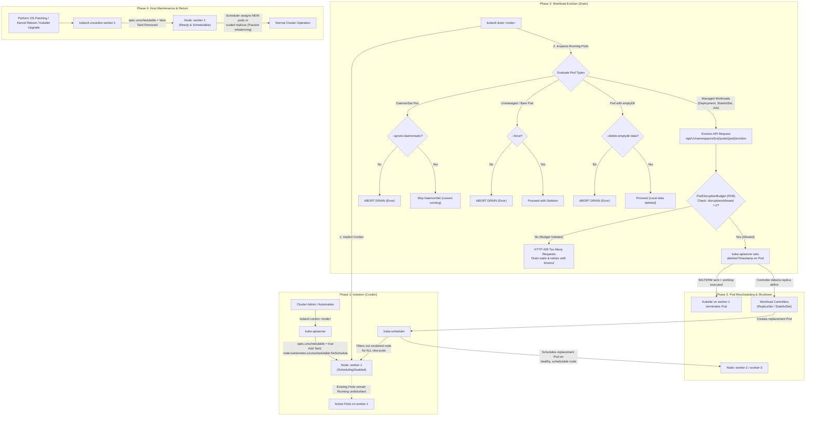
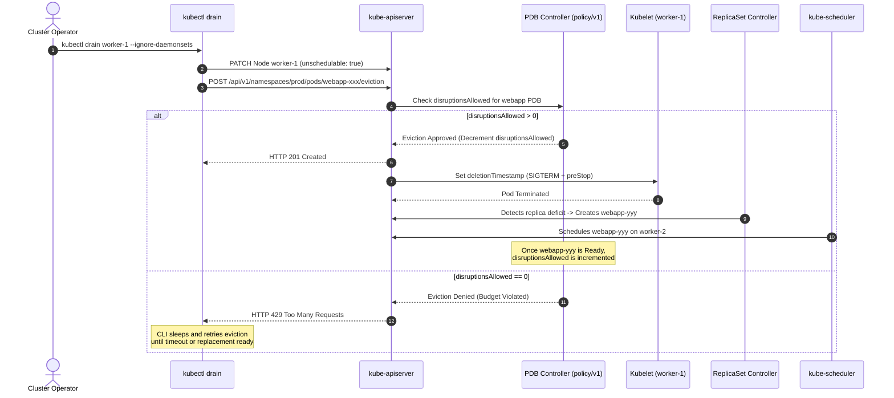
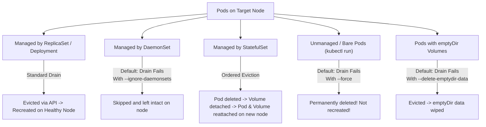
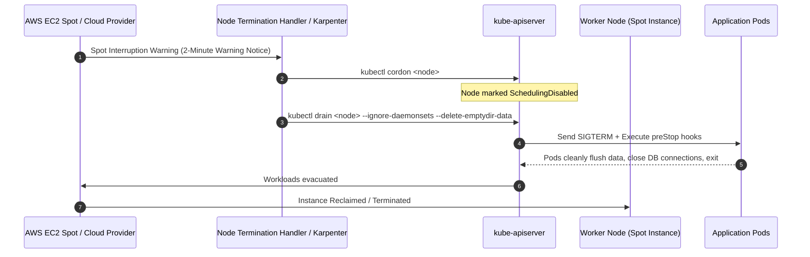
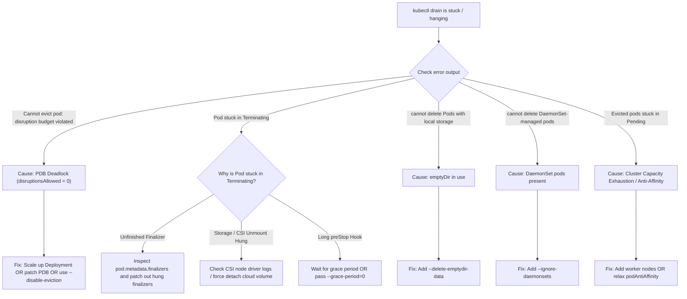
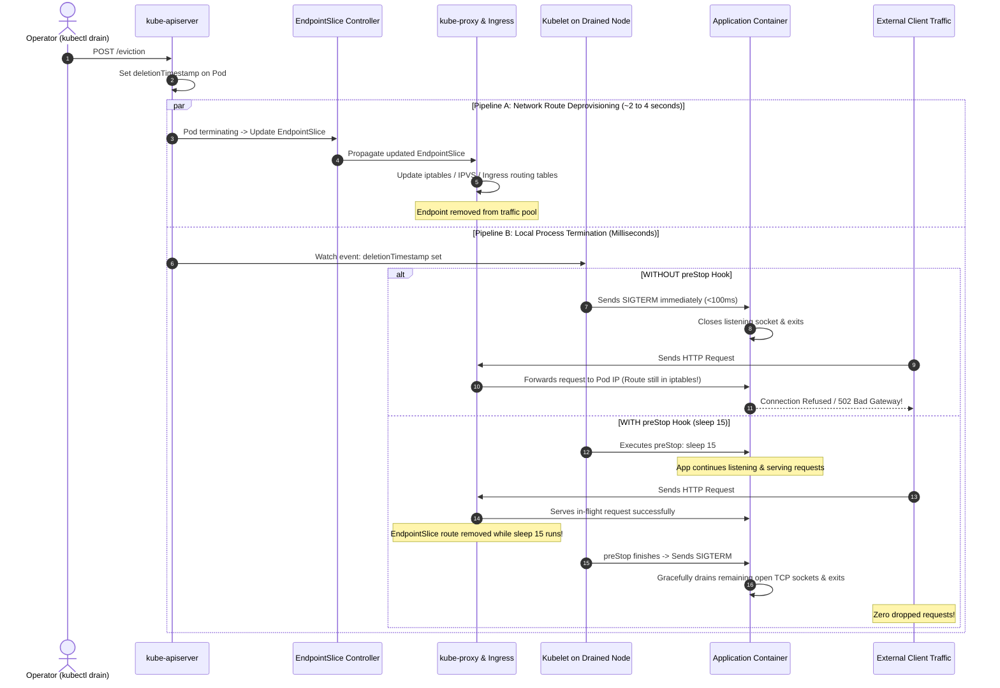
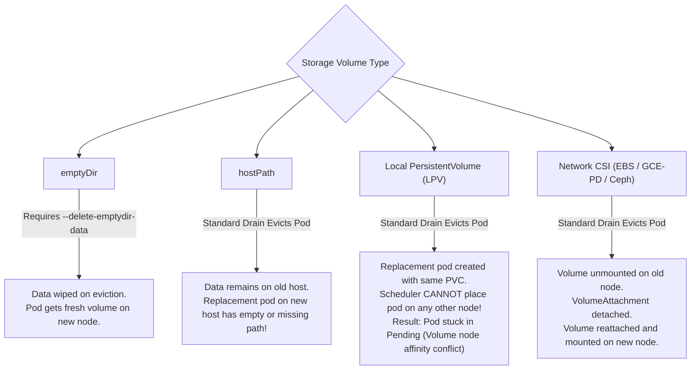
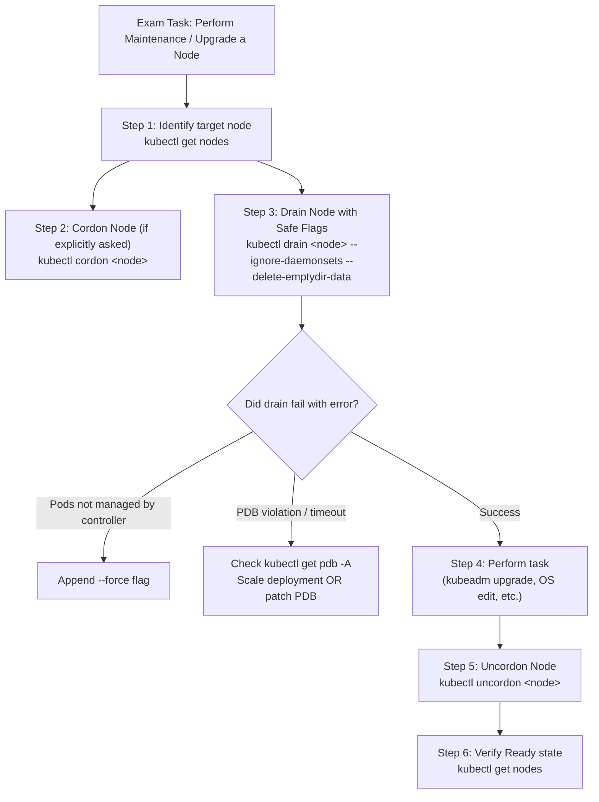

# Exercise 08 — Node Drain and Cordon

> Related: [README — Cluster Architecture](../../README.md#domain-4--cluster-architecture-installation--configuration-25)

Drain a worker node for maintenance, then bring it back. This tests your understanding of pod eviction, DaemonSets, and scheduling.

## Tasks

1. List all nodes and identify a worker node
2. Cordon the worker node (mark it unschedulable)
3. Verify the node shows `SchedulingDisabled`
4. Create a Deployment with 3 replicas and observe where pods are scheduled
5. Drain the worker node — handle DaemonSets and local data
6. Verify all non-DaemonSet pods have been evicted from the node
7. Uncordon the node
8. Scale the deployment to 6 replicas and verify pods get scheduled on the uncordoned node

## Hints

<details>
<summary>Stuck? Click to reveal hints</summary>

You honestly don't need hints for this one. `k drain --help` tells you everything. The two flags you always need are `--ignore-daemonsets` and `--delete-emptydir-data`.

</details>

## What tripped me up

> I ran `k drain worker-1` without `--ignore-daemonsets` and it failed immediately. The error message is long and mentions DaemonSet-managed pods, but I didn't read it carefully — I just thought drain was broken. Always use `--ignore-daemonsets --delete-emptydir-data`. Every time. No exceptions.
>
> Subtle one: `k cordon` marks the node unschedulable but does NOT evict existing pods. I cordoned a node thinking it would move pods off it, then spent 5 minutes wondering why pods were still there. Cordon = "don't schedule new pods here." Drain = "evict everything and cordon."

## Verify

```bash
# After cordon
k get nodes
# Worker should show SchedulingDisabled

# After drain
k get pods -o wide
# No pods on the drained node (except DaemonSets)

# After uncordon + scale
k get pods -o wide
# Pods should spread across nodes again
```

## Cleanup

```bash
k uncordon <node-name>
k delete deployment drain-test
```

<details>
<summary>Solution</summary>

```bash
# List nodes
k get nodes
# Pick a worker node, e.g., worker-1

# Cordon
k cordon worker-1
k get nodes
# worker-1 should show SchedulingDisabled

# Create deployment
k create deployment drain-test --image=nginx:1.27 --replicas=3

# Check pod placement
k get pods -o wide

# Drain
k drain worker-1 --ignore-daemonsets --delete-emptydir-data

# Verify eviction
k get pods -o wide
# All drain-test pods should be on other nodes

# Check node
k get pods -A --field-selector spec.nodeName=worker-1
# Only DaemonSet pods should remain

# Uncordon
k uncordon worker-1
k get nodes
# worker-1 should be Ready (no SchedulingDisabled)

# Scale up — new pods should land on worker-1 too
k scale deployment drain-test --replicas=6
k get pods -o wide
```

</details>

---

## Node Maintenance, Drain, Cordon, Eviction & Scheduling Deep Dive

In production Kubernetes clusters, worker nodes regularly undergo routine maintenance: Linux kernel updates, security patching, hardware upgrades, Kubernetes version upgrades via `kubeadm`, or cloud instance resizing and autoscaling consolidation. 

Performing maintenance without taking down production applications requires mastering three tightly coupled mechanisms:
1. **Node Cordoning** (`kubectl cordon`): Prevents the scheduler from assigning new pods to a node.
2. **Node Draining** (`kubectl drain`): Safely evicts running workloads via the Kubernetes Eviction API while respecting availability guarantees.
3. **Node Uncordoning** (`kubectl uncordon`): Restores the node to an active scheduling state once maintenance is complete.

---

### 1. Architectural Workflow: The Node Maintenance Lifecycle



---

### 2. Core Concepts & Deep Technical Definitions

#### 2.1 Node Cordon (`kubectl cordon`)
* **Definition**: An imperative command that modifies a Node resource to mark it **unschedulable**.
* **Under-the-Hood Mechanism**:
  1. `kubectl cordon <node-name>` sends a `PATCH` request to the Kubernetes API server updating the node specification:
     ```json
     { "spec": { "unschedulable": true } }
     ```
  2. The Node Controller automatically adds a system taint:
     ```yaml
     taints:
     - key: node.kubernetes.io/unschedulable
       effect: NoSchedule
     ```
  3. When `kube-scheduler` filters candidate nodes for pending pods during its `NodeUnschedulable` and `NodeResourcesFit` filtering plugins, any node with `spec.unschedulable: true` is immediately eliminated—unless the incoming pod has an explicit toleration for `node.kubernetes.io/unschedulable`.
* **Node Status Display**: `kubectl get nodes` displays `SchedulingDisabled` in the `STATUS` column next to `Ready`.
* **Crucial Rule**: Cordoning affects **only future scheduling decisions**. It does **not** stop, terminate, evict, or relocate any pod currently running on that node.

```bash
# Imperative Cordon
kubectl cordon worker-1

# View node status showing SchedulingDisabled
kubectl get node worker-1
# NAME       STATUS                     ROLES    AGE   VERSION
# worker-1   Ready,SchedulingDisabled   <none>   14d   v1.31.0

# Declarative equivalent via JSON patch
kubectl patch node worker-1 -p '{"spec":{"unschedulable":true}}'
```

---

#### 2.2 Node Uncordon (`kubectl uncordon`)
* **Definition**: Reverses the cordoned state, making the node available again for new pod assignments.
* **Under-the-Hood Mechanism**:
  1. Sends a `PATCH` request setting:
     ```json
     { "spec": { "unschedulable": null } }
     ```
  2. The `node.kubernetes.io/unschedulable:NoSchedule` taint is removed.
  3. The `SchedulingDisabled` status is cleared, returning the node to `Ready`.
* **The "Passive Scheduler" Principle**:
  > [!IMPORTANT]
  > **Uncordoning does NOT move existing pods back to the node.**
  > The Kubernetes `kube-scheduler` is an event-driven scheduler that acts only when a pod is created or updated in the pending queue. It does **not** proactively rebalance or relocate existing, healthy running pods from other nodes back onto an uncordoned node. To rebalance workloads, you must either scale workloads, perform a rolling restart, or run the **Kubernetes Descheduler**.

```bash
# Imperative Uncordon
kubectl uncordon worker-1

# Declarative equivalent via JSON patch
kubectl patch node worker-1 -p '{"spec":{"unschedulable":false}}'
```

---

#### 2.3 Node Drain (`kubectl drain`)
* **Definition**: An administrative command that safely cordons a node and evicts all eligible pods running on it so the underlying host can be taken offline for maintenance without service interruption.
* **Drain Orchestration Sequence**:
  1. **Implicit Cordon**: Draining immediately cordons the node first. If eviction subsequently fails or is canceled, the node remains cordoned to prevent new pods from arriving.
  2. **Pod Inventory & Safety Validation**: Scans all pods on the node and checks for blocking conditions:
     - Are there DaemonSet-managed pods? (Requires `--ignore-daemonsets`)
     - Are there pods with local `emptyDir` volumes? (Requires `--delete-emptydir-data`)
     - Are there unmanaged / bare pods? (Requires `--force`)
  3. **Eviction Request Execution**: Rather than calling `DELETE /api/v1/namespaces/{ns}/pods/{pod}`, `kubectl drain` invokes the **Pod Eviction Subresource API** (`POST /api/v1/namespaces/{ns}/pods/{pod}/eviction`).
  4. **PodDisruptionBudget (PDB) Compliance**: The API server queries any matching PDBs. If evicting a pod would violate its PDB, the request is rejected with `HTTP 429 Too Many Requests`. The drain process waits and retries until the budget recovers or `--timeout` is reached.
  5. **Graceful Pod Termination**: Kubelet sends a `SIGTERM` signal to the container processes, executes `preStop` lifecycle hooks, and waits up to `terminationGracePeriodSeconds` before issuing a `SIGKILL`.
  6. **Workload Controller Rescheduling**: Workload controllers (ReplicaSet, StatefulSet, Job) notice that running pod counts are below desired capacity and create replacement pods, which `kube-scheduler` places onto other healthy, schedulable nodes.

---

#### 2.4 Eviction API vs. Direct Pod Deletion vs. Kubelet Eviction

Understanding the difference between the three forms of pod termination in Kubernetes is critical:

| Feature / Behavior | Pod Eviction API (`POST .../eviction`) | Direct Pod Deletion (`kubectl delete pod`) | Kubelet Node-Pressure Eviction |
| :--- | :--- | :--- | :--- |
| **Initiated By** | `kubectl drain`, Cluster Autoscaler, Karpenter | Admin (`kubectl delete pod`), CI/CD | Kubelet daemon on the worker node |
| **Trigger Type** | Voluntary disruption | Manual / Administrative | Involuntary disruption (Resource Starvation) |
| **Honors PDBs?** | **YES** (Rejects with HTTP 429 if violated) | **NO** (Bypasses all PDBs immediately) | **NO** (Bypasses all PDBs) |
| **Graceful Shutdown?** | **YES** (Honors `terminationGracePeriodSeconds`) | **YES** (Unless `--force --grace-period=0`) | **NO** (Zero or minimal grace period: `gracePeriod=0`) |
| **Typical Triggers** | Node maintenance, autoscaler scale-down | Debugging, stuck pods, pipeline scripts | Node OOM (`MemoryPressure`), Disk full (`DiskPressure`) |

---

### 3. Pod Disruption Budgets (PDB) & Eviction Safety

A **PodDisruptionBudget** (`policy/v1`) is an API object that defines how many replicas of a replicated application can be voluntarily disrupted at the same time during administrative operations such as `kubectl drain`.



#### 3.1 PDB Specifications: `minAvailable` vs. `maxUnavailable`
You can configure a PDB using either `minAvailable` or `maxUnavailable` (never both simultaneously):
- `minAvailable`: The minimum number or percentage of pods that **must remain running and Ready** at all times during voluntary disruptions.
- `maxUnavailable`: The maximum number or percentage of pods that can be **unavailable** simultaneously.

#### 3.2 Production Manifest: PodDisruptionBudget

```yaml
apiVersion: policy/v1
kind: PodDisruptionBudget
metadata:
  name: webapp-pdb
  namespace: production
spec:
  # Guarantees at least 2 out of 3 replicas are always Ready during drain
  minAvailable: 2
  selector:
    matchLabels:
      app: webapp
---
apiVersion: policy/v1
kind: PodDisruptionBudget
metadata:
  name: payment-pdb
  namespace: production
spec:
  # Ensures only 1 pod is taken offline at a time
  maxUnavailable: 1
  selector:
    matchLabels:
      app: payment-gateway
```

#### 3.3 The PDB Drain Deadlock (Production Trap)
One of the most common reasons `kubectl drain` freezes in production is a **misconfigured PDB**.

##### The Deadlock Scenario:
Suppose a deployment has `replicas: 1` and a PDB configured with `minAvailable: 1` (or `maxUnavailable: 0`):
1. `kubectl drain` attempts to evict the single pod.
2. The PDB controller checks: `currentReady (1) - 1 = 0`, which is less than `minAvailable: 1`.
3. The API server rejects the eviction request with:
   ```text
   Cannot evict pod as it would violate the pod's disruption budget.
   eviction rate at currently allowed maximum (0 disruptions permitted)
   ```
4. `kubectl drain` retries every few seconds indefinitely until `--timeout` expires.

##### Production Remediation Options:
1. **Scale Up the Workload First** (Best Practice):
   ```bash
   kubectl scale deployment webapp --replicas=2 -n production
   # Wait for the second pod to become Ready, then rerun drain
   ```
2. **Temporarily Patch the PDB**:
   ```bash
   kubectl patch pdb webapp-pdb -n production -p '{"spec":{"maxUnavailable":1}}'
   ```
3. **Emergency Bypass (`--disable-eviction`)**:
   > [!CAUTION]
   > `--disable-eviction` instructs `kubectl drain` to bypass the Eviction API and directly issue HTTP `DELETE` calls to the Pods, **completely ignoring all PDBs**. Only use this in emergencies when a node must be evacuated immediately.
   ```bash
   kubectl drain worker-1 --ignore-daemonsets --delete-emptydir-data --disable-eviction
   ```

---

### 4. DaemonSets and the `--ignore-daemonsets` Mandate

#### 4.1 What is a DaemonSet and Why is It Unique?
A **DaemonSet** (`apps/v1`) ensures that a copy of a pod runs on all (or targeted) nodes in the cluster. Standard examples include:
- Cluster Networking (CNI): `cilium`, `calico-node`, `aws-node`, `kube-flannel`
- Storage Drivers (CSI): `csi-ebs-node`, `ceph-csi-nodeplugin`
- Monitoring & Logging Agents: `node-exporter`, `fluentbit`, `datadog-agent`

#### 4.2 Built-In Tolerations in DaemonSet Pods
When `kubectl drain` marks a node with `spec.unschedulable: true`, the Node Controller adds the taint `node.kubernetes.io/unschedulable:NoSchedule`.

However, the Kubernetes DaemonSet Controller **automatically injects the following toleration** into every DaemonSet pod:
```yaml
tolerations:
- key: node.kubernetes.io/unschedulable
  operator: Exists
  effect: NoSchedule
```

#### 4.3 The Infinite Recreation Paradox
If `kubectl drain` attempted to evict a DaemonSet pod:
1. The DaemonSet pod would terminate.
2. The DaemonSet Controller would immediately detect that `worker-1` is missing its required DaemonSet pod.
3. Because the DaemonSet pod tolerates `node.kubernetes.io/unschedulable`, the scheduler or DaemonSet controller would **immediately recreate the pod on worker-1**.
4. `kubectl drain` would attempt to evict it again, entering an **infinite loop of eviction and recreation**.

To prevent this deadlock, `kubectl drain` halts immediately if it detects DaemonSet pods and requires the explicit flag:
```bash
kubectl drain <node-name> --ignore-daemonsets
```
With this flag, `kubectl drain` simply ignores DaemonSet pods and leaves them running on the node during host maintenance. When the host reboots or powers down, the operating system stops them naturally.

#### 4.4 Production Manifest: DaemonSet with Maintenance Tolerations

```yaml
apiVersion: apps/v1
kind: DaemonSet
metadata:
  name: node-logging-agent
  namespace: kube-system
  labels:
    app: logging-agent
spec:
  selector:
    matchLabels:
      app: logging-agent
  updateStrategy:
    type: RollingUpdate
    rollingUpdate:
      maxUnavailable: 1
  template:
    metadata:
      labels:
        app: logging-agent
    spec:
      # Tolerates cordoned state and master/control-plane taints
      tolerations:
      - key: node.kubernetes.io/unschedulable
        operator: Exists
        effect: NoSchedule
      - key: node-role.kubernetes.io/control-plane
        operator: Exists
        effect: NoSchedule
      containers:
      - name: fluent-bit
        image: fluent/fluent-bit:3.1.8
        resources:
          limits:
            cpu: 200m
            memory: 256Mi
          requests:
            cpu: 50m
            memory: 64Mi
        volumeMounts:
        - name: varlog
          mountPath: /var/log
          readOnly: true
      volumes:
      - name: varlog
        hostPath:
          path: /var/log
```

---

### 5. Workload-Specific Eviction Behaviors & Special Flags

When draining a node, Kubernetes handles different workload types with specific safety boundaries:



#### 5.1 Standalone / Unmanaged Pods (`--force`)
* **What is an unmanaged pod?** A pod created directly (e.g. `kubectl run debug-pod --image=busybox`) without an owning controller (ReplicaSet, StatefulSet, Job, DaemonSet).
* **Why Drain Fails**: Since no controller exists to supervise the pod, evicting it means **it is gone forever**.
* **Drain Flag**: `--force` overrides this safety check:
  ```bash
  kubectl drain worker-1 --ignore-daemonsets --force
  ```
  > [!WARNING]
  > When `--force` deletes unmanaged pods, they are permanently destroyed. Never run unmanaged pods in production environments.

#### 5.2 Ephemeral Local Storage (`emptyDir` and `--delete-emptydir-data`)
* **What is `emptyDir`?** A volume created in the host filesystem under `/var/lib/kubelet/pods/<pod-uid>/volumes/kubernetes.io~empty-dir/` when a pod starts. It is shared between containers in the pod for scratch space or caching.
* **Why Drain Fails**: Evicting the pod deletes the pod directory on the host, permanently destroying all data stored in the `emptyDir`.
* **Drain Flag**: `--delete-emptydir-data` (formerly `--delete-local-data`) acknowledges that the temporary data will be lost:
  ```bash
  kubectl drain worker-1 --ignore-daemonsets --delete-emptydir-data
  ```

#### 5.3 StatefulSets & Persistent Storage during Drain
* **Network Volumes (ReadWriteOnce - EBS, GCE-PD, Ceph RBD)**:
  1. When a StatefulSet pod (e.g., `db-0`) is evicted, Kubelet unmounts the volume.
  2. The CSI controller detaches the volume from `worker-1` by updating the `VolumeAttachment` API object.
  3. The StatefulSet controller creates a replacement `db-0` on `worker-2`.
  4. The CSI controller attaches the existing volume to `worker-2` and Kubelet mounts it.
  > [!NOTE]
  > If volume detachment on the drained node hangs due to an unresponsive storage provider, the replacement pod on the new node will get stuck in `ContainerCreating` with `Multi-Attach error for volume`.
* **Local Persistent Volumes (LPV)**:
  - If a StatefulSet pod uses a PersistentVolume backed by `local` host disks (with `nodeAffinity` pinned to `worker-1`), the replacement pod **cannot be scheduled to any other node**. It will remain in `Pending` until `worker-1` is uncordoned and returns to `Ready`.

#### 5.4 Jobs and Batch Workloads
* When a pod managed by a `Job` is evicted during drain, the container process receives `SIGTERM`.
* The Job controller registers the pod termination as a failed attempt. If `backoffLimit` (default: 6) has not been exceeded, the Job controller schedules a new pod replacement on another node.
* Batch tasks should be written to be **idempotent** so that interrupted jobs can safely restart or resume.

---

### 6. Comprehensive `kubectl drain` CLI Flags Reference Matrix

| Flag | Type | Default | Production Use & Purpose | Failure Without Flag |
| :--- | :--- | :--- | :--- | :--- |
| `--ignore-daemonsets` | Boolean | `false` | Skips DaemonSet-managed pods so drain does not loop infinitely. | `cannot delete DaemonSet-managed pods: ...` |
| `--delete-emptydir-data` | Boolean | `false` | Deletes pods using `emptyDir` local volumes, acknowledging loss of ephemeral cache/temp data. | `cannot delete Pods with local storage: ...` |
| `--force` | Boolean | `false` | Deletes standalone / bare pods that are not backed by any controller. | `cannot delete Pods not managed by ReplicationController, ReplicaSet, Job, DaemonSet or StatefulSet: ...` |
| `--grace-period=<sec>` | Integer | `-1` | Overrides `spec.terminationGracePeriodSeconds` on pods. Set to `0` for instantaneous termination. | Pods use their configured grace periods (default 30s). |
| `--timeout=<duration>` | Duration | `0s` (Infinite) | Maximum time `kubectl drain` will wait for pods to evict before aborting (e.g., `10m`, `300s`). | Drain blocks indefinitely if a pod is stuck in terminating or PDB deadlocked. |
| `--disable-eviction` | Boolean | `false` | Bypasses the Eviction API and directly calls Pod Deletion API. Ignores all PDBs. **Emergency only.** | PDBs are strictly enforced; may block if disruptions are 0. |
| `--pod-selector=<label>` | String | `""` | Restricts eviction to only pods matching the specified label query (e.g., `-l tier=frontend`). | All eligible pods on the node are targeted. |
| `--skip-wait` | Boolean | `false` | Sends eviction requests and exits immediately without waiting for pods to terminate. | Command blocks until all pods are completely removed. |
| `--dry-run=client/server` | String | `none` | Simulates the drain and prints which pods would be evicted or blocked without executing changes. | Live changes applied. |
| `--chunk-size` | Integer | `500` | Limits the number of pod results retrieved per API call on massive enterprise clusters. | Uses standard API list pagination. |

---

### 7. Production-Grade Node Maintenance Scenarios

#### Scenario 1: Routine Linux OS / Kernel Patching & Safe Host Reboot
In enterprise environments, nodes are patched and rebooted monthly or quarterly for security CVEs.

```bash
# -----------------------------------------------------------------
# Step 1: Pre-flight cluster health and capacity check
# -----------------------------------------------------------------
# Ensure all other nodes are Ready and have sufficient CPU/Memory headroom
kubectl get nodes -o wide
kubectl top nodes
kubectl get pdb -A

# -----------------------------------------------------------------
# Step 2: Cordon the node (Stop new workloads from arriving)
# -----------------------------------------------------------------
TARGET_NODE="worker-1"
kubectl cordon "${TARGET_NODE}"

# -----------------------------------------------------------------
# Step 3: Drain workloads gracefully with a safety timeout
# -----------------------------------------------------------------
kubectl drain "${TARGET_NODE}" \
  --ignore-daemonsets \
  --delete-emptydir-data \
  --timeout=15m

# -----------------------------------------------------------------
# Step 4: Verify eviction status
# -----------------------------------------------------------------
# Verify that ONLY DaemonSet pods remain on the node
kubectl get pods -A --field-selector "spec.nodeName=${TARGET_NODE}"

# -----------------------------------------------------------------
# Step 5: Perform host maintenance (via SSH or automation/Ansible)
# -----------------------------------------------------------------
# ssh root@worker-1
# apt-get update && apt-get dist-upgrade -y
# reboot

# -----------------------------------------------------------------
# Step 6: Wait for host to recover and verify Kubelet is Ready
# -----------------------------------------------------------------
kubectl wait --for=condition=Ready "node/${TARGET_NODE}" --timeout=5m

# -----------------------------------------------------------------
# Step 7: Uncordon the node to restore scheduling
# -----------------------------------------------------------------
kubectl uncordon "${TARGET_NODE}"

# Verify the node shows Ready without SchedulingDisabled
kubectl get node "${TARGET_NODE}"
```

---

#### Scenario 2: Worker Node Upgrades with `kubeadm` (CKA Critical Workflow)
During Kubernetes minor/major version upgrades, worker nodes must be upgraded sequentially.

```bash
# 1. Drain the worker node from control-plane or admin terminal
kubectl drain worker-1 --ignore-daemonsets --delete-emptydir-data

# 2. SSH into the worker node
ssh worker-1

# 3. Upgrade kubeadm on worker node (example target version: v1.31.1)
sudo apt-mark unhold kubeadm
sudo apt-get update && sudo apt-get install -y kubeadm=1.31.1-1.1
sudo apt-mark hold kubeadm

# 4. Execute kubeadm node upgrade (pulls updated configurations)
sudo kubeadm upgrade node

# 5. Upgrade kubelet and kubectl binaries
sudo apt-mark unhold kubelet kubectl
sudo apt-get update && sudo apt-get install -y kubelet=1.31.1-1.1 kubectl=1.31.1-1.1
sudo apt-mark hold kubelet kubectl

# 6. Restart the kubelet daemon
sudo systemctl daemon-reload
sudo systemctl restart kubelet
sudo systemctl status kubelet --no-pager

# 7. Exit the worker node back to admin terminal
exit

# 8. Uncordon the node and verify updated version
kubectl uncordon worker-1
kubectl get nodes -o wide
# Check that worker-1 shows version v1.31.1 and STATUS Ready
```

---

#### Scenario 3: Cloud Autoscaler & Spot Instance Termination (EKS / GKE / Karpenter)
In public cloud environments (AWS, GCP, Azure), compute nodes frequently shut down during autoscaling scale-down or spot instance preemption.



* **AWS Node Termination Handler (NTH)**: Listens to AWS EventBridge / EC2 Instance Metadata Service (IMDS) for Spot Interruption notices (delivered 120 seconds before termination) or Scheduled Maintenance events. Upon receiving the signal, NTH automatically issues `cordon` and `drain` against the node.
* **Karpenter Consolidation**: Karpenter continuously models cluster utilization. When it determines that workloads on an underutilized node can fit onto other active nodes, it cordons and drains the underutilized node, waits for pods to reschedule cleanly, and terminates the cloud instance to minimize infrastructure costs.

---

#### Scenario 4: Degraded / Unresponsive Worker Node (Emergency Drain)
If a worker node experiences a hard kernel hang, power supply failure, or hardware memory degradation, the node enters `NotReady`. The standard Eviction API may hang because the Kubelet on the target node cannot be contacted to confirm container shutdown.

```bash
# 1. Identify unresponsive node
kubectl get nodes
# worker-bad   NotReady   <none>   30d   v1.31.0

# 2. Attempt standard drain with a short timeout
kubectl drain worker-bad --ignore-daemonsets --delete-emptydir-data --timeout=2m

# 3. If drain hangs due to dead Kubelet, bypass Eviction API (Emergency Procedure)
kubectl drain worker-bad \
  --ignore-daemonsets \
  --delete-emptydir-data \
  --force \
  --disable-eviction \
  --grace-period=0

# 4. If volume attachments remain locked in Cloud Storage:
kubectl get volumeattachment | grep worker-bad
# Delete stuck VolumeAttachment objects only AFTER confirming the physical host is dead
```

---

### 8. Troubleshooting Production Pitfalls & Stuck Drains



#### Pitfall 1: Pod Stuck in `Terminating` Due to Hung Finalizers
A **finalizer** (`metadata.finalizers`) prevents deletion of a Kubernetes object until external cleanup logic completes. If a controller managing that finalizer is broken or unreachable, the pod remains in `Terminating` indefinitely, blocking `kubectl drain`.

```bash
# Locate pods stuck in Terminating on the target node
kubectl get pods -A --field-selector spec.nodeName=worker-1 | grep Terminating

# Inspect the pod manifest for finalizers
kubectl get pod webapp-789 -n prod -o jsonpath='{.metadata.finalizers}'

# If the external cleanup has completed or the controller is dead, remove the finalizer
kubectl patch pod webapp-789 -n prod -p '{"metadata":{"finalizers":null}}'
```

#### Pitfall 2: Cluster Resource Exhaustion (Evicted Pods Stuck in `Pending`)
When you drain a node hosting 30 pods, those 30 pods must be scheduled on the remaining nodes.
* If the remaining nodes lack sufficient allocatable CPU or Memory to satisfy the pods' `resources.requests`, `kube-scheduler` marks the replacement pods as `Pending`:
  ```text
  0/4 nodes available: 4 Insufficient cpu, 2 Insufficient memory.
  ```
* **Production Prevention**: Always ensure the cluster maintains an **$N+1$ or $N+2$ redundancy model**, where remaining capacity can absorb the failure or draining of at least one large worker node without hitting resource limits.

#### Pitfall 3: Strict Inter-Pod Anti-Affinity Collisions
If an application defines hard anti-affinity (`requiredDuringSchedulingIgnoredDuringExecution`):
```yaml
affinity:
  podAntiAffinity:
    requiredDuringSchedulingIgnoredDuringExecution:
    - labelSelector:
        matchLabels:
          app: cache
      topologyKey: "kubernetes.io/hostname"
```
If there are 3 replicas of `cache` across 3 worker nodes, and you drain `worker-1`, the evicted pod **cannot schedule onto worker-2 or worker-3** because they already run a pod with `app: cache`. The evicted pod stays `Pending` until `worker-1` is uncordoned or an additional node is added.

---

### 9. Post-Uncordon Workload Rebalancing

When a node completes maintenance and is uncordoned (`kubectl uncordon worker-1`), the node is fully schedulable, but **empty** (except for DaemonSets). Workloads that were evicted to other nodes will remain on those other nodes.

To rebalance the cluster, use one of the following production strategies:

#### Strategy 1: Controlled Rolling Restart
For stateless Deployments and DaemonSets, trigger a rolling restart during a low-traffic window. The scheduler will distribute the new pods across all schedulable nodes, including the newly returned node:
```bash
kubectl rollout restart deployment webapp -n production
kubectl rollout status deployment webapp -n production
```

#### Strategy 2: The Kubernetes Descheduler (`kube-descheduler`)
In enterprise clusters, the **Kubernetes Descheduler** runs as a CronJob or Deployment. It evaluates running pods against scheduling constraints and evicts pods that violate balance strategies:
- `LowNodeUtilization`: Evicts pods from over-utilized nodes so they can be scheduled onto under-utilized nodes.
- `RemoveDuplicates`: Ensures that no more than a certain number of pods for a given ReplicaSet run on the same node.
- `RemovePodsViolatingInterPodAntiAffinity`: Evicts pods violating soft/hard anti-affinity rules.
- `RemovePodsViolatingTopologySpreadConstraint`: Evicts pods to satisfy zone and node balance rules.

##### Production Descheduler Policy (`policy.yaml`):
```yaml
apiVersion: "descheduler/v1alpha2"
kind: "DeschedulerPolicy"
profiles:
- name: DefaultProfile
  strategies:
    LowNodeUtilization:
      enabled: true
      params:
        nodeResourceUtilizationThresholds:
          thresholds:
            cpu: 20
            memory: 20
            pods: 20
          targetThresholds:
            cpu: 70
            memory: 70
            pods: 70
    RemoveDuplicates:
      enabled: true
    RemovePodsViolatingTopologySpreadConstraint:
      enabled: true
```

---

### 10. Complete Production-Grade YAML Manifests

#### Manifest A: Production High-Availability Web Application
Demonstrates zero-downtime drain compatibility using preStop hooks, graceful shutdown periods, readiness probes, and topology spread constraints:

```yaml
apiVersion: apps/v1
kind: Deployment
metadata:
  name: production-web
  namespace: production
  labels:
    app.kubernetes.io/name: webapp
spec:
  replicas: 4
  selector:
    matchLabels:
      app: webapp
  template:
    metadata:
      labels:
        app: webapp
    spec:
      # Allows 60 seconds for in-flight requests to complete during drain
      terminationGracePeriodSeconds: 60
      # Evenly distributes replicas across worker nodes and availability zones
      topologySpreadConstraints:
      - maxSkew: 1
        topologyKey: "kubernetes.io/hostname"
        whenUnsatisfiable: DoNotSchedule
        labelSelector:
          matchLabels:
            app: webapp
      - maxSkew: 1
        topologyKey: "topology.kubernetes.io/zone"
        whenUnsatisfiable: ScheduleAnyway
        labelSelector:
          matchLabels:
            app: webapp
      containers:
      - name: nginx
        image: nginx:1.27-alpine
        lifecycle:
          preStop:
            exec:
              # Sleeps 10s to allow Ingress/Service endpoints to remove this Pod IP
              # before the web server begins terminating active TCP connections
              command: ["/bin/sh", "-c", "sleep 10"]
        ports:
        - containerPort: 80
        readinessProbe:
          httpGet:
            path: /
            port: 80
          initialDelaySeconds: 5
          periodSeconds: 5
        livenessProbe:
          httpGet:
            path: /
            port: 80
          initialDelaySeconds: 15
          periodSeconds: 10
        resources:
          requests:
            cpu: 100m
            memory: 128Mi
          limits:
            cpu: 500m
            memory: 512Mi
```

---

#### Manifest B: Production PodDisruptionBudget (PDB)
Guarantees high availability during drain operations for the deployment above:

```yaml
apiVersion: policy/v1
kind: PodDisruptionBudget
metadata:
  name: production-web-pdb
  namespace: production
spec:
  # Out of 4 replicas, at least 3 must always remain Running and Ready
  minAvailable: 3
  selector:
    matchLabels:
      app: webapp
```

---

#### Manifest C: Production StatefulSet with ReadWriteOnce Persistent Storage
Demonstrates storage handling and volume unmount during node drain:

```yaml
apiVersion: apps/v1
kind: StatefulSet
metadata:
  name: database-cluster
  namespace: production
spec:
  serviceName: "db-headless"
  replicas: 3
  podManagementPolicy: OrderedReady
  selector:
    matchLabels:
      app: database
  template:
    metadata:
      labels:
        app: database
    spec:
      terminationGracePeriodSeconds: 120
      containers:
      - name: postgres
        image: postgres:16-alpine
        ports:
        - containerPort: 5432
          name: postgres
        env:
        - name: POSTGRES_PASSWORD
          value: "SecureClusterPass123"
        volumeMounts:
        - name: pgdata
          mountPath: /var/lib/postgresql/data
  volumeClaimTemplates:
  - metadata:
      name: pgdata
    spec:
      accessModes: [ "ReadWriteOnce" ]
      storageClassName: "standard-csi"
      resources:
        requests:
          storage: 20Gi
```

---

#### Manifest D: Standalone Unmanaged Pod (To Demonstrate `--force`)

```yaml
apiVersion: v1
kind: Pod
metadata:
  name: unmanaged-troubleshoot-pod
  namespace: default
  labels:
    purpose: manual-debug
spec:
  containers:
  - name: busybox
    image: busybox:1.37
    command: ["sleep", "3600"]
```

> [!NOTE]
> If `unmanaged-troubleshoot-pod` is running on `worker-1`, `kubectl drain worker-1 --ignore-daemonsets` will fail with:
> `cannot delete Pods not managed by ReplicationController, ReplicaSet, Job, DaemonSet or StatefulSet: default/unmanaged-troubleshoot-pod`.
> Passing `--force` will delete this pod permanently without recreating it.

---

### 11. Static Pods, Mirror Pods & Control-Plane Node Maintenance

In Kubernetes, **Static Pods** are managed directly by the local `kubelet` daemon on a specific node, rather than by the `kube-apiserver` and workload controllers.
* **Storage Location**: Defined by local manifest files in `/etc/kubernetes/manifests/` (or configured via `--pod-manifest-path` in the Kubelet configuration).
* **Control-Plane Components as Static Pods**: In clusters created with `kubeadm`, the core control-plane components—`kube-apiserver`, `kube-controller-manager`, `kube-scheduler`, and `etcd`—run as static pods on the control-plane nodes.
* **Mirror Pods**: The `kubelet` creates an unmanaged read-only reflection of the static pod on the API server known as a **Mirror Pod** (identified by the annotation `kubernetes.io/config.mirror`).

#### How `kubectl drain` Handles Static / Mirror Pods
When an administrator executes `kubectl drain` on a control-plane node:
1. `kubectl drain` discovers the mirror pods representing `kube-apiserver`, `etcd`, etc.
2. It recognizes them as mirror pods backed by the local filesystem.
3. Instead of failing or aborting, `kubectl drain` **automatically skips mirror pods** and logs an informational notice:
   ```text
   node/control-plane-1 has mirror pods: etcd-control-plane-1, kube-apiserver-control-plane-1, kube-controller-manager-control-plane-1, kube-scheduler-control-plane-1
   ```
4. **Why are Static Pods skipped?** The API server has no authority to delete or reschedule a static pod. Only deleting the YAML file from `/etc/kubernetes/manifests/` or stopping the `kubelet` service will terminate a static pod.

#### High-Availability (HA) Control-Plane Maintenance Rules
When draining or performing maintenance on control-plane nodes in a multi-master cluster with stacked `etcd`:
1. **Etcd Quorum Preservation**: `etcd` uses the Raft consensus algorithm and requires a strict majority quorum:
   $$\text{Quorum} = \lfloor N/2 \rfloor + 1$$
   - In a 3-node control-plane cluster, quorum is $2$. You can tolerate the loss of **at most 1 node**.
   - **Never drain or reboot more than one control-plane node at a time!** Draining two nodes simultaneously destroys quorum, causing the entire cluster API to become read-only or completely unresponsive.
2. **Pre-Maintenance Etcd Health Verification**:
   ```bash
   # Verify etcd endpoint health before draining control plane
   sudo ETCDCTL_API=3 etcdctl \
     --cacert=/etc/kubernetes/pki/etcd/ca.crt \
     --cert=/etc/kubernetes/pki/etcd/server.crt \
     --key=/etc/kubernetes/pki/etcd/server.key \
     --endpoints=https://127.0.0.1:2379 \
     endpoint health -w table
   ```

---

### 12. Zero-Downtime Drain Architecture & The Network Race Condition

In high-throughput production environments, executing `kubectl drain` can cause sporadic `HTTP 502 Bad Gateway`, `HTTP 504 Gateway Timeout`, or `Connection Refused` errors if pods are not properly configured with termination lifecycle hooks.

#### The Distributed Network Race Condition
When the API server accepts an eviction request for a pod, two independent operations execute **in parallel**:



#### Production Remedy: The `preStop` Sleep & Grace Period Alignment
To eliminate 502 errors during node drains:
1. Add a `preStop` hook with a short sleep (e.g., `sleep 10` to `sleep 15`) to allow `kube-proxy`, Ingress-NGINX, Envoy, and cloud load balancers sufficient time to de-register the pod IP.
2. Ensure `terminationGracePeriodSeconds` is larger than the `preStop` duration plus the application's internal graceful shutdown window.

```yaml
spec:
  terminationGracePeriodSeconds: 45
  containers:
  - name: api-service
    image: api-service:v2.4
    lifecycle:
      preStop:
        exec:
          # Delays SIGTERM to let Ingress & kube-proxy remove Pod IP from routing
          command: ["/bin/sh", "-c", "sleep 15"]
```

---

### 13. Advanced PDB Configurations: `unhealthyPodEvictionPolicy` (Kubernetes 1.27+)

In Kubernetes 1.26 and earlier, a critical limitation existed with PodDisruptionBudgets: **crashing or failing pods could permanently deadlock a node drain**.

#### The Problem: Crashing Pods Blocking Maintenance
Suppose a 3-replica backend deployment has:
* 1 pod in `CrashLoopBackOff` or failing its `readinessProbe` (`Ready: false`).
* 2 pods healthy and serving traffic (`Ready: true`).
* A PDB with `minAvailable: 2`.

When an operator ran `kubectl drain`:
1. The target node hosts one of the healthy pods.
2. If evicting that healthy pod leaves only 1 healthy pod, `currentHealthy (1) < minAvailable (2)`.
3. The API server rejected eviction with `HTTP 429`.
4. However, if the crashing pod was on the draining node, `kubectl drain` **could not evict the crashing pod either**, because the PDB controller considered the cluster already below desired availability! Maintenance was completely paralyzed.

#### The Solution: `unhealthyPodEvictionPolicy`
In Kubernetes 1.27+ (promoted to GA), the `spec.unhealthyPodEvictionPolicy` field allows you to specify whether unhealthy pods should block eviction:

| Policy Value | Behavior during `kubectl drain` |
| :--- | :--- |
| `IfHealthyBudget` *(Default)* | Unhealthy pods are evicted **only if** the disruption budget is currently healthy. If the app is degraded, drain blocks. |
| `AlwaysAllow` *(Recommended for Prod)* | Pods that are running but not ready (`Ready: false` or `CrashLoopBackOff`) are **always permitted to be evicted immediately**, preventing deadlocks. |

#### Production Manifest: Resilient PDB
```yaml
apiVersion: policy/v1
kind: PodDisruptionBudget
metadata:
  name: resilient-backend-pdb
  namespace: production
spec:
  minAvailable: 80%
  # Prevents crashing pods from paralyzing cluster node maintenance
  unhealthyPodEvictionPolicy: AlwaysAllow
  selector:
    matchLabels:
      app: backend
```

---

### 14. Storage Dynamics: Local PVs vs. hostPath vs. Network Volumes

Understanding how each storage type behaves during node drain is vital for stateful workloads:



#### 14.1 Local Persistent Volumes (LPV) and the Affinity Conflict Trap
A **Local Persistent Volume** represents a local physical disk (e.g., an NVMe drive) attached to a specific node. It specifies a hard `nodeAffinity`:

```yaml
apiVersion: v1
kind: PersistentVolume
metadata:
  name: local-nvme-pv
spec:
  capacity:
    storage: 500Gi
  accessModes:
  - ReadWriteOnce
  persistentVolumeReclaimPolicy: Retain
  storageClassName: local-storage
  local:
    path: /mnt/fast-disks/vol1
  nodeAffinity:
    required:
      nodeSelectorTerms:
      - matchExpressions:
        - key: kubernetes.io/hostname
          operator: In
          values:
          - worker-1
---
apiVersion: storage.k8s.io/v1
kind: StorageClass
metadata:
  name: local-storage
provisioner: kubernetes.io/no-provisioner
# CRITICAL: Delays volume binding until pod is placed by scheduler
volumeBindingMode: WaitForFirstConsumer
```

> [!WARNING]
> **What happens during drain with Local PVs?**
> If you drain `worker-1`, any pod bound to `local-nvme-pv` is evicted. The StatefulSet controller creates a replacement pod referencing the same PVC. However, `local-nvme-pv` is physically tied to `worker-1` via `nodeAffinity`. Since `worker-1` is cordoned (`spec.unschedulable: true`), `kube-scheduler` reports:
> `0/4 nodes available: 1 node(s) had volume node affinity conflict, 3 node(s) had volume conflict.`
> The replacement pod **remains `Pending` until `worker-1` is uncordoned and returns to service.**

---

### 15. Automated Node Failure Eviction vs. Manual Drain (Node Controller Dynamics)

What happens when a node abruptly dies (power outage, kernel freeze, network partition) without an operator running `kubectl drain`?

#### Heartbeats & Node Leases
1. Every node runs a `NodeLease` object in the `kube-node-lease` namespace. The `kubelet` renews this lease every 10 seconds (`--node-status-update-frequency`).
2. The Node Lifecycle Controller in `kube-controller-manager` checks these leases.
3. If no heartbeat is received within `--node-monitor-grace-period` (default: 40 seconds), the node status changes from `Ready: True` to `Ready: Unknown`.

#### Automated Eviction via Taints
Once marked `Ready: Unknown` or `Ready: False`, the Node Lifecycle Controller automatically applies the following taints:
* `node.kubernetes.io/not-ready:NoExecute`
* `node.kubernetes.io/unreachable:NoExecute`

#### The 300-Second Eviction Delay (`tolerationSeconds`)
By default, Kubernetes automatically injects the following toleration into every pod specification:
```yaml
tolerations:
- key: node.kubernetes.io/not-ready
  operator: Exists
  effect: NoExecute
  tolerationSeconds: 300
- key: node.kubernetes.io/unreachable
  operator: Exists
  effect: NoExecute
  tolerationSeconds: 300
```
* **Meaning**: When a node crashes unexpectedly, Kubernetes waits **300 seconds (5 minutes)** before evicting pods from the failed node.
* **Why 5 minutes?** This prevents massive "pod thrashing" or cascading failovers caused by transient network blips or quick reboots.
* **Tuning for Fast Failover**: For critical stateless services requiring rapid automated failover, reduce `tolerationSeconds` to 30 or 60 seconds in the deployment template:
  ```yaml
  tolerations:
  - key: node.kubernetes.io/unreachable
    operator: Exists
    effect: NoExecute
    tolerationSeconds: 30
  ```

---

### 16. Enterprise Shell Automation: `safe-node-drain.sh`

In enterprise production environments, manual `kubectl drain` commands are encapsulated into automated, validated maintenance scripts. The following production-ready script performs pre-flight capacity checks, inspects PDBs, executes safe draining with rollbacks, and handles timeouts:

```bash
#!/usr/bin/env bash
# ==============================================================================
# Script: safe-node-drain.sh
# Purpose: Production-grade safe node drain with capacity and PDB pre-checks
# ==============================================================================
set -euo pipefail

NODE_NAME="${1:-}"
TIMEOUT="15m"

if [[ -z "${NODE_NAME}" ]]; then
  echo "ERROR: Target node name required. Usage: $0 <node-name>"
  exit 1
fi

echo "===================================================================="
echo "Starting Safe Node Drain for: ${NODE_NAME}"
echo "===================================================================="

# 1. Verify kubectl connectivity and node existence
if ! kubectl get node "${NODE_NAME}" >/dev/null 2>&1; then
  echo "ERROR: Node ${NODE_NAME} does not exist in cluster."
  exit 1
fi

# 2. Pre-check: Inspect PodDisruptionBudgets for 0 disruptions allowed
echo "[+] Checking for potential PDB deadlocks on target node..."
BLOCKED_PDBS=$(kubectl get pdb -A -o json | jq -r '
  .items[] | 
  select(.status.disruptionsAllowed == 0) | 
  "Namespace: \(.metadata.namespace), PDB: \(.metadata.name), Allowed: \(.status.disruptionsAllowed)"
')

if [[ -n "${BLOCKED_PDBS}" ]]; then
  echo "WARNING: The following PDBs currently have 0 disruptions allowed:"
  echo "${BLOCKED_PDBS}"
  echo "Note: If any pods on ${NODE_NAME} belong to these PDBs, drain may block."
fi

# 3. Pre-check: Cluster CPU / Memory Capacity Headroom
TOTAL_NODES=$(kubectl get nodes --no-headers | wc -l)
READY_NODES=$(kubectl get nodes --no-headers | grep -w "Ready" | wc -l)
echo "[+] Cluster health: ${READY_NODES}/${TOTAL_NODES} nodes Ready."

if [[ "${READY_NODES}" -le 2 ]]; then
  echo "WARNING: Small cluster detected (<= 2 Ready nodes). Drain may lead to Pending pods."
fi

# 4. Cordon the node
echo "[+] Cordoning node: ${NODE_NAME}..."
kubectl cordon "${NODE_NAME}"

# 5. Trap signals to guarantee uncordon on user cancel (Ctrl+C)
trap 'echo "[-] Script interrupted! Node remains cordoned for safety: ${NODE_NAME}"; exit 1' INT TERM

# 6. Execute graceful drain with safety flags
echo "[+] Executing drain (Timeout: ${TIMEOUT})..."
if kubectl drain "${NODE_NAME}" \
  --ignore-daemonsets \
  --delete-emptydir-data \
  --timeout="${TIMEOUT}"; then
  echo "===================================================================="
  echo "SUCCESS: Node ${NODE_NAME} successfully drained."
  echo "Only DaemonSets remain on the node. Safe to proceed with maintenance."
  echo "===================================================================="
else
  echo "ERROR: Drain failed on ${NODE_NAME} within ${TIMEOUT}!"
  echo "To safely rollback and restore node scheduling, run: kubectl uncordon ${NODE_NAME}"
  exit 1
fi
```

---

### 17. Hands-On Troubleshooting Drills & Scenarios

#### Drill 1: Diagnose & Fix a PDB Deadlock
* **Scenario**: You run `kubectl drain worker-2 --ignore-daemonsets` and the terminal freezes for 10 minutes with:
  ```text
  evicting pod default/payment-api-7b89f-k8l9m
  error when evicting pods: Cannot evict pod as it would violate the pod's disruption budget.
  ```
* **Step-by-Step Resolution**:
  ```bash
  # 1. Identify which PDB is blocking
  kubectl get pdb -A

  # Output shows:
  # NAMESPACE   NAME          MIN AVAILABLE   MAX UNAVAILABLE   ALLOWED DISRUPTIONS   AGE
  # default     payment-pdb   1               N/A               0                     5d

  # 2. Check replicas of the underlying deployment
  kubectl get deployment payment-api
  # Only 1 replica is running!

  # 3. Remedy A: Scale up deployment to satisfy minAvailable (Recommended)
  kubectl scale deployment payment-api --replicas=2
  kubectl rollout status deployment payment-api

  # 4. As soon as replica 2 is Ready, disruptionsAllowed becomes 1, and drain succeeds automatically!
  ```

#### Drill 2: Diagnose & Fix an Unmanaged Pod Blocking Drain
* **Scenario**: Drain fails immediately with:
  ```text
  cannot delete Pods not managed by ReplicationController, ReplicaSet, Job, DaemonSet or StatefulSet: default/manual-loadgen
  ```
* **Step-by-Step Resolution**:
  ```bash
  # 1. Inspect the offending pod
  kubectl get pod manual-loadgen -o yaml | grep ownerReferences -A 5
  # Empty ownerReferences confirms it is a standalone / bare pod!

  # 2. Check if the pod is critical or temporary
  # If temporary/throwaway, rerun drain with --force:
  kubectl drain worker-1 --ignore-daemonsets --delete-emptydir-data --force

  # 3. If the pod was running critical production code, convert it to a Deployment:
  # kubectl create deployment loadgen --image=...
  ```

#### Drill 3: Diagnose & Fix a Pod Stuck in `Terminating` with Finalizers
* **Scenario**: Drain is stuck waiting on `pod/logging-shipper-4a5b` which has been in `Terminating` for 20 minutes.
* **Step-by-Step Resolution**:
  ```bash
  # 1. Check why the pod cannot terminate
  kubectl describe pod logging-shipper-4a5b

  # 2. Inspect active finalizers
  kubectl get pod logging-shipper-4a5b -o jsonpath='{.metadata.finalizers}'
  # Returns: ["storage.company.com/cleanup-lock"]

  # 3. Check if the controller handling that finalizer is dead or broken
  # If cleanup is verified or controller is defunct, patch the finalizer out:
  kubectl patch pod logging-shipper-4a5b -p '{"metadata":{"finalizers":null}}'
  # The pod disappears immediately, and drain finishes!
  ```

---

### 18. CKA Exam Cheat Sheet & Quick Decision Tree



#### Speed Commands Reference Table:
| Goal / Exam Scenario | Optimal Command Syntax | Notes & Warnings |
| :--- | :--- | :--- |
| **Standard Safe Drain** | `kubectl drain <node> --ignore-daemonsets --delete-emptydir-data` | Memorize this exact combination for CKA. Works 99% of the time. |
| **Drain with Bare Pods** | `kubectl drain <node> --ignore-daemonsets --delete-emptydir-data --force` | Use when standalone pods are present on the node. |
| **Pre-Drain Dry Run** | `kubectl drain <node> --ignore-daemonsets --delete-emptydir-data --dry-run=client` | Verifies which pods will be evicted without touching cluster state. |
| **Mark Unschedulable Only** | `kubectl cordon <node>` | Stops new pods; existing pods keep running. |
| **Restore Scheduling** | `kubectl uncordon <node>` | Node returns to `Ready` without `SchedulingDisabled`. |
| **Check Remaining Pods** | `kubectl get pods -A --field-selector spec.nodeName=<node>` | Inspect all pods still residing on the target node. |
| **Verify DaemonSets** | `kubectl get daemonsets -A` | Compare pods remaining on drained node against cluster DaemonSets. |
| **Filter by Labels** | `kubectl drain <node> --pod-selector app=frontend --ignore-daemonsets` | Only evicts pods matching the specified label. |
| **Fast Termination** | `kubectl drain <node> --ignore-daemonsets --grace-period=0 --force` | Bypasses 30s grace period for instant shutdown in test environments. |


